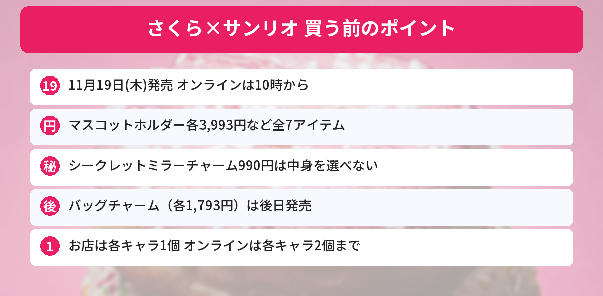

## この記事で分かること

さくらちゃんとサンリオのコラボがサンリオショップで出るって！懐かしくてテンション上がる…！


11月19日（木）発売だよ。さくらちゃんとサンリオキャラがペアのマスコットホルダーなど全7アイテム。お店とオンラインで買える数がちがうから、一緒に見ていこう。


サンリオが、「**カードキャプターさくら×サンリオキャラクターズ**」の新しいグッズを発表しました。さくらちゃんとサンリオキャラクターが**おそろいのコスチューム**を着たデザインです。

この記事では、[サンリオ公式の発表](https://www.sanrio.co.jp/news/goods/mx-ccsakura-202611/)をもとに、値段、売っている場所、個数制限をまとめます（2026年11月11日に確認）。



---
## 発売日と売っている場所

- **発売日**：2026年11月19日（木）
- **売っている場所**：サンリオ直営店・百貨店のサンリオコーナーほか、サンリオオンラインショップ
- **オンライン**：10:00発売（商品ページは9:30以降に見られる）
- **バッグチャーム**：後日発売（日にちは決まり次第、公式ページで発表）
- **Sanrio Hello Stage ルクア サウス店（大阪）**：11月24日（火）のオープン時に販売
- **取り扱いがないお店**：一部店舗（MR. MEN LITTLE MISS MARKET 原宿店など）、アウトレット店舗、サンリオカフェ


---
## 全7アイテムと値段
| | アイテム | 値段（税込） |
|---|---|---|
| 1 | マスコットホルダー（全5種） | 各3,993円 |
| 2 | ミニフラットポーチ（全5種） | 各1,595円 |
| 3 | ケース付きエコバッグ | 2,200円 |
| 4 | ケース＆ステッカーセット | 880円 |
| 5 | シールバインダー | 1,980円 |
| 6 | シークレットミラーチャーム（全8種） | 990円 |
| 7 | バッグチャーム（全5種）※後日発売 | 各1,793円 |

### マスコットホルダー（各3,993円）
さくらちゃんとサンリオキャラクターが**ペアになった**マスコットです。おそろいのコスチュームを着ています。全5種です。

### ミニフラットポーチ（各1,595円）
引き手に**杖の形のマスコット**がついたポーチです。リップなどの小物入れのほか、内側のループで**キーケース**にもなります。チェーンでバッグにもさげられます。

### シークレットミラーチャーム（990円）
作品に出てくる**カードの世界観**をイメージした、ミラー付きのチャームです。透明な窓のふたがついています。**中身は選べません**。全8種を1つずつそろえた**コンプリートセット**でも買えますが、お店や在庫によってはそろわないこともあります。


杖のマスコットつきのポーチ、ほしすぎる…！


ケロちゃんの顔の形のポーチがついたエコバッグもあるよ。シークレットは全8種だから、1個で推しが出る確率は単純に8分の1だね。


### そのほか
- **ケース付きエコバッグ（2,200円）**：**ケロちゃんのフェイス形ポーチ**付き
- **ケース＆ステッカーセット（880円）**：スマホケースに入るカード形ステッカーと小さめのステッカー。金箔加工入り
- **シールバインダー（1,980円）**：リフィル付き。くるくる巻きのリボンと星のチャーム付き
- **バッグチャーム（各1,793円）**：ペアのマスコット付き。**後日発売**

---
## 個数制限（お店とオンラインでちがう）
| | お店 | オンラインショップ |
|---|---|---|
| 期間 | 11月19日（木）〜23日（月・祝） | 11月19日（木）〜25日（水） |
| 各アイテム | **各キャラクター1個まで** | **各キャラクター2個まで** |
| シークレットミラーチャーム | 8個まで | 8個まで |

### お店で買うときの注意点
- 発売初日は、混雑をさけるため**カウンター販売**をするお店があります。手に取って選ぶことはできません
- 制限の期間中は、お店でも電話でも**取り置きはできません**
- 何人分かをまとめて払う、並び直す、といった買い方はえんりょするよう案内されています

---
## サンリオのほかの新商品もチェック
11月12日発売の[クリスマスデザインシリーズの記事](/posts/sanrio-christmas-design-series-2026/)や、11月24日オープンの[Sanrio Hello Stage ルクア サウス店の記事](/posts/sanrio-hello-stage-lucua-south-2026/)もあわせてどうぞ。発売日は[発売日カレンダー](/calendar/)にまとめています。

---
## よくある質問（FAQ）
### Q: いつ発売ですか？
A: 2026年11月19日（木）です。サンリオオンラインショップは10:00発売です。バッグチャームだけ後日発売です。

### Q: どこで買えますか？
A: サンリオ直営店・百貨店のサンリオコーナーほか、サンリオオンラインショップです。大阪のSanrio Hello Stage ルクア サウス店では11月24日から販売します。

### Q: マスコットホルダーはいくらですか？
A: 1つ3,993円（税込）で、全5種です。

### Q: 何個まで買えますか？
A: お店（11月19日〜23日）は各アイテム各キャラクター1個まで、オンライン（11月19日〜25日）は各キャラクター2個までです。シークレットミラーチャームはどちらも8個までです。

### Q: シークレットミラーチャームは選べますか？
A: 選べません。全8種を1つずつそろえたコンプリートセットでも買えますが、お店や在庫によってはそろわない場合があります。

---

11月19日の10時、忘れないようにしなきゃ！


お店は1個まで、オンラインは2個まで。どこで買うか先に決めておこうね。


## まとめ
- カードキャプターさくら×サンリオキャラクターズのグッズは、2026年11月19日（木）発売
- マスコットホルダー各3,993円、ミニフラットポーチ各1,595円など全7アイテム
- シークレットミラーチャーム（990円）は中身を選べない。コンプリートセットもあり
- バッグチャーム（各1,793円）は後日発売
- 個数制限：お店は各キャラ1個（〜23日）、オンラインは各キャラ2個（〜25日）

---
### あわせて読みたい
- [【サンリオ】クリスマスデザインシリーズ2026は11/12発売！値段・全7アイテム・個数制限まとめ](/posts/sanrio-christmas-design-series-2026/)
- [【サンリオ】Sanrio Hello Stage ルクア サウス店が11/24オープン！大阪・梅田の限定グッズとノベルティまとめ](/posts/sanrio-hello-stage-lucua-south-2026/)
