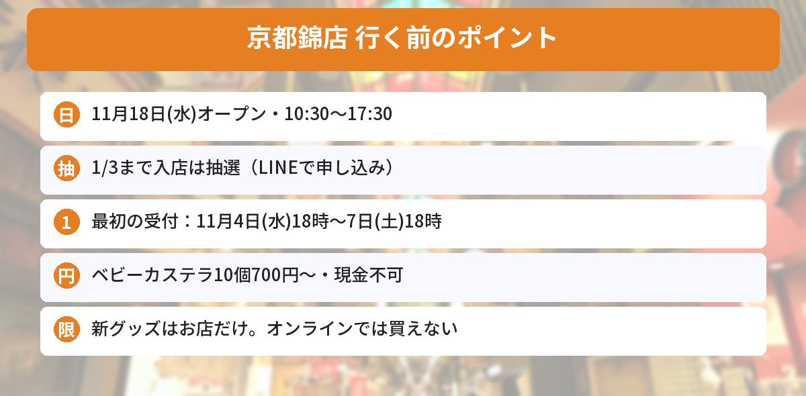

## この記事で分かること

ちいかわのベビーカステラのお店が京都にできるって！小樽まで行けなかったからうれしい…。すぐ行ける？


「ちいかわベビーカステラ 京都錦店」が11月18日（水）に錦市場でオープンするよ。ただ、**2027年1月3日までは入店が抽選の予約制**なんだ。最初の申し込みは**11月4日（水）18時から**だから、それまでにLINEの準備をしておこう。


北海道・小樽の1号店に続く2号店として、京都・錦市場に「ちいかわベビーカステラ」がオープンします。ちいかわインフォの公式Xの告知ポストは、いいね2,200件を超えました（10月28日時点）。

この記事では、運営する寺子屋のプレスリリースと、ちいかわもぐもぐ本舗の公式サイトをもとに、お店の情報、メニュー、新グッズ、抽選の日程をまとめます。



---
## 公式情報

ちいかわインフォの公式Xの告知ポストです。京都錦店のオープン日と、あわせて出る新グッズが紹介されています。

---
## お店の基本情報

- **オープン**：2026年11月18日（水）
- **場所**：京都府京都市中京区鍛冶屋町205番地（錦市場）
- **アクセス**：京都河原町駅から徒歩3分
- **営業時間**：10:30〜17:30 ※季節や状況で変わることがあります
- **定休日**：年中無休
- **入店**：2026年11月18日〜2027年1月3日は事前予約（抽選）・完全入れ替え制
- **支払い**：クレジットカード・電子マネー・QR決済（**現金は使えません**）


店内で焼き上げるベビーカステラや、ベビーカステラつきのソフトクリームが楽しめる**テイクアウトのお店**です。

---
## 入店の抽選（LINEで申し込み）
11月18日（水）〜2027年1月3日（日）は、入店が**事前予約（抽選）**になります。申し込みは「**ちいかわもぐもぐ本舗**」のLINE公式アカウントで受け付けます。

| 入店する日 | 申し込み期間 | 結果発表 |
|---|---|---|
| 11/18（水）〜11/22（日） | **11/4（水）18:00〜11/7（土）18:00** | 11/9（月） |
| 11/23（月）〜11/29（日） | 11/11（水）18:00〜11/14（土）18:00 | 11/16（月） |
| 11/30（月）〜12/6（日） | 11/18（水）18:00〜11/21（土）18:00 | 11/23（月） |
| 12/7（月）〜12/13（日） | 11/25（水）18:00〜11/28（土）18:00 | 11/30（月） |
| 12/14（月）〜12/20（日） | 12/2（水）18:00〜12/5（土）18:00 | 12/7（月） |
| 12/21（月）〜12/27（日） | 12/9（水）18:00〜12/12（土）18:00 | 12/14（月） |
| 12/28（月）〜1/3（日） | 12/16（水）18:00〜12/19（土）18:00 | 12/21（月） |

### 抽選の注意点
- デジタルチケットは**1人1枚**必要です。小学生以下の子どもは一緒に入れますが、お会計は申し込んだ人の1回だけです
- 1つの受付期間の中で**1日1回**応募できますが、当選は**どれか1回**だけです
- 当選したチケットの**キャンセル・ゆずり渡しはできません**
- ご予約の時間帯ごとの**完全入れ替え制**です


受付は毎週水曜18時から土曜18時までなんだね。京都旅行の日程に合わせて申し込もう！


そうそう。小樽店も11月18日〜29日は同じLINEで抽選になるから、まちがえないように気をつけてね。


---
## メニューと値段
メニューは小樽店と同じです。フードには**オリジナルさすまたピック**（全2種）がランダムで1本つきます。

| メニュー | 価格（税込） |
|---|---|
| ベビーカステラ10個入り（クリームつき）いちご／チョコ／プリン | 各800円 |
| ベビーカステラ10個入り | 700円 |
| ベビーカステラつきソフト ミルク／チョコレート／ミックス | 各700円 |
| アイスキャンディ ちいかわ（いちご）／ハチワレ（ソーダ）／うさぎ（パイナップル） | 各650円 |

- ベビーカステラつきソフトは、のせるベビーカステラのキャラを**5種から選べます**
- アイスキャンディは季節限定で、なくなりしだい終了です。持ち帰りはできません

### 注文はスマホで
店内で配られるQRコードから**モバイルオーダー**で注文します。使えない人向けにセルフレジもありますが、**現金は使えません**。

---
## 11月18日発売の新グッズ
京都錦店のオープンにあわせて、小樽店と京都錦店で新しいグッズが発売されます。**お店だけの販売**で、オンラインストアでは買えません。

| グッズ | 価格（税込） |
|---|---|
| カップと繋がるマスコットセット | 5,280円 |
| ぬいぐるみカップホルダー（全3種） | 各2,200円 |

ほかに、フード1点につき1点買えるスーベニアグッズ（リユーザブルカップ 各550円、保冷温ランチバッグ 2,640円）もあります。

### オープン記念のステッカー
京都錦店でフードや商品を買うと、**オリジナルステッカー（非売品）**が1会計につき1枚もらえます。

---
## ちいかわのほかの情報もチェック
11月6日発売のクリスマスグッズは[ツリーなうさぎの記事](/posts/chiikawa-tree-usagi-christmas-2026/)、11月24日からのイベントは[ちいかわのクリスマス2026まとめ](/posts/chiikawa-christmas-2026/)で紹介しています。抽選のしめきりは[発売日カレンダー](/calendar/)にもまとめています。

---
## よくある質問（FAQ）
### Q: ちいかわベビーカステラ京都錦店はいつオープンですか？
A: 2026年11月18日（水）です。営業時間は10時30分〜17時30分で、年中無休です。

### Q: 予約なしで入れますか？
A: 11月18日（水）〜2027年1月3日（日）は、事前予約（抽選）と完全入れ替え制です。ちいかわもぐもぐ本舗のLINE公式アカウントで申し込みます。

### Q: 最初の抽選はいつですか？
A: 11月18日〜22日に入店する分は、11月4日（水）18時〜11月7日（土）18時に申し込み、11月9日（月）に結果が出ます。

### Q: 現金で払えますか？
A: 払えません。モバイルオーダーかセルフレジで、クレジットカード・電子マネー・QR決済を使います。

### Q: 新しいグッズはオンラインでも買えますか？
A: 買えません。カップと繋がるマスコットセットとぬいぐるみカップホルダーは、ちいかわベビーカステラのお店だけで販売されます。

---

11月18日オープン、最初の抽選は11月4日の18時から。支払いはキャッシュレスだけ！


うん。LINEの友だち追加だけ先にしておくと、当日あわてずにすむよ。


## まとめ
- 「ちいかわベビーカステラ 京都錦店」は2026年11月18日（水）に京都・錦市場でオープン
- 11月18日〜2027年1月3日は事前予約（抽選）・完全入れ替え制。申し込みはちいかわもぐもぐ本舗のLINE公式アカウント
- 最初の抽選は11月4日（水）18時〜11月7日（土）18時（11/18〜22入店分）
- ベビーカステラ10個入り700円〜。支払いはキャッシュレスのみ
- 新グッズ「カップと繋がるマスコットセット」「ぬいぐるみカップホルダー」はお店だけで販売

---
### あわせて読みたい
- [【ちいかわ】動く！？ツリーなうさぎは抽選販売！11/2正午まで・11/6発売のクリスマス新商品まとめ](/posts/chiikawa-tree-usagi-christmas-2026/)
- [【ちいかわ】クリスマス2026まとめ！パークとクリスマスマーケット、抽選は10/25まで](/posts/chiikawa-christmas-2026/)
