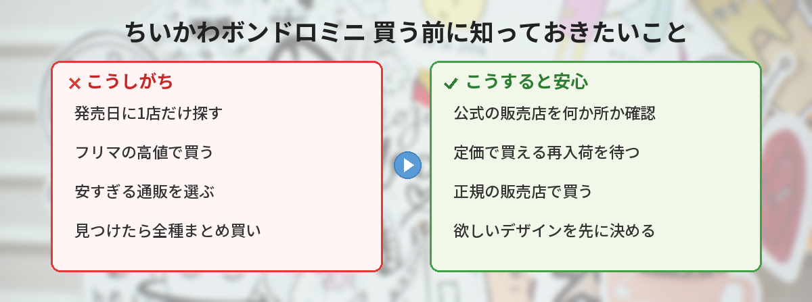

## この記事で分かること


ちいかわの「ボンドロ」に、ミニが出るって本当？ボンドロっていつも売り切れてるイメージなんだけど…



本当だよ！ちいかわ公式が今日（10/16）発表したばかりなの。全8種で、10月下旬から順次発売。どこで買えるか、買い逃さないコツをまとめるね。


10月16日、ちいかわの広報アカウントが、サンスター文具の「ボンボンドロップシールミニ」にちいかわデザインが登場すると発表しました。全8種で、10月下旬から順次、ちいかわらんど・ちいかわマーケットのほか、全国の量販店・書店・文具店などで発売される予定です。

ボンボンドロップシール（通称「ボンドロ」）は、飴玉のようにぷっくり、つやつやした立体シールです。「シール交換ブーム」の中心にある人気シリーズで、新作が出るたびに品薄になってきました。この記事では、公式発表で分かっていることと、買うときに気をつけたいポイントを整理します。



---

## 公式情報



発表のポストは、公開から数時間で800件を超えるいいねが集まりました（10月16日時点）。

---

## 基本情報


- **商品名**：ボンボンドロップシールミニ ちいかわ（全8種）
- **発売元**：サンスター文具
- **発売時期**：2026年10月下旬から順次
- **販売場所**：ちいかわらんど、ちいかわマーケット、全国の量販店・書店・文具店など（一部取り扱いのない店舗あり）
- **価格**：この記事を書いた10月16日時点では、公式の発表で確認できていません



発売日はまだ「10月下旬」なんだね。値段も決まってないの？



発表されたのは「10月下旬から順次」までなんだ。お店ごとに並ぶ日がちがうこともあるよ。値段は、ちいかわマーケットの商品ページが出たら確かめよう。


---

## そもそも「ボンボンドロップシール」って？

### ぷっくり立体のシール

ボンボンドロップシールは、表面がぷっくりとふくらんだ、キャンディのようなシールです。透明感とつやがあって、光に当てるときらきらします。手帳やスマホケースに貼ったり、友だちとシール交換をしたりして楽しまれています。

サンスター文具の案内によると、企画は株式会社クーリアとサンスター文具、製造は株式会社クーリア、発売はサンスター文具です。「ボンボンドロップ」はクーリアの登録商標です。

### 「ミニ」は小さめサイズのシリーズ

「ボンボンドロップシールミニ」は、通常のボンボンドロップシールより小ぶりなシートのシリーズです。これまでにサンリオキャラクターズ、ディズニー、スヌーピーなどのミニが出ていて、今回そこにちいかわが加わります。

ちいかわのボンボンドロップシールは、通常サイズでは以前から発売されていて、ちいかわマーケットでも取り扱いがあります。ミニは今回が新登場です。


ミニだと、手帳とかスマホにも貼りやすそう！



そうそう。小さいシートなら、交換用にいくつか持ち歩くのにもちょうどいいよね。


---

## どこで買える？

公式発表で案内されている販売場所は、次のとおりです。

| 種類 | 販売場所 |
|------|------|
| ちいかわ公式 | ちいかわらんど（各店舗）、ちいかわマーケット（オンライン） |
| そのほかのお店 | 全国の量販店・書店・文具店など |

「※一部お取り扱いのない場合あり」と書かれているので、近くのお店に必ずあるとは限りません。

---

## 独自の視点・買い逃さないためのコツ

### 1. 1か所にしぼらず、販売店を何か所か見ておく

今回は、ちいかわらんどやちいかわマーケットだけでなく、書店や文具店でも売られる予定です。ボンボンドロップシールは、これまでも入荷してすぐ売り切れることが多いシリーズでした。

「ちいかわらんどで買えなかったら終わり」ではなく、近くの書店・文具店・量販店もチェックしておくと、出会える可能性が上がります。

### 2. 高値の転売品は待つのがおすすめ

人気のボンボンドロップシールは、売り切れると通販サイトで定価より高い値段で出品されることがあります。たとえばサンリオのミニでは、Amazonで2,000円前後の出品も見られました（10月16日時点）。

「順次発売」なので、最初に見つからなくても、あとから入荷するお店はあるはずです。あせって高値で買う前に、公式の販売店の再入荷を待つのが安心です。

### 3. 偽物（模倣品）に気をつける


偽物もあるの？シールなのに？



あるんだよ…。サンスター文具が、公式サイトで注意を呼びかけてるの。


サンスター文具は2025年12月、ネット通販サイトやフリマサイト、一部の実店舗で、ボンボンドロップシールの模倣品が多く出回っていると発表しました。正規品と模倣品を比べた画像も公開していて、見た目だけでは区別が難しいものもあると注意しています。

偽物を避けるには、次の点を意識しましょう。

- ちいかわらんど、ちいかわマーケット、信頼できるお店で買う
- 相場よりとても安い出品は避ける
- パッケージで発売元（サンスター文具）を確認する

### 4. 欲しいデザインを先に決めておく

全8種あるので、見つけたときに迷っている間に売り切れることもあります。公式の画像を見て、「これだけは欲しい」というデザインを先に決めておくと、お店ですぐ手に取れます。

### 5. 10月下旬はちいかわの発売がほかにもたくさん

10月下旬は、ちいかわの新作が続きます。[ちいかわ×ANAのコラボグッズ](/posts/chiikawa-jet-ana-2026/)は10月23日、[ちいぽけ公式グッズ第4弾](/posts/chiikawa-pocket-goods-vol4-2026/)は10月24日発売です。予算を決めて、優先順位をつけておくと慌てずに済みます。

---

## SNSでの反応

発表のポストには、短い時間でたくさんの反応が集まりました。Xでは、こんな声が見られました。

- ちいかわのボンドロミニ、絶対ほしい
- 小さいサイズは貼りやすそう
- また争奪戦になりそうでドキドキする
- 書店や文具店でも売るなら、探しやすくてうれしい

「欲しい」という声と同じくらい、「買えるかな」という心配の声も目立ちました。ボンボンドロップシールの人気の高さが伝わってきます。

---

## よくある質問（FAQ）

### Q: ちいかわのボンボンドロップシールミニはいつ発売ですか？
A: 2026年10月下旬から順次発売の予定です。お店によって並ぶ日が異なる場合があります。

### Q: どこで買えますか？
A: ちいかわらんど、ちいかわマーケット、全国の量販店・書店・文具店などで発売予定です。一部取り扱いのない店舗もあります。

### Q: 何種類ありますか？
A: 全8種です。

### Q: 値段はいくらですか？
A: 10月16日時点では、公式の発表で価格を確認できていません。ちいかわマーケットの商品ページなどで確認してください。

### Q: 偽物を買わないためにはどうすればいいですか？
A: ちいかわらんどやちいかわマーケットなど、信頼できるお店で買うのが確実です。サンスター文具も、模倣品への注意を公式サイトで呼びかけています。

---


10月下旬から順次発売、全8種なんだね！ちいかわらんどだけじゃなくて、書店や文具店も見てみるよ。



その意気！高い転売品やあやしい出品には手を出さず、正規のお店で買おうね。価格が分かったら、公式の情報をチェックしてみて。


## まとめ

- ちいかわデザインの「ボンボンドロップシールミニ」（全8種）が、サンスター文具から登場
- 2026年10月下旬から順次、ちいかわらんど・ちいかわマーケット・全国の量販店・書店・文具店などで発売予定
- 価格は10月16日時点では未確認。公式の商品ページで確認を
- 品薄になりやすいので、販売店を何か所か見ておくのがおすすめ
- 偽物（模倣品）が出回っているので、正規のお店で買う

---
### あわせて読みたい
- [【ちいかわジェット】10/19就航！ANAコラボグッズは10/23発売](/posts/chiikawa-jet-ana-2026/)
- [【ちいぽけ】グッズ第4弾10/24発売！お弁当・お店屋さんとポップアップ情報](/posts/chiikawa-pocket-goods-vol4-2026/)
