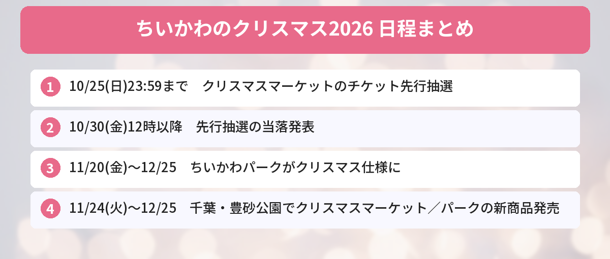

## この記事で分かること


ちいかわのクリスマスイベントがいくつかあるって聞いたけど、パークとマーケットって何がちがうの？どっちも行きたい！



池袋の「ちいかわパーク」がクリスマス仕様になるのと、千葉で「ちいかわクリスマスマーケット」が開かれるの。マーケットはチケットの先行抽選が10月25日までだから、急いだほうがいいよ！


2026年のクリスマスシーズン、ちいかわのイベントが2つ予定されています。ひとつは、池袋のサンシャインシティにある体験型施設「ちいかわパーク」の期間限定クリスマス企画。もうひとつは、ABEMAが主催する体験型イベント「ちいかわクリスマスマーケット」です。

マーケットは日時指定のチケット制で、**先行抽選の受付は10月25日（日）23時59分まで**。この記事では、2つのイベントの日程・料金・ちがいと、行く前に知っておきたいことを、公式発表をもとにまとめます。



---

## 公式情報



ちいかわクリスマスマーケットの公式Xは、フードやグッズなどの新情報を毎日発信しています。10月17日に公開された「マシュマロスモア」の紹介ポストには、900件を超えるいいねが集まりました（10月17日時点）。

---

## 基本情報


- **期間**：2026年11月24日（火）〜12月25日（金）
- **場所**：豊砂公園（千葉県千葉市）
- **主催**：ABEMA
- **チケット**：日時指定制
- **料金（税込）**：平日 大人（12歳以上）2,500円・子ども（4〜11歳）1,200円／土日祝 大人2,800円・子ども1,400円
- **特典**：「飛び出す！クリスマスカード」、会場の巨大ガチャガチャ1回無料（全16種のオーナメントからランダムで1点）
- **先行抽選**：10月15日（木）12時〜10月25日（日）23時59分。当落発表は10月30日（金）12時以降



- **期間**：2026年11月20日（金）〜12月25日（金）
- **場所**：サンシャインシティ アネックス B1F・1F（東京都豊島区東池袋）
- **営業時間**：10:00〜19:00（12月1日〜30日は10:00〜20:00、12月31日は10:00〜18:00）
- **入場料**：大人（12歳以上）3,500円、子ども（4〜11歳）1,800円、中学生・高校生・大学生・専門学校生2,800円 ほか
- **内容**：クリスマスの装飾、限定衣装のグリーティング、11月24日（火）に新商品、SNSハッシュタグキャンペーン


---

## ちいかわクリスマスマーケットの中身

### 高さ約6mのシンボルツリー

会場は約6,000㎡の広さです。中心には高さ約6mのシンボルツリーが立ち、ちいかわたちがクリスマスの準備を進めるオリジナルストーリーを、光・映像・音で演出します。

### フォトスポットがたくさん

入口では、巨大なポップアップ風のクリスマスカードや、リースのようなウェルカムゲートがお出迎え。会場には、全高約3mのちいかわ・ハチワレ・うさぎの巨大バルーン、スノードーム、動くメリーゴーランド（観賞・撮影用）などのフォトスポットが登場します。

### 限定フード全35種とグッズ

限定のオリジナルフードは全35種。公式Xでは、ちいかわたちのクッキーでマシュマロとチョコをはさんだ「マシュマロスモア」などが紹介されています。オリジナルグッズの販売もあります。

### 参加型のお楽しみ

- **鎧さんマーケット**：好きなパーツを組み合わせて、オリジナルのキーチャームを作れる
- **キャンディわなげ**
- **クッキー量りチャレンジ**


キーチャームを自分で作れるの、楽しそう！鎧さんのお店っていうのも、ちいかわらしいね。



原作で鎧さんが作ってるハンドメイドグッズが元ネタだね。フードやグッズの買い方は、公式Xのリンク先で案内されてるから、行く前にチェックしておこう。


---

## ちいかわパークのクリスマス



ちいかわパークは、ちいかわの世界に入り込める体験型施設です。地下1階に体験展示エリア、1階にゲームコーナーや限定グッズのショップがあります。

11月20日（金）から12月25日（金）までは、パークの中がクリスマスの装飾に変わります。期間中の主な企画は次のとおりです。

- **限定衣装のグリーティング**：ちいかわたちがクリスマスの衣装で登場（日時・登場キャラクターは変更や中止の場合あり）
- **新商品**：11月24日（火）に発売予定
- **SNSハッシュタグキャンペーン**：パークで撮った写真などを指定のハッシュタグを付けて投稿し、画面をキャストに見せると、オリジナルステッカー（全3種）をランダムで1枚もらえる（なくなり次第終了。詳細は後日発表）

### 今のパークでは10/16から新グッズ

クリスマスの前に、10月16日（金）からはパーク限定の新グッズが販売されています。SNSでは、「ちいかわの家」や「ゴブリンたちの牢屋」などのデザインのおでかけポーチ（各3,300円）や、鎧さんのZIPパーカー（7,920円）が紹介されています。公式によると、新商品は**購入点数に制限**があります。

---

## 独自の視点・行く前に知っておきたいこと

### 1. マーケットは「まず先行抽選に応募」

マーケットのチケットは日時指定制です。先行抽選は10月25日（日）23時59分まで。当落発表は10月30日（金）12時以降です。行けそうな日が決まっていなくても、候補の日を考えて早めに応募しておきましょう。応募方法は、特設サイトで確認してください。

### 2. 料金は平日のほうが安い

マーケットは、大人で平日2,500円、土日祝2,800円です。クリスマス直前の土日は混みやすいので、平日に行ける人は平日がねらい目です。

### 3. パークは「当日入場できない場合あり」

ちいかわパークは、当日入場できないことがあると案内されています。クリスマス期間は特に混むと考えて、行く前に公式サイトのチケット情報を確認しておきましょう。

### 4. 1日で両方は回れる？

パークは池袋、マーケットは千葉市の豊砂公園と、場所が離れています。電車でも移動に時間がかかるので、**別の日に分けるほうが落ち着いて楽しめます**。池袋では、パークのほかにちいかわらんどにも寄れます。

### 5. 冬の屋外イベントの準備を

マーケットの会場は公園です。12月の夜は冷えるので、あたたかい服装で出かけましょう。フードを買う予定なら、支払い方法も事前に確認しておくと安心です。

### 6. 秋〜冬のちいかわ新作もチェック

10月下旬は、[ちいかわ×ANAのコラボグッズ](/posts/chiikawa-jet-ana-2026/)（10/23発売）や、[ボンボンドロップシールミニ](/posts/chiikawa-bonbondrop-seal-mini-2026/)（10月下旬から順次）など、新作の発売が続きます。クリスマスに向けて、予算の配分を考えておくと安心です。

---

## SNSでの反応

マーケットの開催が発表されてから、Xではこんな声が見られました。

- 抽選に応募した、当たりますように
- スノードームやアクスタのグッズが全部ほしい
- パーク、マーケット、ほかのテーマパークと、12月の予定がちいかわでいっぱい
- 地方から行くので、ほかにどこでちい活するか考え中

「当たるかな」という期待と、「フードやグッズにいくら使うことになるか」を気にする声の両方が見られました。

---

## よくある質問（FAQ）

### Q: ちいかわクリスマスマーケットのチケットはいつまでに申し込めばいいですか？
A: 先行抽選は2026年10月15日（木）12時から10月25日（日）23時59分までです。当落発表は10月30日（金）12時以降です。

### Q: クリスマスマーケットの入場料はいくらですか？
A: 平日は大人2,500円・子ども1,200円、土日祝は大人2,800円・子ども1,400円です（税込）。クリスマスカードと巨大ガチャガチャ1回の特典つきです。

### Q: ちいかわパークのクリスマスはいつからですか？
A: 2026年11月20日（金）から12月25日（金）までです。11月24日（火）にはクリスマスの新商品も発売予定です。

### Q: ちいかわパークは予約なしで入れますか？
A: 当日入場できない場合があると案内されています。行く前に公式サイトのチケット情報を確認してください。

### Q: パークとマーケットを同じ日に回れますか？
A: 池袋と千葉市で場所が離れているため、別の日に分けるのがおすすめです。

---


マーケットは10月25日までに抽選に応募、パークは11月20日からクリスマス仕様なんだね！今日のうちに応募しておく！



いいね！当落は10月30日のお昼以降だよ。パークもマーケットも、細かい内容はこれから発表されるから、公式Xをフォローしておくと見逃さないよ。


## まとめ

- ちいかわクリスマスマーケットは、2026年11月24日〜12月25日に千葉市の豊砂公園で開催
- マーケットのチケットは日時指定制。先行抽選は10月25日（日）23時59分まで、当落は10月30日（金）12時以降
- ちいかわパーク（池袋）は11月20日〜12月25日にクリスマス仕様。限定衣装のグリーティングや11月24日の新商品あり
- パークは当日入場できない場合があるので、チケット情報を事前に確認
- 2つの会場は離れているので、別の日に分けて楽しむのがおすすめ

---
### あわせて読みたい
- [【ちいかわジェット】10/19就航！ANAコラボグッズは10/23発売](/posts/chiikawa-jet-ana-2026/)
- [【ちいかわ】ボンボンドロップシールミニ全8種が10月下旬発売！買える場所と注意点](/posts/chiikawa-bonbondrop-seal-mini-2026/)

<!-- affiliate -->
## 関連リソース

クリスマスイベントの前に、ちいかわたちの物語をおさらいできる1冊を選びました。

**ちいかわ なんか小さくてかわいいやつ（1）**（ナガノ／講談社） 
ちいかわたちの「楽しくて、切なくて、ちょっとハードな日々」が始まる、原作コミックスの第1巻です。

- <a href="https://af.moshimo.com/af/c/click?a_id=5490814&amp;p_id=54&amp;pc_id=54&amp;pl_id=27059&amp;url=https%3A%2F%2Fitem.rakuten.co.jp%2Fbook%2F16589257%2F" rel="nofollow sponsored noopener" referrerpolicy="no-referrer-when-downgrade" target="_blank">ちいかわ なんか小さくてかわいいやつ（1）（楽天市場）</a>
- <a href="https://af.moshimo.com/af/c/click?a_id=5490817&amp;p_id=170&amp;pc_id=185&amp;pl_id=27060&amp;url=https%3A%2F%2Fwww.amazon.co.jp%2Fdp%2F4065223962" rel="nofollow sponsored noopener" referrerpolicy="no-referrer-when-downgrade" target="_blank">ちいかわ なんか小さくてかわいいやつ（1）（Amazon）</a>
<!-- /affiliate -->
