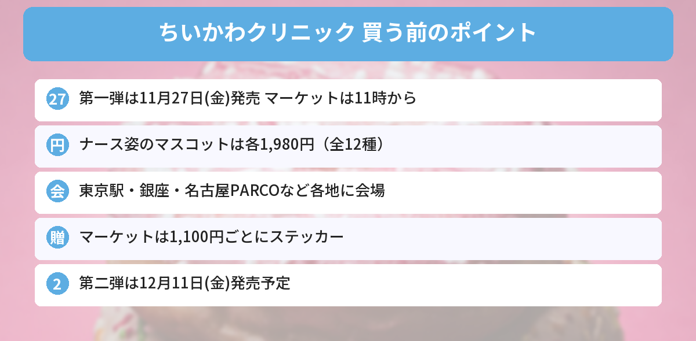

## この記事で分かること

ちいかわがナースになってる！「ちいかわクリニック」って何？いつ買えるの？


ちいかわ寿司、ちいかわベビーに続く、今年のテーマだよ。第一弾は11月27日（金）発売。ナース服のマスコットは1個1,980円なんだ。会場がたくさんあるから、一緒に見ていこう。


ちいかわの2026年のテーマは「**ちいかわクリニック**」です。一昨年の「ちいかわ寿司」、昨年の「Chiikawa Baby（ちいかわベビー）」に続くシリーズで、**ナース服や白衣**を着たちいかわたちのグッズが並びます。

この記事では、ちいかわ公式Xの発表と、[ディズニー＆エンタメ情報サイトDtimesの記事](https://dtimes.jp/post-1466058/)をもとにまとめます（2026年11月12日に確認）。



---
## 公式情報

ちいかわ公式Xの、ちいかわクリニック開催のお知らせです。

---
## 発売日と売っている場所

- **発売日**：2026年11月27日（金）
- **第二弾**：12月11日（金）発売予定（くわしくは順次発表）
- **オンライン**：ちいかわマーケット（11時〜）
- **お店**：ちいかわらんど（原宿・新宿・池袋パルコ・ソラマチ・横浜・越谷レイクタウン・金沢フォーラス・京都四条河原町・心斎橋パルコ・福岡パルコ・札幌パルコ）ほか
- **オンラインくじ**：カプセルトイ2種と「ないぞういろいろマスコット」は「ちいかわくじ」で販売


### 催事の会場と期間
| 会場 | 期間 |
|---|---|
| 東京駅一番街 東京キャラクターストリート いちばんプラザ | 11月27日〜12月24日 |
| ギンザミライミュージアム | 11月27日〜12月27日 |
| 名古屋PARCO 東館 | 11月27日〜12月20日 |
| キデイランド大阪梅田店 POP UP 1 | 〜12月9日 |
| キデイランド広島パルコ店 POP UP | 〜2027年1月6日 |
| 札幌アピア | 〜2027年1月5日 |
| 仙台PARCO1 | 〜12月20日 |
| アミュプラザくまもと 2階 特設会場 | 〜2027年1月11日 |

これまでのちいかわの催事では、入店に**事前予約や抽選**が必要になることが多くありました。入り方は会場ごとに、公式サイトや会場の案内で確かめてください。

---
## 主なグッズと値段（第一弾）
### おだいじにね。マスコット（ナース姿・全12種）
| キャラクター | 値段（税込） |
|---|---|
| ちいかわ、ハチワレ、うさぎ、モモンガ、くりまんじゅう、ラッコ、シーサー、古本屋、あのこ | 各1,980円 |
| ナースなオデ、ナースなポシェットの鎧さん | 各1,870円 |
| ナースなカブトムシ | 1,650円 |

ちいかわたちは、**ふわふわのハート**を持っています。シーサー、くりまんじゅう、ラッコは**ピンクのカーディガン**姿です。

### われわれにおまかせください。マスコット（ドクター姿・2種）
**うさぎ**と**ラッコ**が、白衣と聴診器のドクター姿になったマスコットです。各1,980円です。


うさぎがドクターなの、ちょっと心配だけどかわいい…！


ラッコは丸い眼鏡と、おでこのキズまで刺繍で作ってあるんだって。ナース12種＋ドクター2種で、全部そろえると14体だね。


### そのほかのグッズ
| アイテム | 値段（税込） |
|---|---|
| 視力検査なデイリーユーストート | 3,850円 |
| マルチケース | 3,300円 |
| ナースなみんなのショルダーポケットポーチ | 2,970円 |
| 手を洗おう！バイキンなゴブリンのミニマスコット2個セット | 2,420円 |
| 臓器磁器（3種） | 各2,200円 |
| うがいしよう！ウイルスなオデのミニミニマスコット3個セット | 1,980円 |
| ぬいぐるみも入る！おくすり袋風なポーチ | 1,980円 |
| おくすりになっちゃったポーチ（3種） | 各1,650円 |
| ぬいぐるみも入る！レントゲンなクリアポーチ | 1,430円 |
| レントゲンなみんなの蓄光ステッカーセット | 660円 |
| 近況報告マグネット（5種） | 各550円 |
| 絆創膏風フレークシール（24枚入り） | 550円 |
| トレーディングつながる！ミニケース（全8種） | 単品330円／BOX2,640円 |
| トレーディングポスター風きらきらカード（全10種） | 単品330円／BOX3,300円 |

このほかにも、たくさんの商品があります。

### オンラインくじ「ないぞういろいろマスコット」
心臓・胃・肺などが**ちいかわ風の顔つき**になったマスコット（全9種）です。

- **ちいかわくじ**で、11月27日（金）11:00発売
- 1回990円（税込）、**1日5回まで**

---
## ちいかわマーケットのノベルティ
| 条件（税込） | もらえるもの | 対象 |
|---|---|---|
| 1,100円ごと | ないぞういろいろホログラムステッカー（全9種・ランダム）1枚 | ちいかわマーケット（11月27日11時〜） |
| 8,800円以上 | ぬいぐるみおかおバッジ（全8種・ランダム）1個 | ちいかわマーケット、ちいかわらんど、各催事会場 |
| 3,300円以上 | ちいかわクリニックデザインのオリジナルBOXで届く | ちいかわマーケット（11月27日11時〜） |

- どれも**なくなり次第終了**です
- 合計金額に送料はふくまれません。eギフトや一部の商品は対象外です

---
## ちいかわのほかの新商品もチェック
新入学グッズは[ちいかわ2027年新入学グッズの記事](/posts/chiikawa-school-goods-2027/)、クリスマスは[ツリーなうさぎの記事](/posts/chiikawa-tree-usagi-christmas-2026/)にまとめています。発売日は[発売日カレンダー](/calendar/)でも見られます。

---
## よくある質問（FAQ）
### Q: いつ発売ですか？
A: 第一弾は2026年11月27日（金）です。ちいかわマーケットは11時から。第二弾は12月11日（金）発売予定です。

### Q: どこで買えますか？
A: ちいかわマーケット、ちいかわらんど各店、東京駅一番街・ギンザミライミュージアム・名古屋PARCOなどの催事会場です。

### Q: ナース姿のマスコットはいくらですか？
A: ちいかわ・ハチワレ・うさぎなど9種は各1,980円、オデと鎧さんは各1,870円、カブトムシは1,650円です。

### Q: 「ないぞういろいろマスコット」はどこで買えますか？
A: オンラインくじの「ちいかわくじ」限定です。11月27日11時から、1回990円・1日5回までです。

### Q: 会場には予約なしで入れますか？
A: 会場ごとに入り方がちがう可能性があります。行く前に、公式サイトや会場の案内を確かめてください。

---

ナースなハチワレ、絶対ほしい！11月27日の11時、カレンダーに入れとく。


12月11日には第二弾も出るから、予算を少し残しておくといいかもね。


## まとめ
- ちいかわの2026年のテーマは「ちいかわクリニック」。ナース服や白衣のちいかわたちのグッズ
- 第一弾は2026年11月27日（金）発売、第二弾は12月11日（金）予定
- ナース姿のマスコットは各1,980円（オデ・鎧さん1,870円、カブトムシ1,650円）
- 東京駅一番街、ギンザミライミュージアム、名古屋PARCOなど各地に会場
- ちいかわマーケットは1,100円ごとにステッカー、8,800円以上でバッジ、3,300円以上でオリジナルBOX

---
### あわせて読みたい
- [【ちいかわ】2027年の新入学グッズが登場！文具の値段と、11月下旬発売のトート・ナップサックまとめ](/posts/chiikawa-school-goods-2027/)
- [【ちいかわもぐもぐ本舗】3周年の新商品は11/13発売！舞妓さんなみんな・和装マスコットの値段とノベルティ](/posts/chiikawa-mogumogu-3rd-new-items-2026/)
