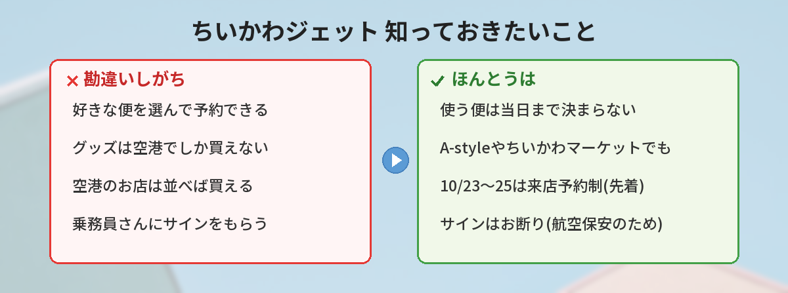

## この記事で分かること


ちいかわの飛行機が飛ぶって本当？乗れるの？グッズも出るって聞いたよ！



本当だよ！ANAの特別機「ちいかわジェット」が10月19日から飛び始めるの。グッズは10月23日発売で、今日（10/15）情報が解禁されたばかり。乗り方や買い方をまとめるね。


10月15日の午前、ANAグループの公式Xが「ちいかわ×ANA」のコラボグッズ情報を解禁しました。ちいかわ公式の情報アカウントも続けて告知し、タイムラインは一気にちいかわジェットの話題でいっぱいになっています。

この記事では、特別機「ちいかわジェット」の初便と飛ぶ路線、機内の限定デザイン、そして10月23日に発売されるコラボグッズの買える場所と注意点を、ANA公式の発表をもとにまとめます。「どの便に乗れば会える？」「グッズはどこで買える？」という疑問に答えていきます。



---

## 公式情報



ANA公式の特設ページ「ちいかわ × ANA」では、コラボに込めた想いとして、個性豊かな仲間と困難を乗り越えていくちいかわたちと、たくさんの仲間が力を合わせて空を飛び続けるANAの姿を重ねています。

---

## 基本情報


- **就航開始**：2026年10月19日（月）から国内線の定期便に就航
- **機材**：ボーイング767-300型機（機番：JA609A）
- **初便（行き）**：羽田→長崎 ANA661便 8:15発（予定）
- **初便（帰り）**：長崎→羽田 ANA664便 11:00発（予定）
- **デザイン**：ちいかわたちのまわりに、四季を通じて日本各地で見られるモチーフ
- **機内**：ヘッドレストカバーと紙コップが限定デザイン



- **発売日**：2026年10月23日（金）から
- **デザイン**：ANAの制服を着たちいかわたち
- **販売場所**：ANA公式EC「A-style」「A-style ANA Mall 店」、空港内ギフトショップ「ANA FESTA」（一部店舗）、ちいかわマーケット、ちいかわらんど など
- **羽田空港**：「ちいかわ×ANA」仕様のお店が登場
- **注意**：ANA FESTAの一部店舗は、10月23日〜25日に来店予約制（先着）


---

## ちいかわジェットはどこを飛ぶ？

初便は、10月19日（月）の羽田→長崎線です。そのあとは路線を固定せず、ANA国内線のさまざまな路線を飛び回る予定と案内されています。

ANA公式の特設ページでは、投入される可能性がある路線が、時期ごとに公開されています。

| 期間 | 投入の可能性がある路線 |
|------|------|
| 10月24日まで | 羽田発着：新千歳・伊丹・松山・広島・福岡・長崎・那覇／伊丹発着：新千歳／名古屋発着：新千歳・那覇 |
| 10月25日以降 | 羽田発着：新千歳・伊丹・福岡・那覇・松山・長崎・函館・米子・熊本・宮崎・広島・宇部・高知・鹿児島・石垣／伊丹発着：新千歳・那覇／名古屋発着：新千歳・那覇／福岡発着：新千歳 |

ただし、**どの便にちいかわジェットが使われるかは、運航状況によって当日まで決まりません**。運航のトラブルがあったときは、上の表以外の路線を飛ぶこともあります。


じゃあ、「この便に乗れば絶対ちいかわジェット！」って予約はできないの？



そうなの、当日まで決まらないんだって。だから「乗れたらラッキー」くらいの気持ちがいいよ。確実なのは初便の羽田→長崎ANA661便だけど、それも予定だから変わることはあるよ。


---

## 機体と機内の見どころ

### 機体のデザイン

機体には、ちいかわ・ハチワレ・うさぎなど8キャラクターが描かれています。キャラクターのまわりには、紅葉や雪の結晶など、四季を通じて日本各地で見られるモチーフがちりばめられています。ANA公式は「空港で見かけたら、ぜひ探してみてくださいね」と呼びかけています。

### 機内の限定デザイン

ちいかわジェットの機内では、次の2つが限定デザインになります。

- **ヘッドレストカバー**：座席の頭の部分にかかるカバー
- **紙コップ**：飲み物のサービスで使われるコップ

乗れたときだけ見られる、特別なデザインです。

### 乗務員へのサインはお断り

ANA公式によると、航空保安上の理由から、乗務員によるサインや、ログ帳（記録用の帳面）へのメッセージ記入はお断りとのことです。マナーを守って楽しみましょう。

---

## 10月23日発売のコラボグッズ



コラボグッズは、ちいかわたちがANAの制服を着た特別デザインです。10月23日（金）から、次の場所で順次販売されます。

| 種類 | 販売場所 |
|------|------|
| オンライン | ANA公式EC「A-style」、「A-style ANA Mall 店」、ちいかわマーケット |
| 空港 | 空港内ギフトショップ「ANA FESTA」（一部店舗）、羽田空港の「ちいかわ×ANA」仕様のお店 |
| 店舗 | ちいかわらんど など |

アイテムの種類や価格の一覧は、ANA公式の特設ページで案内されています。この記事を書いた10月15日時点では、まだ情報が出そろっていないものもあるため、購入前に公式ページで最新情報を確認してください。

---

## 独自の視点・買い逃さないためのコツ

### 1. ANA FESTAは10/23〜25に来店予約制（先着）



空港内のANA FESTAでは、10月23日（金）〜25日（日）の3日間、混雑緩和と安全確保のため、コラボグッズの購入に**来店予約制（先着）**を一部店舗で導入します。空港で買いたい人は、予約の方法と対象店舗を、ANAの案内で事前に確認しておきましょう。

### 2. 空港に行けない人はオンラインで

A-styleやちいかわマーケットなら、空港に行かなくても購入できます。最近のちいかわグッズは、発売直後に売り切れることが多く、10月13日には「売り切れ続出」とニュースにもなりました。欲しいアイテムを先に決めて、発売時間に合わせて開いておくと安心です。

### 3. ちいかわジェットは「会えたらラッキー」

使われる便は当日まで決まりません。飛行機に乗る予定がある人は、当日の空港で探してみるくらいの気持ちで楽しむのがおすすめです。空港の展望デッキで、離着陸を見守るのも楽しみ方のひとつです。

### 4. 10月はちいかわの新作がいっぱい

10月は、ちいかわのコラボや新商品が続いています。[ちいぽけ公式グッズ第4弾](/posts/chiikawa-pocket-goods-vol4-2026/)は10月24日発売、[まじかるちいかわの巨大ぬいぐるみ](/posts/magical-chiikawa-gororin-nuigurumi-2026/)は10月20日正午まで受注予約中です。発売日が重なるので、お財布と相談しながら優先順位を決めておくと慌てずに済みます。

---

## SNSでの反応

ANAグループのグッズ解禁ポストは、公開から30分ほどで500件を超えるいいねが集まりました（10月15日時点）。ちいかわジェットが8月に発表されたときから話題になっていて、今回のグッズ解禁で一気に盛り上がっています。

Xでは、こんな声が見られました。

- 制服姿のちいかわたちがかわいすぎる
- ちいかわジェットに乗りたい、どの便か当日まで分からないのはドキドキ
- 羽田空港のちいかわ仕様のお店に行ってみたい
- ANA FESTAが来店予約制になるくらい人気になりそう
- 陸・海・空、ちいかわはどこにでもいる

「乗れるかどうか分からないワクワク」と「グッズ争奪戦への心配」が、同じくらい語られていました。

---

## よくある質問（FAQ）

### Q: ちいかわジェットはいつから飛びますか？
A: 2026年10月19日（月）から、国内線の定期便に就航します。初便は羽田→長崎のANA661便（8:15発予定）です。

### Q: ちいかわジェットに乗れる便を予約できますか？
A: どの便に使われるかは運航状況によって当日まで決まらないため、指定して予約することはできません。初便も予定のため、変更になる場合があります。

### Q: コラボグッズはいつ、どこで買えますか？
A: 10月23日（金）から、ANA公式EC「A-style」「A-style ANA Mall 店」、空港内の「ANA FESTA」（一部店舗）、ちいかわマーケット、ちいかわらんどなどで販売されます。

### Q: 空港のお店では並ばずに買えますか？
A: ANA FESTAの一部店舗では、10月23日〜25日に来店予約制（先着）が導入されます。予約方法と対象店舗は、ANAの案内を確認してください。

### Q: 乗務員さんにサインをもらえますか？
A: 航空保安上の理由から、乗務員によるサインやログ帳へのメッセージ記入はお断りと案内されています。

---


ちいかわジェットは10月19日から、グッズは10月23日からなんだね！乗れたらラッキー、グッズはオンラインでも買えるのが安心だな。



その通り！空港のANA FESTAで買いたいなら、最初の3日間は来店予約を忘れずにね。グッズの詳しい一覧は、ANA公式の特設ページをチェックしてみて。


## まとめ

- ちいかわ×ANAの特別機「ちいかわジェット」が、2026年10月19日（月）から国内線に就航
- 初便は羽田→長崎ANA661便（8:15発予定）。その後はさまざまな路線を飛び、使う便は当日まで決まらない
- 機内ではヘッドレストカバーと紙コップが限定デザイン
- ANAの制服を着たちいかわたちのコラボグッズは、10月23日（金）発売。A-styleやちいかわマーケットでも買える
- ANA FESTAの一部店舗は、10月23日〜25日に来店予約制（先着）

---
### あわせて読みたい
- [【ちいぽけ】グッズ第4弾10/24発売！お弁当・お店屋さんとポップアップ情報](/posts/chiikawa-pocket-goods-vol4-2026/)
- [【まじかるちいかわ】全長70cm超！ごろりん抱きぬいぐるみ 10/20まで受注](/posts/magical-chiikawa-gororin-nuigurumi-2026/)

<!-- affiliate -->
## 関連リソース

空の旅のおともに、ちいかわたちの物語を最初から読める1冊を選びました。

**ちいかわ なんか小さくてかわいいやつ（1）**（ナガノ／講談社） 
ちいかわたちの「楽しくて、切なくて、ちょっとハードな日々」が始まる、原作コミックスの第1巻です。

- <a href="https://af.moshimo.com/af/c/click?a_id=5490814&amp;p_id=54&amp;pc_id=54&amp;pl_id=27059&amp;url=https%3A%2F%2Fitem.rakuten.co.jp%2Fbook%2F16589257%2F" rel="nofollow sponsored noopener" referrerpolicy="no-referrer-when-downgrade" target="_blank">ちいかわ なんか小さくてかわいいやつ（1）（楽天市場）</a>
- <a href="https://af.moshimo.com/af/c/click?a_id=5490817&amp;p_id=170&amp;pc_id=185&amp;pl_id=27060&amp;url=https%3A%2F%2Fwww.amazon.co.jp%2Fdp%2F4065223962" rel="nofollow sponsored noopener" referrerpolicy="no-referrer-when-downgrade" target="_blank">ちいかわ なんか小さくてかわいいやつ（1）（Amazon）</a>
<!-- /affiliate -->
