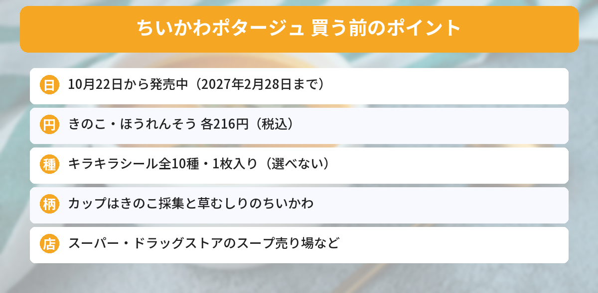

## この記事で分かること

ちいかわのカップスープにシールが入ってるって聞いたよ！いつまで買えるの？シールは何種類？


丸美屋の「きのこのポタージュ」と「ほうれんそうのポタージュ」だね。10月22日から発売中で、2027年2月28日までの期間限定だよ。どちらも1個216円で、キラキラシールが1枚入っているんだ。


アニメ「ちいかわ」のデザインのカップスープが、丸美屋から期間限定で登場しました。ちいかわ広報の公式Xの告知ポストは、いいね1.4万件を超えています（10月26日時点）。

この記事では、丸美屋食品工業の発表とちいかわ広報の告知をもとに、値段、カップのデザイン、シール、売っている場所をまとめます。



---
## 公式情報

ちいかわ広報の公式Xの告知ポストです。きのこを持ったちいかわのカップと、草むしりをするちいかわのカップが紹介されています。

---
## 基本情報

- **販売期間**：2026年10月22日（木）〜2027年2月28日（日）の期間限定
- **価格**：各216円（税込）
- **種類**：きのこのポタージュ（20g）、ほうれんそうのポタージュ（17.8g）の2種類
- **おまけ**：本品限定の「キラキラシール」1枚入り（全10種・2品共通）
- **売っている場所**：ちいかわらんど、ちいかわPOP UP STORE、スーパー、ドラッグストアなど ※取り扱いがないお店もあります
- **賞味期間**：12か月
- **発売元**：丸美屋食品工業


---
## 2種類のポタージュ
### きのこのポタージュ
カップには、**ちいかわがきのこを採集しているシーン**が描かれています。香味野菜をベースに、きのこのうま味が溶けこんだ、クリーミーでコクのあるポタージュです。内容量は20gです。

### ほうれんそうのポタージュ
カップには、**ちいかわが草むしりをしているシーン**が描かれています。ほうれんそうの素材を生かし、隠し味にチーズをきかせたポタージュです。内容量は17.8gです。


草むしりのちいかわ、いつものお仕事の姿だ…！カップも捨てられなくなりそう。


わかる。飲んだあとにカップを洗って取っておく人もいそうだね。


---
## キラキラシールは全10種
どちらのポタージュにも、**本品限定のキラキラシールが1枚**入っています。

- 全10種で、**きのこ・ほうれんそうの2品で絵柄は共通**
- ちいかわ、ハチワレ、うさぎなどが登場
- 花をめでるちいかわや、大暴れするうさぎなどの絵柄が紹介されています
- どの絵柄が入っているかは選べません

全10種を集めたいなら、2つの味を交互に買って飲みくらべるのも楽しいですね。

---
## 売っている場所と注意点
### スーパーやドラッグストアのスープ売り場
食品なので、スーパーやドラッグストアでは**インスタントスープの売り場**にならびます。お菓子売り場やおもちゃ売り場ではないので、探すときは注意してください。

### ちいかわらんど・POP UP STOREでも
ちいかわらんどや、ちいかわPOP UP STOREでも取り扱いがあります。

### 知っておきたい注意点
- **取り扱いがないお店もあります**
- **期間限定**なので、2027年2月28日を過ぎると買えなくなります（なくなりしだい終了の場合もあります）
- シールは**ランダム**です

---
## ちいかわのほかの新商品もチェック
10月28日からは、オンラインくじ「[シーサーだらけくじ](/posts/chiikawa-shisa-darake-kuji-2026/)」も始まります。ちいかわのシールが好きな人は、[ボンボンドロップシールミニの記事](/posts/chiikawa-bonbondrop-seal-mini-2026/)もどうぞ。発売日やしめきりは[発売日カレンダー](/calendar/)にまとめています。

---
## よくある質問（FAQ）
### Q: ちいかわのポタージュはいつまで買えますか？
A: 2026年10月22日（木）から2027年2月28日（日）までの期間限定です。

### Q: 値段はいくらですか？
A: きのこのポタージュ、ほうれんそうのポタージュともに各216円（税込）です。

### Q: シールは何種類ありますか？
A: 本品限定のキラキラシールが全10種です。2品で絵柄は共通で、1個に1枚入っています。どの絵柄かは選べません。

### Q: どこで買えますか？
A: ちいかわらんど、ちいかわPOP UP STORE、スーパー、ドラッグストアなどです。取り扱いがないお店もあります。

### Q: 2種類の味のちがいは？
A: きのこのポタージュは香味野菜ベースにきのこのうま味、ほうれんそうのポタージュは隠し味にチーズをきかせた味です。

---

1個216円でシールつき、2月末まで買えるんだね！寒い日の朝に飲みたい。


そうそう。スープ売り場をのぞいてみてね。見つからないときは、ほかのお店も探してみよう。


## まとめ
- 丸美屋「期間限定 アニメちいかわ きのこのポタージュ／ほうれんそうのポタージュ」は2026年10月22日から発売中
- 販売は2027年2月28日までの期間限定。各216円（税込）
- カップはきのこ採集と草むしりのちいかわ
- 本品限定のキラキラシール（全10種・2品共通）が1枚入り
- ちいかわらんど、POP UP STORE、スーパー、ドラッグストアなどで販売。取り扱いがないお店もあり

---
### あわせて読みたい
- [【ちいかわ】シーサーだらけくじ10/28発売！全12種・1回1,100円・買い方まとめ](/posts/chiikawa-shisa-darake-kuji-2026/)
- [【ちいかわ】ボンボンドロップシールミニ全8種が10月下旬発売！買える場所と注意点](/posts/chiikawa-bonbondrop-seal-mini-2026/)
