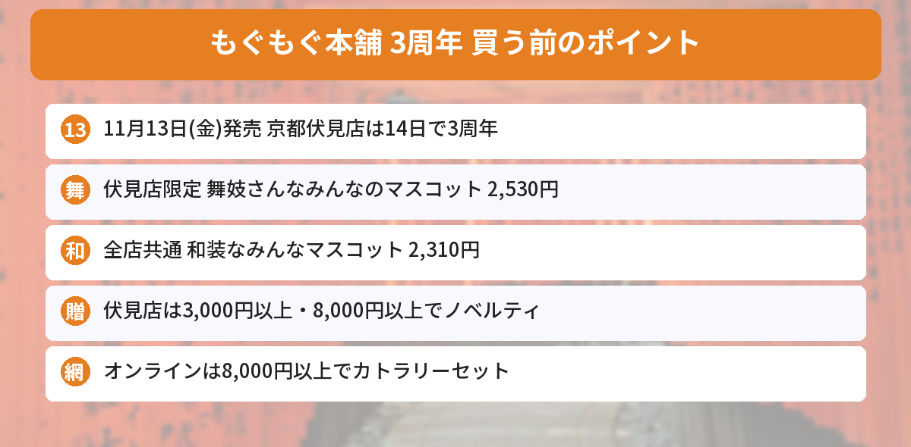

## この記事で分かること

もぐもぐ本舗の3周年の新商品、ついに発表されたって！舞妓さんのみんながいるって本当？


本当だよ。11月13日（金）発売で、伏見店限定の「舞妓さんなみんな」と、全部のお店で買える「和装なみんな」があるんだ。ノベルティの条件も一緒に見ていこう。


ちいかわもぐもぐ本舗が11月4日、**3周年を記念した新商品**を発表しました。京都伏見店は11月14日（土）でオープン3周年です。

この記事では、[もぐもぐ本舗の公式サイト](https://www.chiikawamogumogu.jp/)と[公式オンラインストアの「11月13日発売商品」ページ](https://chiikawamogumogu.shop/collections/new2026-11-13)をもとに、値段とノベルティをまとめます（2026年11月5日に確認）。



---
## 公式情報

ちいかわもぐもぐ本舗公式Xの発表です。京都伏見店では限定アイテムも多く出ると案内されています。

---
## 発売日と売っている場所

- **発売日**：2026年11月13日（金）
- **売っている場所**：ちいかわもぐもぐ本舗の各店舗、公式オンラインストア
- **伏見店限定のアイテム**：京都伏見店とオンラインストアで販売
- **全店共通のアイテム**：「和装なみんなマスコット」など


公式Xの新商品情報アカウント（ちいかわ情報）によると、**舞妓さんなみんなの新商品は京都伏見店とオンラインストアの限定**で、**和装なみんなのマスコットは全店舗共通**です。川越店の新商品は、[川越店のページ](https://www.chiikawamogumogu.jp/stores/kawagoe/)で案内されています。

---
## 伏見店限定「舞妓さんなみんな」
| アイテム | 値段（税込） |
|---|---|
| 舞妓さんなみんなのマスコット（ちいかわ） | 2,530円 |
| 舞妓さんなみんなのマスコット（ハチワレ） | 2,530円 |
| 芸妓さんなみんなのマスコット（うさぎ） | 2,530円 |
| 舞妓さんなみんなのポケッタブルエコバッグ | 1,650円 |
| 舞妓さんなみんなのまるい巾着 | 1,320円 |
| 舞妓さんなみんなの3連アクリルチャーム | 1,320円 |
| 舞妓さんなみんなの4枚セット ステッカー | 770円 |
| 舞妓さんなみんなのパタパタふせん | 715円 |
| 舞妓さんなみんなのマスキングテープ | 605円 |
| 舞妓さんなみんなの手触りの良いクリアファイル | 440円 |
| 舞妓さんなみんなの大きめ缶バッジ | 385円 |


うさぎだけ「芸妓さん」なんだね！


そうなの。ちいかわとハチワレは舞妓さん、うさぎは芸妓さんの姿だよ。いちばん安いのは缶バッジの385円だね。


---
## 全店共通「和装なみんなマスコット」（各2,310円）
和装をしたマスコットです。オンラインストアには、次の**8種**が並んでいます。

- ちいかわ
- ハチワレ
- うさぎ
- モモンガ
- くりまんじゅう
- シーサー
- ラッコ
- 古本屋

このほか、**ちりめんがま口 ちいかわ（1,540円）**なども並んでいます。オンラインストアの「11月13日発売商品」ページは3ページあり、ここで紹介したのはその一部です。

---
## 3周年のノベルティ
| | 条件 | もらえるもの |
|---|---|---|
| **京都伏見店** | 税込3,000円以上 | アクリルコネクタチャーム |
| **京都伏見店** | 税込8,000円以上 | ダイカットハンドタオル |
| **オンラインストア** | 税込8,000円以上 | カトラリーセット（再登場） |

- 伏見店は**11月13日（金）から**です
- オンラインストアは**11月13日（金）9:30から**です
- くわしい配布の条件は、公式サイトとオンラインストアで確かめてください

---
## 伏見店に行くなら入店の抽選に注意
京都伏見店は、**11月13日（金）〜15日（日）は入店に事前予約（抽選）が必要**です。LINEでの申し込みは**今日11月5日（木）の18時まで**です。くわしくは[伏見店3周年の入店抽選の記事](/posts/chiikawa-mogumogu-fushimi-3rd-2026/)にまとめています。

申し込みに間に合わなかった人や、落選した人は、**オンラインストア**で伏見店限定のアイテムを探すのがおすすめです。

---
## よくある質問（FAQ）
### Q: いつ発売ですか？
A: 2026年11月13日（金）です。オンラインストアのノベルティは同じ日の9:30から始まります。

### Q: 舞妓さんなみんなのマスコットはいくらですか？
A: 1つ2,530円（税込）です。ちいかわ・ハチワレは舞妓さん、うさぎは芸妓さんの姿です。

### Q: 伏見店に行けなくても買えますか？
A: 舞妓さんなみんなの新商品は、京都伏見店とオンラインストアの限定と案内されています。オンラインストアにも並んでいます。

### Q: 和装なみんなマスコットはどこで買えますか？
A: 全店舗共通の新商品と案内されています。1つ2,310円（税込）です。

### Q: ノベルティの条件は？
A: 京都伏見店は税込3,000円以上でアクリルコネクタチャーム、8,000円以上でダイカットハンドタオル。オンラインストアは税込8,000円以上でカトラリーセットです。

---

舞妓さんのハチワレ、ほしい！伏見に行けなくてもオンラインで買えるのうれしいな。


うん。発売日の朝はオンラインも混みやすいから、ほしいものを先に決めておくと安心だよ。


## まとめ
- ちいかわもぐもぐ本舗の3周年記念の新商品は、2026年11月13日（金）発売
- 伏見店限定「舞妓さんなみんなのマスコット」は各2,530円。伏見店とオンラインストアで販売
- 全店共通の「和装なみんなマスコット」は各2,310円。オンラインストアには8種
- ノベルティ：伏見店は3,000円以上・8,000円以上、オンラインは8,000円以上
- 伏見店は11月13日〜15日の入店が抽選制

---
### あわせて読みたい
- [【ちいかわもぐもぐ本舗】京都伏見店が11/14で3周年！11/13〜15は入店抽選・申し込みは11/5まで](/posts/chiikawa-mogumogu-fushimi-3rd-2026/)
- [【ちいかわ】ベビーカステラ京都錦店が11/18オープン！入店は抽選・申し込みは11/4から](/posts/chiikawa-baby-castella-kyoto-2026/)
