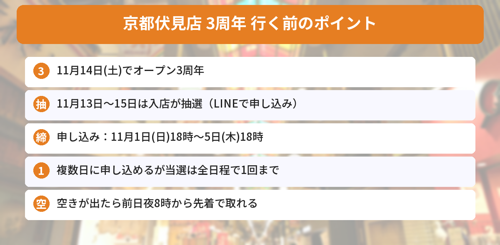

## この記事で分かること

伏見稲荷のちいかわのお店、もうすぐ3周年なんだって！記念の日に行きたいんだけど、予約がいるの？


「ちいかわもぐもぐ本舗 京都伏見店」だね。**11月14日（土）で3周年**で、**11月13日（金）〜15日（日）は入店に抽選の予約がいる**よ。申し込みは**今日11月1日の18時から11月5日（木）18時まで**。LINEで申し込むから、先に準備しておこう。


伏見稲荷大社の参道にある「ちいかわもぐもぐ本舗 京都伏見店」は、2023年11月14日にオープンしました。ちいかわたちと「和」の世界観を楽しめるお店で、ここでしか買えない伏見店限定のグッズもあります。

この記事では、ちいかわもぐもぐ本舗の公式サイトと公式Xのお知らせをもとに、3周年の期間の入店抽選についてまとめます。



---
## 公式情報

ちいかわもぐもぐ本舗の公式Xのお知らせです。最初の投稿に誤りがあったため、内容を直して出し直されたものです。

---
## 入店抽選の日程

- **対象の日**：2026年11月13日（金）〜15日（日）
- **申し込み**：11月1日（日）18:00〜11月5日（木）18:00
- **結果発表**：11月7日（土）
- **申し込み先**：ちいかわもぐもぐ本舗のLINE公式アカウント


### 抽選のルール
- 期間中の**いくつかの日に申し込めます**（各日1枠）
- ただし、**当選は1つのLINEアカウントにつき、全日程で1回まで**です
- お店からの**距離は関係ありません**（遠くに住んでいても申し込めます）
- 予約は**入店の約束**で、ほしい商品を必ず買えるわけではありません


3日とも申し込めるけど、当たるのは1回だけなんだね。


そうそう。行ける日が多いほうが当たりやすいかもしれないから、行けそうな日は全部申し込んでおくといいよ。


### 空きが出たら先着で取れる
予約に空きが出た場合は、**前日の夜8時から先着で**取れます。位置情報による取得の制限はありません。当日券の対応については、公式のお知らせの画像で案内されています。

---
## 3周年で何がある？
公式Xでは、3周年に向けて**新商品**や、京都伏見店での**3周年記念のノベルティ**が用意されると予告されています。**くわしい内容は後日発表**です。

去年の2周年のときは、京都伏見店限定のグッズや、お買い上げ特典のノベルティが登場しました。発表が出たら、この記事にも追記します。

---
## お店の基本情報

- **住所**：京都府京都市伏見区深草稲荷中之町46-1
- **営業時間**：9:30〜17:30 ※状況により変わることがあります
- **アクセス**：JR奈良線「稲荷駅」から徒歩5分、京阪本線「伏見稲荷駅」から徒歩10分
- **オープン**：2023年11月14日


伏見店では、きつねのお面のバッグや、伏見稲荷なマスコットなどの限定グッズがあり、再入荷のお知らせも公式Xで出ています。

---
## 京都のちいかわ情報もチェック
11月18日には、錦市場に「ちいかわベビーカステラ 京都錦店」もオープンします。こちらも同じLINEで入店抽選があり、最初の申し込みは11月4日（水）18時からです。くわしくは[ちいかわベビーカステラ京都錦店の記事](/posts/chiikawa-baby-castella-kyoto-2026/)で紹介しています。抽選のしめきりは[発売日カレンダー](/calendar/)にまとめています。

---
## よくある質問（FAQ）
### Q: 京都伏見店の3周年はいつですか？
A: 2026年11月14日（土）です。2023年11月14日にオープンしました。

### Q: 予約なしで入れますか？
A: 11月13日（金）〜15日（日）は、入店に事前予約（抽選）が必要です。ほかの日の案内は公式サイトで確かめてください。

### Q: 抽選の申し込みはいつまでですか？
A: 11月1日（日）18時から11月5日（木）18時までです。結果は11月7日（土）に発表されます。

### Q: 何日も申し込めますか？
A: 期間中の複数の日に申し込めます（各日1枠）。ただし、当選は1つのLINEアカウントにつき全日程で1回までです。

### Q: 外れたら、もう行けませんか？
A: 予約に空きが出た場合は、前日の夜8時から先着で取れます。

---

申し込みは11月5日の18時まで、結果は11月7日！ベビーカステラのお店の抽選とも日にちが近いね。


そうなんだ。どっちも同じLINEで申し込むから、まちがえないように気をつけてね。


## まとめ
- 「ちいかわもぐもぐ本舗 京都伏見店」は2026年11月14日（土）でオープン3周年
- 11月13日（金）〜15日（日）は入店が事前予約（抽選）制
- 申し込みは11月1日（日）18時〜11月5日（木）18時、ちいかわもぐもぐ本舗のLINE公式アカウントで。結果は11月7日（土）
- 複数日に申し込めるが、当選は全日程で1回まで。空きが出たら前日夜8時から先着
- 3周年の新商品と記念ノベルティは後日発表

---
### あわせて読みたい
- [【ちいかわ】ベビーカステラ京都錦店が11/18オープン！入店は抽選・申し込みは11/4から](/posts/chiikawa-baby-castella-kyoto-2026/)
- [【ちいかわ】動く！？ツリーなうさぎは抽選販売！11/2正午まで・11/6発売のクリスマス新商品まとめ](/posts/chiikawa-tree-usagi-christmas-2026/)
