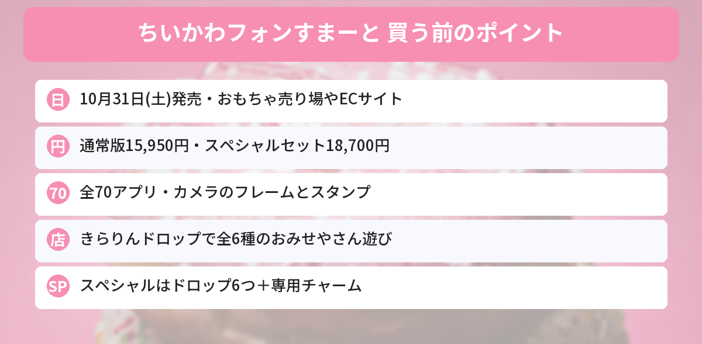

## この記事で分かること

ちいかわのスマホのおもちゃが出るって！クリスマスプレゼントにしたいんだけど、ふつうのとスペシャルセット、どっちがいいの？


「ちいかわフォンすまーと」だね。**10月31日（土）発売**だよ。通常版は15,950円、スペシャルセットは18,700円。ちがいは、ついてくる「きらりんドロップ」の数と専用チャームなんだ。順番に見ていこう。


バンダイから、ちいかわの世界観がつまったスマホ型のおもちゃが登場します。「日本おもちゃ大賞2026」にも選ばれた商品です。

この記事では、ちいかわ広報の告知とバンダイの発表をもとに、できること、2つのセットのちがい、売っている場所をまとめます。



---
## 公式情報

ちいかわ広報の公式Xの告知ポストです。10月31日（土）から、全国のおもちゃ売り場やECサイトなどで発売と案内されています。

---
## 基本情報

- **発売日**：2026年10月31日（土）
- **価格**：通常版 15,950円／スペシャルセット 18,700円（どちらも税込）
- **アプリ**：全70アプリ
- **売っている場所**：全国のおもちゃ売り場、ECサイトなど
- **発売元**：バンダイ


---
## どんなことができる？
### 全70アプリ
ちいかわたちと**電話やメッセージ**のやりとりができるアプリや、**カレンダー・計算機**などの便利なアプリが入っています。

### カメラでデコ
カメラアプリでは、ちいかわたちの**フォトフレーム**をつけて写真をとったり、**スタンプ**でデコったりできます。

### きらりんドロップでおみせやさん遊び
いちばんの特ちょうが「**きらりんドロップ**」です。裏の二次元コードをスキャンすると、ちいかわたちと**おみせやさん遊び**ができます。

- 遊べるお店は**全6種類**
- 店長のちいかわたちに**さしいれ**をしたり、**そうじ**をしたり
- **バイトゲーム**でお店を大きくできる


ちいかわたちのお店でバイトできるの、楽しそう…！


お店は6種類で、きらりんドロップを読みこんで遊ぶんだ。だから、ドロップの数がセット選びのポイントになるよ。


---
## 通常版とスペシャルセットのちがい
| | 通常版 | スペシャルセット |
|---|---|---|
| 価格（税込） | 15,950円 | 18,700円 |
| 本体 | 1 | 1 |
| タッチペン（松葉紐つき） | 1 | 1 |
| **きらりんドロップ**（ボールチェーンつき） | **3** | **6** |
| **専用チャーム**（松葉紐つき） | なし | **1** |
| 松葉紐 | 1 | なし |
| USB（Type-C）ケーブル | 1 | 1 |

スペシャルセットは、**きらりんドロップが6種類そろい**、じゃらづけできる**専用チャーム**がつきます。差額は2,750円です。

---
## 売っている場所と注意点
- 全国の**おもちゃ売り場**や**ECサイト**などで発売されます
- お店によっては、予約で**特典**（例：きらりんドロップステッカー）をつけているところがあります。特典はなくなりしだい終了です
- 通販では、お店によって値段がちがうことがあります
- 人気商品なので、クリスマス前は品薄になることも考えられます

---
## ちいかわのほかの新商品もチェック
11月6日発売のクリスマスグッズは[ツリーなうさぎの記事](/posts/chiikawa-tree-usagi-christmas-2026/)、11月18日オープンのお店は[ちいかわベビーカステラ京都錦店の記事](/posts/chiikawa-baby-castella-kyoto-2026/)で紹介しています。発売日は[発売日カレンダー](/calendar/)にまとめています。

---
## よくある質問（FAQ）
### Q: ちいかわフォンすまーとはいつ発売ですか？
A: 2026年10月31日（土）です。全国のおもちゃ売り場やECサイトなどで発売されます。

### Q: 値段はいくらですか？
A: 通常版が15,950円、スペシャルセットが18,700円（どちらも税込）です。

### Q: 通常版とスペシャルセットは何がちがいますか？
A: きらりんドロップの数（通常版3つ、スペシャルセット6つ）と、専用チャームがつくかどうかです。

### Q: どんなアプリが入っていますか？
A: 電話やメッセージ、カレンダー、計算機、カメラなど全70アプリです。きらりんドロップを読みこむと、全6種類のお店でおみせやさん遊びができます。

### Q: 充電はどうしますか？
A: USB（Type-C）ケーブルがついています。くわしい使い方は商品の説明書を確かめてください。

---

10月31日発売で、6種類のお店を全部遊ぶならスペシャルセットだね！


そうそう。プレゼントにするなら、早めにお店の在庫や予約特典をチェックしておこう。


## まとめ
- 「ちいかわフォンすまーと」は2026年10月31日（土）発売
- 通常版15,950円、スペシャルセット18,700円（税込）
- 全70アプリ入り。カメラのフレームやスタンプも使える
- きらりんドロップをスキャンして、全6種類のお店でおみせやさん遊び
- スペシャルセットは、きらりんドロップ6つと専用チャームつき

---
### あわせて読みたい
- [【ちいかわ】動く！？ツリーなうさぎは抽選販売！11/2正午まで・11/6発売のクリスマス新商品まとめ](/posts/chiikawa-tree-usagi-christmas-2026/)
- [【ちいかわ】ベビーカステラ京都錦店が11/18オープン！入店は抽選・申し込みは11/4から](/posts/chiikawa-baby-castella-kyoto-2026/)
