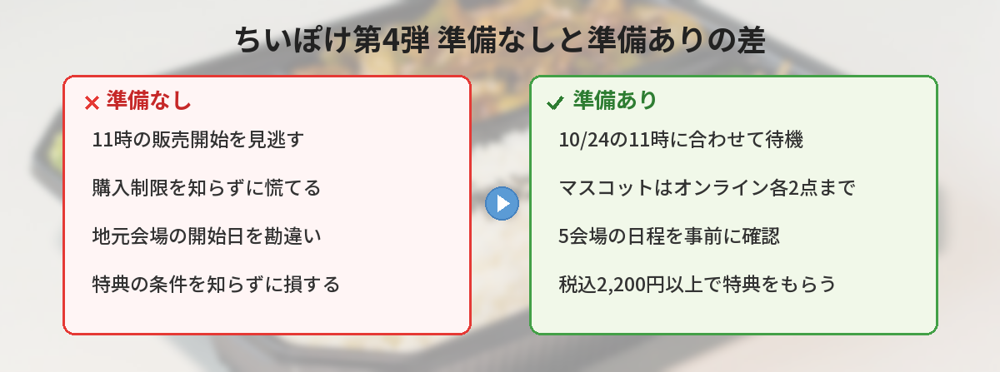

## この記事で分かること


ちいぽけのグッズ第4弾が出るって、タイムラインがすごいことになってるよ！いつ、どこで買えるの？



10月24日（土）発売だよ！今回はゲームで人気だった「お弁当衣装」と「お店屋さん衣装」がモチーフなの。全国5か所のポップアップストアも決まったから、まとめて整理するね。


10月13日（火）のお昼、スマホゲーム『ちいかわぽけっと』（通称ちいぽけ）の公式Xが、公式グッズ第4弾の発売を発表しました。発表のポストには、公開から2時間ほどで9,000件を超えるいいねが集まっています。

この記事では、全ラインナップと価格、購入制限、オンライン販売の開始時刻、全国5会場のPOP UP STOREの日程、お買い上げ特典をまとめました。「何時から買える？」「いくつまで買える？」「地元の会場はいつ？」といった疑問に答えていきます。



---

## 公式情報



ちいかわぽけっと公式（@chiikawa_pt_jp）が、10月13日12時に発表しました。詳細は[ちいかわぽけっとグッズストアのお知らせ](https://chiikawa-pocket-goods-store.com/news/detail/?newsId=634877837599)で案内されていて、運営会社のアプリボットもプレスリリースで全ラインナップと価格を公開しています。

『ちいかわぽけっと』は、ナガノさんの漫画「ちいかわ」を原作にした、ちいかわ初のスマホアプリです。2025年3月27日から世界43の国と地域で配信されていて、基本プレイは無料（アプリ内課金あり）です。

---

## 基本情報


- **発売日**：2026年10月24日（土）
- **オンライン販売**：公式グッズオンラインストア「ちいかわぽけっとグッズストア」で同日11:00から
- **モチーフ**：「お弁当」と「お店屋さん」
- **ラインナップ**：お弁当モチーフ8アイテム、お店屋さんモチーフ7アイテム
- **POP UP STORE**：東京・大阪・仙台・福岡・名古屋の全国5会場
- **価格**：すべて税込。写真はサンプルで、実物とは少し異なる場合があります


---

## お弁当モチーフの全ラインナップと価格

ゲーム内で4月末に登場した「お弁当衣装」が、グッズになりました。公式Xの衣装紹介では、ちいかわはおにぎり、ハチワレはたこさんウインナー、うさぎはエビフライ、くりまんじゅうはアスパラベーコン、モモンガはブロッコリー、シーサーはたまごやきに変身していました。

| 商品名 | 価格（税込） | 購入制限 |
|------|------|------|
| お弁当なマスコット（全7種） | 各2,200円 | オンライン各2点まで／ポップアップ各1点まで |
| お弁当なトレーディング刺繍缶バッジ（全7種・ランダム） | 単品385円／BOX 2,695円 | 7点（1BOX）まで |
| お弁当なスマホに貼れるサイズのステッカー（全7種） | 各330円 | 各1点まで |
| お弁当なバスタオル | 3,025円 | 1点まで |
| お弁当な大きめトートバッグ | 3,630円 | 1点まで |
| お弁当なハンドタオル（全3種） | 各880円 | 各1点まで |
| お弁当なクリアファイル | 440円 | 1点まで |
| お弁当なTシャツ（全2種・M/L/XL） | 各3,630円 | 各サイズ1点まで |

いちばんの注目は、全7種の立体マスコットです。プレスリリースでは、おにぎり姿のちいかわや、タコ姿のハチワレなど7体がそろうと紹介されています。刺繍缶バッジは、お弁当衣装のキャラクターの顔を刺繍風に描いた丸い缶バッジで、BOXで買うと7種がそろいます。

---

## お店屋さんモチーフの全ラインナップと価格

もうひとつのモチーフは「お店屋さん」です。魚を持つハチワレ、花を持つちいかわ、白衣のモモンガなど、お店で働く姿のキャラクターが描かれています。

| 商品名 | 価格（税込） | 購入制限 |
|------|------|------|
| お店屋さんなトレーディングアクリルスタンド（全7種・ランダム） | 単品495円／BOX 3,465円 | 7点（1BOX）まで |
| お店屋さんなスマホに貼れるサイズのステッカー（全7種） | 各330円 | 各1点まで |
| お店屋さんなバスタオル | 3,025円 | 1点まで |
| お店屋さんな大きめトートバッグ | 3,630円 | 1点まで |
| お店屋さんなハンドタオル（全3種） | 各880円 | 各1点まで |
| お店屋さんなクリアファイル | 440円 | 1点まで |
| お店屋さんなTシャツ（全2種・M/L/XL） | 各3,630円 | 各サイズ1点まで |

お店屋さんモチーフに、マスコットはありません。そのかわりに、トレーディングアクリルスタンドが全7種で登場します。大きめトートバッグは、道とお店を地図のように描いたデザインです。生成り色なので、普段のお買い物にも使いやすそうです。


マスコットはお弁当のほうだけなんだね。7種ぜんぶそろえたら、いくらになるの？



1個2,200円だから、7種で15,400円だよ。ちなみにマスコット1個で、ちょうど特典がもらえる「2,200円以上」に届くの。特典のことは、このあとくわしく話すね。


---

## POP UP STORE 第4弾の日程と会場



第4弾の発売を記念して、全国5会場でポップアップストアが開かれます。会場ごとに開始日がずれているので、行く予定の会場を確認しておきましょう。

| 会場 | 期間 | 時間 | 場所 |
|------|------|------|------|
| 東京 | 10月24日（土）〜11月23日（月・祝） | 11:00〜21:00 | 池袋PARCO 本館6F 0% IKEBUKURO |
| 大阪 | 10月30日（金）〜11月15日（日） | 10:30〜20:30 | 天王寺ミオ 本館6F ミオラボ |
| 仙台 | 11月3日（火・祝）〜11月23日（月・祝） | 10:00〜21:00（最終日17:00閉場） | イオンモール仙台上杉 1階 あまみやコート |
| 福岡 | 11月6日（金）〜11月23日（月・祝） | 10:00〜20:30（最終日17:00閉場） | 福岡PARCO 本館B1F EVENT SPACE |
| 名古屋 | 11月13日（金）〜11月29日（日） | 10:00〜20:00（最終日17:00閉場） | 名古屋PARCO 西館5F イベントスペース |

いちばん早く始まり、期間も長いのは東京会場です。発売日の10月24日から買えるのは、オンラインストアと東京会場だけになります。

販売商品や各会場の入場方法、注意事項は、[POP UP STORE 第4弾の公式ページ](https://chiikawa-info.jp/p26/chiikawa_pocket042610/)で案内されています。過去の開催では入場整理券が案内された会場もあったので、出かける前に必ず確認してください。

---

## お買い上げ特典は3つ

グッズを買うと、次の3つの特典がもらえます。

| 特典 | もらえる場所 | 条件 |
|------|------|------|
| ちいぽけ オリジナルスタンプ Vol.4 | ポップアップストア | 商品を購入した方 |
| ちいぽけ POP UP STORE専用ショッパー | ポップアップストア | 税込2,200円以上の購入で1枚 |
| ちいぽけ ホームアイテムステッカー（芸術の秋） | オンラインストア・ポップアップストア | 税込2,200円以上の購入で1枚 |

オリジナルスタンプは、東京・大阪・名古屋・仙台・福岡の地名入りで、会場ごとにデザインが違うデジタルアイテムです。アプリのプロフィールに登録でき、ゲームに反映できるのは各デザイン1回までです。

ホームアイテムステッカーは、裏面のシリアルコードから、ゲームで使えるホームアイテム「芸術の秋」がもらえます。ショッパーとステッカーは1人1会計につき1枚で、会計の合算や分割はできません。どちらも、なくなり次第終了です。



さらに、グッズストアやポップアップストアで買うと「ちいぽけポイント」ももらえます。公式Xによると、ポイントはゲーム内のアイテムや、オリジナル壁紙と交換できます。

---

## 独自の視点・買い逃さないためのコツ

### 1. オンラインは10月24日11:00の開始に合わせる

オンラインストアは、発売日の11:00に販売が始まります。最近のちいかわグッズは争奪戦になりやすく、10月13日には、ちいかわマーケットの新商品が売り切れ続出だとニュースになっていました。欲しいものを先に決めておき、11時には画面を開いておくと安心です。

公式Xによると、ちいかわぽけっとグッズストアは、スマホのホーム画面に追加して1タップで開けるようになりました。発送通知や新商品のお知らせも届くので、発売日の前に追加しておくと、当日あわてずに済みます。

### 2. マスコットの買える数は、オンラインと会場で違う

お弁当なマスコットは、オンラインでは各2点まで、ポップアップストアでは各1点までです。家族や友だちの分もまとめて買いたい人は、オンラインのほうが向いています。

### 3. 特典は「税込2,200円以上」がカギ

ショッパーとステッカーの条件は、1回の会計で税込2,200円以上です。マスコット1個（2,200円）で、ちょうど条件を満たせます。ステッカー（330円）やクリアファイル（440円）を組み合わせる場合は、合計金額に気をつけましょう。

### 4. 東京以外の会場は、開始日を確認してから

大阪は10月30日、仙台は11月3日、福岡は11月6日、名古屋は11月13日スタートです。東京以外の会場は、発売日から1週間ほどあとに始まります。前回の第3弾も会場ごとに期間が違ったので、行く前に公式ページで最新情報を確認しましょう。

### 5. 完売や特典終了に注意

前回の第3弾では、会場でマスコットの一部が完売したり、お買い上げ特典の配布が途中で終わったりしたと、公式のお知らせが出ていました。人気キャラクターのマスコットを狙うなら、早めに行くのがおすすめです。

### 6. 転売品ではなく公式で買う

人気グッズは、発売直後から定価より高い値段で転売されることがあります。偽物や高額転売を避けるためにも、公式のオンラインストアと会場で買いましょう。

---

## SNSでの反応

10月5日に「第4弾を10月に発売」と予告したポストには、いいねが2.3万件以上、リポストが5,500件以上集まっていました（10月13日時点）。13日の正式発表も、公開から2時間ほどでいいね9,000件を超えています。

発表後のXでは、こんな声が見られました。

- お弁当の具材がかわいいから、マスコットにしてくれてうれしい
- エビフライのうさぎと、アスパラベーコンのくりまんじゅうが欲しい
- 今回は刺繍缶バッジがいい感じ
- 発売から数日たっても、マスコットは買えるのか不安
- 前に出たシリーズのマスコットも、また販売してほしい

マスコット化を喜ぶ声と、「買えるかな」と心配する声が、同じくらい目立っていました。発売日までは、公式Xの続報もチェックしておきたいところです。

---

## よくある質問（FAQ）

### Q: オンラインストアでは何時から買えますか？
A: 2026年10月24日（土）の11:00から、公式グッズオンラインストア「ちいかわぽけっとグッズストア」で販売が始まります。

### Q: 購入制限はありますか？
A: あります。お弁当なマスコットはオンライン各2点・ポップアップ各1点まで、トレーディング商品は7点（1BOX）まで、そのほかは各1点まで（Tシャツは各サイズ1点まで）です。

### Q: ポップアップストアに入るのに、整理券は必要ですか？
A: 各会場の入場方法は、POP UP STORE 第4弾の公式ページで案内されています。過去の開催では入場整理券が案内された会場もあるため、出かける前に必ず確認してください。

### Q: 特典はオンラインストアでももらえますか？
A: 「ホームアイテムステッカー（芸術の秋）」は、オンラインストアでも税込2,200円以上の購入でもらえます。オリジナルスタンプVol.4と専用ショッパーは、ポップアップストアの特典です。ステッカーとショッパーは、なくなり次第終了です。

### Q: 東京以外では、いつから買えますか？
A: 大阪は10月30日（金）、仙台は11月3日（火・祝）、福岡は11月6日（金）、名古屋は11月13日（金）からです。早く手に入れたい場合は、10月24日11:00からのオンラインストアを使いましょう。

---


10月24日の11時にオンライン、東京ならその日から会場でも買えるんだね！マスコット1個で特典がもらえるのもうれしいな。



そうそう！東京以外の会場は始まる日が違うから、行く前に公式ページで入場方法も確認してね。続報は公式Xで出るから、フォローしておくと安心だよ。


## まとめ

- ちいかわぽけっとの公式グッズ第4弾は、2026年10月24日（土）発売
- モチーフは「お弁当」と「お店屋さん」。マスコットはお弁当モチーフの全7種（各2,200円）
- オンラインストアは10月24日11:00から。マスコットはオンライン各2点・会場各1点まで
- POP UP STOREは東京・大阪・仙台・福岡・名古屋の5会場で、開始日は会場ごとに違う
- 税込2,200円以上の購入で、ショッパーやステッカーの特典あり（なくなり次第終了）

---
### あわせて読みたい
- [【2026年最新】ちいかわパーク完全ガイド！料金・アクセス・グッズ・口コミまとめ](/posts/chiikawa-park-guide-2026/)
- [映画ちいかわ「人魚の島のひみつ」7月24日公開！あらすじ・前売り券・最新情報まとめ](/posts/chiikawa-movie-mermaid-island-2026/)

<!-- affiliate -->
## 関連リソース

ちいぽけの原作になっている漫画を、最初から読んでみたい方向けに、評価の高い第1巻を選びました。

**ちいかわ なんか小さくてかわいいやつ（1）**（ナガノ／講談社） 
ちいかわたちの「楽しくて、切なくて、ちょっとハードな日々」が始まる、原作コミックスの第1巻です。

- <a href="https://af.moshimo.com/af/c/click?a_id=5490814&amp;p_id=54&amp;pc_id=54&amp;pl_id=27059&amp;url=https%3A%2F%2Fitem.rakuten.co.jp%2Fbook%2F16589257%2F" rel="nofollow sponsored noopener" referrerpolicy="no-referrer-when-downgrade" target="_blank">ちいかわ なんか小さくてかわいいやつ（1）（楽天市場）</a>
- <a href="https://af.moshimo.com/af/c/click?a_id=5490817&amp;p_id=170&amp;pc_id=185&amp;pl_id=27060&amp;url=https%3A%2F%2Fwww.amazon.co.jp%2Fdp%2F4065223962" rel="nofollow sponsored noopener" referrerpolicy="no-referrer-when-downgrade" target="_blank">ちいかわ なんか小さくてかわいいやつ（1）（Amazon）</a>
<!-- /affiliate -->
