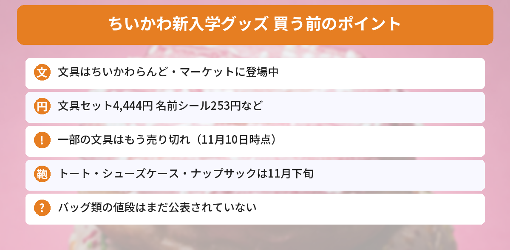

## この記事で分かること

来年の春に小学校に入る子がいるんだけど、ちいかわの文房具ってもう出てるの？


出てるよ！文具はもうちいかわらんどに入荷していて、トートバッグやナップサックは11月下旬から順次発売なんだ。売り切れの文具もあるから、早めに見ておこう。


ちいかわの**2027年新入学シリーズ**が、11月に入ってから**ちいかわらんど各店**に入荷しはじめました。さらに、ちいかわ公式Xが「**アニメちいかわ**」の新入学グッズを発表しています。

この記事では、[ちいかわ公式Xの発表](https://x.com/chiikawa_kouhou/status/2119595834300060128)と[ちいかわマーケット](https://chiikawamarket.jp/search?q=%E6%96%B0%E5%85%A5%E5%AD%A6)の商品ページをもとにまとめます（2026年11月10日に確認）。



---
## 公式情報

ちいかわ公式Xの、アニメちいかわの新入学グッズの発表です。

---
## アニメちいかわの新入学グッズ（11月下旬〜）

- **発売**：2026年11月下旬から順次
- **売っている場所**：ちいかわマーケット、全国の雑貨店・量販店など
- **アイテム**：2wayトートバッグ、シューズケース、ナップサック、巾着S 3枚セット
- **注意**：発売日がちがうお店、取り扱いのないお店もある


通学で毎日使う**バッグ類**がそろっています。値段は、2026年11月10日時点ではまだ公表されていません。

---
## もう出ている文具（ちいかわマーケット）
ちいかわマーケットで「新入学」と検索すると、文具がたくさん並んでいます。デザインは「**Twinkle Chiikawa**」と「**カラフルドリンク**」の2つです。

| アイテム | 値段（税込） |
|---|---|
| 文具セット | 4,444円 |
| コンパクトふでいれヨコピタ ホログラム | 2,200円 |
| 色鉛筆12色 | 1,650円 |
| 鉛筆2B ダースDX | 1,056円 |
| 鉛筆2B 4本セット | 352円 |
| 名前ペン | 330円 |
| クリア下敷 | 308円 |
| 15cm定規 | 275円 |
| 赤青鉛筆 2本セット | 264円 |
| 名前シール | 253円 |
| 鉛筆キャップ 6本 | 242円 |
| 自由帳 | 220円 |

※値段はTwinkle Chiikawaのもの。カラフルドリンクも、同じアイテムは同じ値段です。

### もう売り切れているものも
11月10日に見たときには、**カラフルドリンク**の文具セット・鉛筆キャップ・鉛筆ダースDXなどや、**Twinkle Chiikawa**のクリア下敷・自由帳が**売り切れ**になっていました。


自由帳や下敷きみたいな安いものから売り切れてるんだね…。


入学前は家族みんなでそろえる人が多いからね。名前シールや名前ペンも入学準備に使えるから、まとめて見ておくといいよ。


---
## ちいかわらんどにも入荷中
公式Xでは、ちいかわらんどの**池袋パルコ店、横浜店、金沢フォーラス店、札幌パルコ店、越谷レイクタウン店、福岡パルコ店、広島パルコ店**などが「2027年新入学シリーズ」の入荷を知らせています。お店によって入っているアイテムがちがうので、近くのお店の公式Xを見てから行くと安心です。

ちいかわらんどの新商品コーナーは、日によって**整理券や事前予約**が必要なこともあります。

---
## ちいかわのほかの新商品もチェック
クリスマスの新商品は[ツリーなうさぎの記事](/posts/chiikawa-tree-usagi-christmas-2026/)にまとめています。発売日やしめきりは[発売日カレンダー](/calendar/)でも見られます。

---
## よくある質問（FAQ）
### Q: アニメちいかわの新入学グッズはいつ発売ですか？
A: 2026年11月下旬から順次です。お店によって発売日がちがいます。

### Q: どこで買えますか？
A: ちいかわマーケットと、全国の雑貨店・量販店などです。文具は、ちいかわらんどにも入荷しています。

### Q: 文具はいくらですか？
A: 文具セットは4,444円、名前シールは253円、自由帳は220円などです（すべて税込）。

### Q: 売り切れたら、もう買えませんか？
A: ちいかわマーケットでは、売り切れた商品があとで再入荷することもあります。商品ページをときどき見てみてください。

---

ナップサックとシューズケース、ちいかわでそろえたら学校が楽しみになりそう！


11月下旬の発売を待ちつつ、文具は売り切れる前に見ておこうね。


## まとめ
- ちいかわの2027年新入学シリーズが、ちいかわらんど各店に入荷しはじめた
- ちいかわマーケットには文具が並んでいる。文具セット4,444円、名前シール253円など
- 一部の文具はもう売り切れ（11月10日時点）
- アニメちいかわの2wayトートバッグ・シューズケース・ナップサック・巾着S 3枚セットは11月下旬から順次発売
- 値段はまだ公表されていない

---
### あわせて読みたい
- [【ちいかわ】動く！？ツリーなうさぎは抽選販売！11/2正午まで・11/6発売のクリスマス新商品まとめ](/posts/chiikawa-tree-usagi-christmas-2026/)
- [【ちいかわもぐもぐ本舗】3周年の新商品は11/13発売！舞妓さんなみんな・和装マスコットの値段とノベルティ](/posts/chiikawa-mogumogu-3rd-new-items-2026/)
