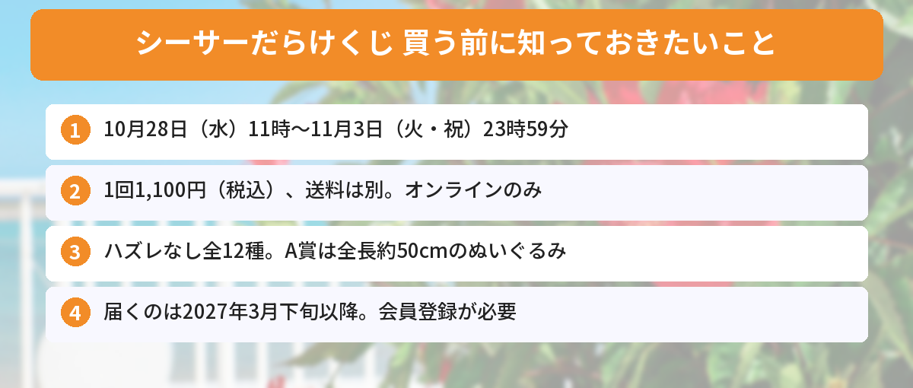

## この記事で分かること

シーサーだけのくじが出るって本当！？いつから引けるの？ハズレはあるの？


本当だよ！「シーサーだらけくじ」は、10月28日（水）11時から11月3日（火・祝）23時59分まで、オンラインだけで引けるくじなんだ。全12種でハズレなし、1回1,100円。届くのは2027年3月下旬以降だから、そこも先に知っておいてね。


ラーメン屋「郎」で修行中のスーパーアルバイター、シーサーのグッズだけが当たるオンラインくじが登場します。9月15日にちいかわマーケット公式Xが出した予告ポストは、表示回数420万回・いいね3.2万件を超えました（10月20日時点、発売元の発表による）。

この記事では、発売元のグレイ・パーカー・サービスの発表をもとに、販売期間、値段、全12種の中身、送料や届く時期をまとめます。



---
## 公式情報

ちいかわマーケット公式Xの予告ポストです。超BIGぬいぐるみや、お師匠とおそろいの鎧姿のぬいぐるみなど、シーサーだらけのラインナップが紹介されています。

---
## 基本情報

- **販売期間**：2026年10月28日（水）11:00〜11月3日（火・祝）23:59
- **価格**：1回1,100円（税込）※送料は別
- **売っている場所**：公式オンラインくじショップ「ちいかわマーケット ちいかわくじ」（オンラインのみ）
- **ラインナップ**：ハズレなし全12種（A賞〜E賞）
- **届く時期**：2027年3月下旬以降、順次
- **まとめ買い特典**：「10回」でまとめて買うと、きせかえシールシートつき


---
## 全12種のラインナップ
### A賞：超BIGぬいぐるみ（1種）
全長約50cm（約H500×W500×D350mm）の、超BIGなシーサーのぬいぐるみです。**お箸とお椀を両手に持った姿**で、ふんわり広がるたてがみとぽってりボディが特徴です。

### B賞：鎧なシーサーぬいぐるみ（1種）
約H400×W390×D180mm。**お師匠とおそろいの金の鎧**に身を包んだシーサーです。頭にかぶったかぶとと、全身の鎧のデザインを再現しています。

### C賞：フェイスクッション（2種）
約H320×W430×D120mm。シーサーのおかおがそのままクッションになっています。
- お師匠ッ（笑顔）
- くやシーサー（熱が出ても勉強をがんばる顔）

### D賞：ぬいぐるみポシェット（2種）
- スイッスイッ（約H200×W210×D70mm）：軽快に踊るシーサー
- ラーメン（約H210×W220×D90mm）："郎"のロゴ入りどんぶりに具がたっぷり

ストラップには絵柄入りのタグがついています。

### E賞：マスコット（6種）
約H100〜115mm。原作のシーンを再現したマスコットで、ボールチェーンつきです。
- スーパーアルバイター（資格証を持つ姿）
- さたぱんびん
- お買い物（財布とレジ袋）
- こんなのレアで〜す（紙エプロンでステーキ）
- 交通整理（ヘルメットと制服）
- がんばりま〜す!!（お酒の資格の勉強）


「くやシーサー」のクッション、ほしすぎる…！E賞のマスコットも全部集めたくなっちゃう。


ハズレなしだから、何が当たってもシーサーだよ。ただ、何回引くかは送料と届く時期も考えて決めようね。


---
## 買い方と注意点
### 引き方
1. 「ちいかわマーケット ちいかわくじ」の会員登録をする（くじを引くのに必要）
2. 10月28日（水）11時以降に、販売ページから回数を選んで買う
3. 2027年3月下旬以降に、まとめて届く

### 知っておきたい注意点
- **オンラインだけ**の販売です。お店では引けません
- **送料は別**にかかります（ファンの方の投稿では「全国一律1,000円」と案内されています。購入画面で確かめてください）
- ちいかわマーケットで買った**ほかの商品とは一緒に届きません**
- **商品がなくなりしだい終了**です。期間中でも売り切れることがあります
- 届くのは**2027年3月下旬以降**。時期は変わることがあります

### まとめ買い特典
「10回 ※シールおまけ」のボタンから買うと、A6サイズの**「貼ってはがせる きせかえシールシート」**がもらえます。

---
## シーサーのほかのグッズもチェック
シーサーとくりまんじゅうの「ねんどろいど」は、11月11日まで予約を受け付けています。ちいかわのほかの新商品は、[ちいかわ図書カードの記事](/posts/chiikawa-tosho-card-2026/)や[ボンボンドロップシールミニの記事](/posts/chiikawa-bonbondrop-seal-mini-2026/)でも紹介しています。発売日やしめきりは[発売日カレンダー](/calendar/)にまとめています。

---
## よくある質問（FAQ）
### Q: シーサーだらけくじはいつから引けますか？
A: 2026年10月28日（水）11時から、11月3日（火・祝）23時59分までです。商品がなくなりしだい終了です。

### Q: 1回いくらですか？
A: 1回1,100円（税込）です。送料は別にかかります。

### Q: お店で引けますか？
A: 引けません。公式オンラインくじショップ「ちいかわマーケット ちいかわくじ」だけの販売です。

### Q: ハズレはありますか？
A: ありません。A賞〜E賞の全12種、どれもシーサーのグッズです。

### Q: いつ届きますか？
A: 2027年3月下旬以降に順次届く予定です。時期は変わる場合があります。

---

10月28日の11時からオンラインで、1回1,100円。届くのは来年の3月下旬以降なんだね！


そうそう。会員登録は前もって済ませておくと、当日あわてずに引けるよ。


## まとめ
- 「ちいかわ シーサーだらけくじ」は2026年10月28日（水）11時〜11月3日（火・祝）23時59分にオンラインで販売
- 1回1,100円（税込）、送料は別。ハズレなし全12種
- A賞は全長約50cmの超BIGぬいぐるみ、B賞は鎧なシーサー、E賞は名場面マスコット6種
- 届くのは2027年3月下旬以降。ほかの商品とは別に届く
- 10回まとめて買うと、きせかえシールシートつき

---
### あわせて読みたい
- [【ちいかわ図書カード】10/22発売！どこで買える？予約・購入制限まとめ](/posts/chiikawa-tosho-card-2026/)
- [【ちいかわ】ボンボンドロップシールミニ全8種が10月下旬発売！買える場所と注意点](/posts/chiikawa-bonbondrop-seal-mini-2026/)
