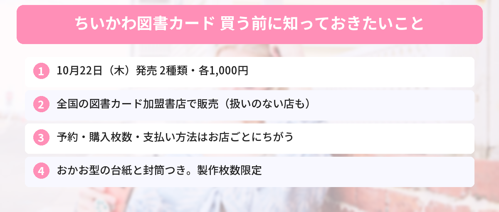

## この記事で分かること

ちいかわの図書カードが明日発売なんだって！本屋さんならどこでも買えるの？予約しておいたほうがいい？


10月22日（木）に、全国の図書カードを扱っている本屋さんで発売されるよ。でも、扱っていないお店もあるし、予約や買える枚数はお店ごとにちがうんだ。行く前に知っておきたいことをまとめるね！


本屋さんで本が買える「図書カードNEXT」に、ちいかわの限定デザインが登場します。ちいかわたちが本を楽しんでいる絵柄で、特製の台紙と封筒もついてきます。

発売日の前日になって、各地の書店の公式Xから「何枚まで買えるか」「予約はできるか」のお知らせが続々と出ています。この記事では、図書カードNEXTの公式サイトと書店の案内をもとに、買い方をまとめます。



---
## 公式情報

書店の公式Xでは、ひとりが買える枚数や、予約・取り置きをしないことが案内されています。お店ごとにルールがちがうので、行く予定のお店のお知らせを確かめましょう。

---
## 基本情報

- **発売日**：2026年10月22日（木）
- **種類**：2種類（A．なかよし読書／B．本とあそぼう）
- **価格**：各1,000円（1,000円分のカードを1,000円で販売。消費税はかかりません）
- **特典**：特製の台紙と封筒つき
- **販売店**：全国の図書カード加盟書店（扱いのないお店もあります）
- **数量**：製作枚数限定（売り切れしだい終了）


---
## どんなデザイン？
デザインは2種類あります。どちらも、ちいかわたちが本との時間を楽しむ姿がテーマです。

- **A．なかよし読書**
- **B．本とあそぼう**

有隣堂の案内によると、カードは**ちいかわのおかお型の台紙**に入っていて、**ハチワレ・ちいかわ・うさぎのイラスト入りの封筒**もついてきます。プレゼントにもしやすい形です。

2枚セットではないので、**どちらか1枚だけ買うこともできます**。

---
## どこで買える？
図書カードNEXTの公式サイトでは、**全国の図書カード加盟書店で販売**すると案内されています。ただし、お店によっては扱いがありません。

### 販売店の一覧は発売日に公開
公式サイトによると、販売する書店の一覧は**発売日に特設サイトに掲載される予定**です。それまでは、店頭に**ちいかわ図書カードのポスターが貼ってあるかどうか**が目印になります。

### 有隣堂の例
有隣堂では、多くの店舗で取り扱いがあると案内されています。ただし、一部の店舗（駅の売店や教室など）は対象外です。また、有隣堂では**現金でしか買えない**と書かれています。お店によって支払い方法がちがうことがあるので注意しましょう。


本屋さんならどこでもあると思ってた…。行く前に確認したほうがいいんだね。


そうなの。いつも行くお店の公式Xや、お店の入り口のポスターを見てみてね。


---
## 予約はできる？何枚まで買える？
### 予約は「お店しだい」
公式サイトでは、**予約制ではない**としたうえで、製作枚数が限られているため早く売り切れることがあると案内しています。

実際の対応はお店によってちがいます。

- 有隣堂：多くの店舗で、店内のサービスコーナーかレジで予約を受け付け（一部の店舗は受け付けなし）
- ほかの書店：**予約・取り置きはしない**と案内しているお店が多く見られます

### 購入枚数の制限もお店ごと
公式サイトは「購入枚数は購入店舗で確認してほしい」としています。書店の公式Xでは、次のような制限が出ています（10月21日時点）。

- ひとり各種2枚、合計4枚まで
- ひとり各種3枚まで

### 販売開始の時間
販売を始める時間もお店ごとです。書店の公式Xでは「10月22日10時から販売開始」と案内している例があります。

---
## 買うときの注意点
- **カードは1,000円分の図書カードとして使えます**。本を買うときに、レジで出すだけです
- 図書カードNEXTは非課税の商品なので、**1,000円で買えて、1,000円分使えます**
- 数量限定なので、確実にほしい人は発売日の早い時間に行くのがおすすめです
- 転売されたものを高い値段で買うのは避けましょう。発売日以降も、お店によっては残っていることがあります

ちいかわのほかの新商品は、[ボンボンドロップシールミニの記事](/posts/chiikawa-bonbondrop-seal-mini-2026/)や[ちいかわ×ANAのコラボグッズ](/posts/chiikawa-jet-ana-2026/)でも紹介しています。発売日がいつか分からなくなったら、[発売日カレンダー](/calendar/)を見てね。

---
## よくある質問（FAQ）
### Q: ちいかわ図書カードはいつ発売ですか？
A: 2026年10月22日（木）に発売されます。

### Q: 値段はいくらですか？
A: 1枚1,000円です。1,000円分の図書カードとして使えて、消費税はかかりません。

### Q: どこで買えますか？
A: 全国の図書カード加盟書店で販売されます。扱いのないお店もあるので、販売店の一覧は発売日に公開される特設サイトで確認してください。

### Q: 予約はできますか？
A: 公式では予約制ではありませんが、有隣堂のように店頭で予約を受け付けるお店もあります。予約・取り置きをしないお店も多いので、行く予定のお店に確認しましょう。

### Q: 何枚まで買えますか？
A: お店ごとに決まっています。書店の案内では「各種2枚、計4枚まで」「各種3枚まで」などの例があります。

---

ポスターが目印で、予約と枚数はお店しだいなんだね！なかよし読書と本とあそぼう、どっちにしようかな。


1枚ずつでも買えるから、両方そろえてもいいね。台紙と封筒つきだから、本好きの友だちへのプレゼントにもぴったりだよ。


## まとめ
- 限定版ちいかわ図書カードは2026年10月22日（木）発売
- 2種類（なかよし読書・本とあそぼう）で各1,000円。おかお型の台紙と封筒つき
- 全国の図書カード加盟書店で販売。扱いのないお店もあり、販売店の一覧は発売日に公開予定
- 予約・購入枚数・支払い方法はお店ごとにちがう
- 製作枚数限定なので、早めの来店がおすすめ

---
### あわせて読みたい
- [【ちいかわ】ボンボンドロップシールミニ全8種が10月下旬発売！買える場所と注意点](/posts/chiikawa-bonbondrop-seal-mini-2026/)
- [【ちいかわジェット】10/19就航！ANAコラボグッズは10/23発売](/posts/chiikawa-jet-ana-2026/)
