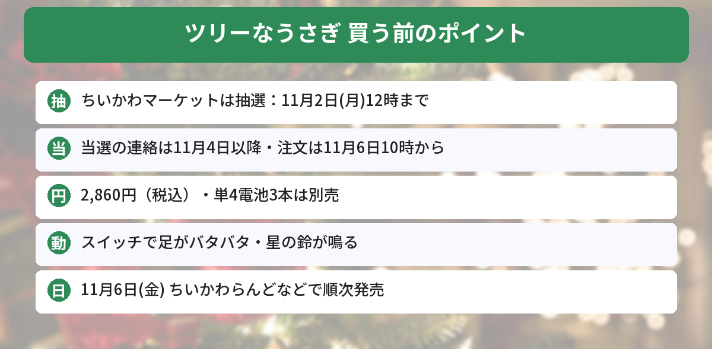

## この記事で分かること

ツリーになったうさぎが足をバタバタさせる動画、見た！？あれ、どうやったら買えるの？


「動く！？ツリーなうさぎぬいぐるみ」だね。11月6日（金）発売なんだけど、ちいかわマーケットでは**抽選販売**なんだ。申し込みは**11月2日（月）のお昼12時まで**だから、早めに済ませておこう。


ちいかわのクリスマス新商品が、11月6日（金）からちいかわらんどやちいかわマーケットなどで順次発売されます。中でも、ツリー姿のうさぎが動くぬいぐるみは、公式通販のちいかわマーケットで抽選販売になりました。

この記事では、ちいかわ広報とちいかわマーケットの告知をもとに、抽選の日程、値段、ほかのクリスマスグッズをまとめます。



---
## 公式情報

ちいかわ広報の公式Xの告知ポストです。クリスマスツリーから顔を出したうさぎが、足を動かす様子が紹介されています。

---
## 動く！？ツリーなうさぎぬいぐるみ

- **価格**：2,860円（税込）
- **大きさ**：約 高さ220×幅150×奥行110mm
- **電池**：単4形乾電池3本（別売）
- **発売日**：2026年11月6日（金）から ちいかわらんど、ちいかわマーケット ほかで順次
- **ちいかわマーケット**：抽選販売（下の日程を見てください）


クリスマスツリーから、うさぎが顔を出したぬいぐるみです。下に足がついていて、**スイッチを押すとバタバタ動きます**。てっぺんの星には**鈴**がついているので、動くと音も鳴ります。

### 抽選販売の日程（ちいかわマーケット）
| | 日時 |
|---|---|
| 申し込み | **10月27日（火）18時〜11月2日（月）12時** |
| 当選の連絡 | 11月4日（水）以降、順番に |
| 当選した人の注文受付 | 11月6日（金）10時から |


単4電池が3本いるんだね。届いた日に動かせないとかなしいから、先に買っておこう…！


いいね。当選の連絡は11月4日以降だから、メールを見のがさないようにしてね。


---
## ほかのクリスマス新商品（11月6日発売）
ちいかわマーケットでは、11月6日（金）11時から発売されます。

| 商品 | 価格（税込） |
|---|---|
| ちいかわ Kiramekko Teddy Bear Christmas（ちいかわ、ハチワレ、うさぎ） | 各2,420円 |
| ちいかわ クリスマスリースなぬいぐるみ | 6,820円 |
| ちいかわ ツリーなうさぎマスコット | 1,650円 |
| ちいかわ クリスマスの精マスコット（ちいかわ、ハチワレ、うさぎ） | 各1,870円 |
| ちいかわ ライティングペンダント（星） | 1,870円 |

**抽選販売になるのは「動く！？ツリーなうさぎぬいぐるみ」だけ**です。動かないタイプの「ツリーなうさぎマスコット」（1,650円）は、ふつうに発売されます。

### クリスマス以外の新商品も同じ日に
- まじかるちいかわ ボンボンドロップシール ジュエル（各660円）
- まじかるちいかわ 強くなったハチワレマスコット／うさぎマスコット（各2,090円）
- ちいかわラーメン豚 店員さんなマスコット（各1,870円）

---
## 買うときの注意点
- ちいかわマーケットで抽選になるのは**動く！？ツリーなうさぎぬいぐるみだけ**です
- 抽選に申し込むには、**ちいかわマーケットの会員登録**が必要です
- ちいかわらんどなどのお店でも11月6日から順次発売されますが、**入荷の日や数はお店によってちがいます**
- 電池（単4形3本）は**別売**です

---
## ちいかわのクリスマス情報もチェック
11月24日からは「ちいかわクリスマスマーケット」も始まります。くわしくは[ちいかわのクリスマス2026まとめ](/posts/chiikawa-christmas-2026/)で紹介しています。10月28日からはオンラインくじ「[シーサーだらけくじ](/posts/chiikawa-shisa-darake-kuji-2026/)」も始まります。発売日やしめきりは[発売日カレンダー](/calendar/)にまとめています。

---
## よくある質問（FAQ）
### Q: 動く！？ツリーなうさぎぬいぐるみはいつ発売ですか？
A: 2026年11月6日（金）から、ちいかわらんど、ちいかわマーケットなどで順次発売です。

### Q: 抽選の申し込みはいつまでですか？
A: ちいかわマーケットでの申し込みは、10月27日（火）18時から11月2日（月）12時までです。当選の連絡は11月4日（水）以降に順番に届きます。

### Q: 値段はいくらですか？
A: 2,860円（税込）です。動かすには単4形乾電池3本（別売）が必要です。

### Q: ほかのクリスマスグッズも抽選ですか？
A: いいえ。ちいかわマーケットで抽選になるのは、動く！？ツリーなうさぎぬいぐるみだけです。ほかの商品は11月6日（金）11時から発売されます。

### Q: どんな動きをしますか？
A: スイッチを押すと、下についた足がバタバタ動きます。てっぺんの星には鈴がついていて、音も鳴ります。

---

申し込みは11月2日のお昼まで、発売は11月6日！まずは抽選に申し込んでみる！


うん。動かないマスコットのほうはふつうに買えるから、そっちも見ておくといいよ。


## まとめ
- 「動く！？ツリーなうさぎぬいぐるみ」は2026年11月6日（金）発売、2,860円（税込）
- ちいかわマーケットでは抽選販売。申し込みは10月27日18時〜11月2日12時
- 当選の連絡は11月4日以降、当選した人の注文は11月6日10時から
- スイッチで足がバタバタ動き、星の鈴が鳴る。単4電池3本は別売
- クリスマスリースなぬいぐるみやKiramekkoテディベアなども11月6日に発売

---
### あわせて読みたい
- [【ちいかわ】クリスマス2026まとめ！パークとクリスマスマーケット、抽選は10/25まで](/posts/chiikawa-christmas-2026/)
- [【ちいかわ】シーサーだらけくじ10/28発売！全12種・1回1,100円・買い方まとめ](/posts/chiikawa-shisa-darake-kuji-2026/)
