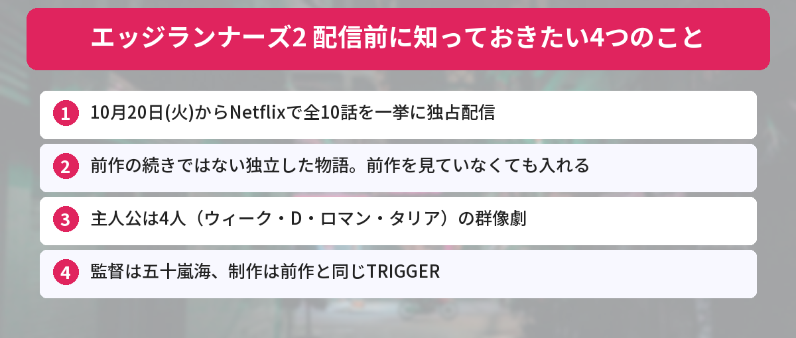

## この記事で分かること


「エッジランナーズ2」がもうすぐ配信ってXでずっと流れてくるんだけど、前作を見てないんだよね…。いきなり2から見ても大丈夫？



大丈夫だよ！今回は前作の続きじゃなくて、新しい主人公たちの独立した物語なの。10月20日（火）にNetflixで全10話がまとめて配信されるから、見る前に押さえておきたいことをまとめるね。


アニメ『サイバーパンク: エッジランナーズ2』が、2026年10月20日（火）からNetflixで独占配信されます。ゲーム『サイバーパンク2077』の世界を舞台にしたアニメの第2弾で、制作は前作に続いてアニメーションスタジオTRIGGERです。

制作のTRIGGERの公式Xでは、配信までのカウントダウンとして毎日イラストが公開されていて、10月18日の「あと2日」のポストには2,500件を超えるいいねが集まっています（10月18日時点）。この記事では、公式サイトや試写会のレポートをもとに、あらすじ、主人公、スタッフと、見る前に知っておきたいことを整理します。



---

## 公式情報



公式サイトでは、本作を「より生々しく、よりリアルに」と紹介しています。CD PROJEKT REDとTRIGGERが、新しい物語と登場人物でナイトシティに戻ってくる作品です。

---

## 基本情報


- **配信開始**：2026年10月20日（火）
- **配信**：Netflixで独占配信。全10話が一度に配信
- **原作の世界**：CD PROJEKT REDのゲーム『サイバーパンク2077』
- **制作**：TRIGGER
- **監督**：五十嵐海
- **脚本**：大塚雅彦、バルトシュ・シュティボル（前作から続投）
- **リードキャラクターデザイン**：菅野一期
- **オープニング曲**：The Cure「10:15 Saturday Night」
- **エンディング曲**：Petite Meller「Watson」


---

## あらすじ

舞台は、前作と同じ巨大都市ナイトシティ。公式サイトのストーリーは、次のように紹介されています。

かつて名をはせた伝説のサイバーパンク「ウィーク」は、クロームと力を失い、時代に取り残されています。彼は、自分が生きている意味を探し始めます。一方、復讐の道を歩み始めたノーマッドの「D」は、決して明るみに出るはずのなかった企業の秘密に近づいていきます。

家族、執着、過去にしばられる思いと未来に託す思い。そして、自分の「レンズ」が周りの人をどう映すのか。10話構成のオリジナルストーリーで、新しいエッジランナーズの運命が描かれます。

---

## 4人の主人公

9月30日に都内で開かれた第1話の試写会のレポート（4Gamer.net）によると、今作は**4人の主人公による群像劇**です。

| 名前 | どんな人物？ |
|------|------|
| ウィーク | かつて「キング」と呼ばれた伝説のサイバーパンク。サイバーサイコシスになりながら生き残った、めずらしい存在 |
| D | 復讐の道を歩むノーマッド。腕の立つネットランナー |
| ロマン | ナイトシティでは時代遅れになった「映画」にこだわる10代前半の少年 |
| タリア | ギャング「メイルストローム」の少女 |

日本語版では、ロマン役を寺澤百花さん、ウィーク役を利根健太朗さんが演じます。


前作の主人公のデイビッドとは、だいぶちがうタイプなんだね。



そうなの。試写会では、脚本の大塚さんが「体を強化して駆け上がっていったデイビッドとの対比を意識した」と話していたんだって。最初から多くを失っているウィークがどう生きるのかが見どころだね。


---

## 前作から変わったこと

### 監督とキャラクターデザインが新しくなった

前作の監督は今石洋之さんでしたが、スケジュールの都合で続投が難しかったため、今作は五十嵐海さんが監督を務めます。キャラクターデザインも一新され、五十嵐監督は試写会で「一見しただけで前作とは異なると感じる絵にしたかった」と話しています。1990年代のアニメを思わせるテイストを取り入れているのも特徴です。

### 脚本は前作のコンビが続投

一方で、脚本は前作と同じ大塚雅彦さんとバルトシュ・シュティボルさんのコンビです。シリーズのクリエイターであるシュティボルさんは、海外向けのコメントで「シーズン1が『ゼロからヒーロー』なら、シーズン2は『ヒーローからゼロ』」と表現しています。

---

## 独自の視点・見る前に知っておきたいこと

### 1. 前作を見ていなくても入れる

今作は、新しい主人公たちの独立した物語です。前作を見ていなくても話は追えます。ただ、ナイトシティという街の空気や、「サイバーサイコシス」（体を機械化しすぎて心が壊れてしまうこと）などの言葉を知っていると、より入りやすくなります。時間があれば、前作（全10話）もNetflixで見られます。

### 2. 全10話が一度に配信される

週に1話ずつではなく、10月20日に全10話がまとめて配信されます。一気に見るか、少しずつ見るかは自分のペースで決められます。

### 3. 配信開始の時刻はNetflixで確認

配信開始の時刻は、Netflixの作品ページで確認しておきましょう。作品ページで「通知を受け取る」を設定しておくと、配信が始まったときに知らせが届きます。

### 4. 大人向けの激しい作品

ナイトシティは、暴力や犯罪が日常的な街として描かれます。試写会のレポートでも、路上で人が殺されたり、企業が襲撃されたりする場面があったと書かれています。激しい描写が苦手な人や、家族で見る場合は注意してください。

### 5. ネタバレを避けたい人は早めに

配信が始まると、SNSには感想があふれます。全話が一度に出るので、ネタバレを見たくない人は、配信日に見る時間を確保しておくか、しばらくSNSの見方を工夫するのがおすすめです。

---

## SNSでの反応

配信日が近づき、Xではこんな声が見られました。

- 20日の配信開始と同時に一気見する
- ネタバレを見たくないけど、インターネットはやめられない
- 前作が好きすぎたので、期待と不安が半分ずつ
- カウントダウンのイラストが毎日楽しみ

TRIGGERのカウントダウンのポストは、毎日数千件のいいねを集めていて、配信前から大きな盛り上がりになっています。

---

## よくある質問（FAQ）

### Q: エッジランナーズ2はいつから見られますか？
A: 2026年10月20日（火）から、Netflixで独占配信されます。

### Q: 全部で何話ですか？
A: 全10話です。配信日にまとめて配信されます。

### Q: 前作を見ていなくても楽しめますか？
A: 新しい主人公たちの独立した物語なので、前作を見ていなくても楽しめます。世界観を先に知っておきたい人は、前作もNetflixで見られます。

### Q: 前作のキャラクターは出てきますか？
A: 公式の発表では、新しい主人公たちの物語と案内されています。くわしくは配信後に作品で確かめてください。

### Q: Netflix以外で見られますか？
A: Netflixの独占配信です。視聴にはNetflixの契約が必要です。

---


前作を見てなくても大丈夫なら、20日から見てみる！全10話なら週末で一気見できそう。



いいね！激しい場面も多いから、そこだけは覚悟しておいてね。Netflixで通知を設定しておくと見逃さないよ。


## まとめ

- アニメ『サイバーパンク: エッジランナーズ2』は、2026年10月20日（火）からNetflixで独占配信
- 全10話がまとめて配信される
- 前作の続きではない独立した物語。ウィーク・D・ロマン・タリアの4人の群像劇
- 監督は五十嵐海、脚本は前作と同じ大塚雅彦さんとバルトシュ・シュティボルさん、制作はTRIGGER
- 暴力的な描写が多い大人向けの作品。ネタバレ対策も早めに

---
### あわせて読みたい
- [【ちいかわ】クリスマス2026まとめ！パークとクリスマスマーケット、抽選は10/25まで](/posts/chiikawa-christmas-2026/)
- [【ちいかわジェット】10/19就航！ANAコラボグッズは10/23発売](/posts/chiikawa-jet-ana-2026/)
