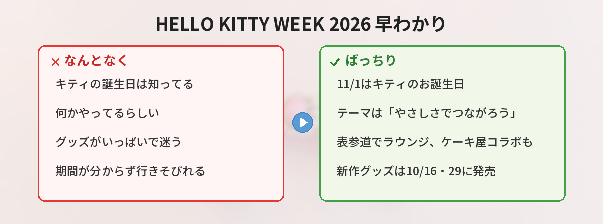

## この記事で分かること


11月1日ってハローキティの誕生日なんだよね？今年は何かやるの？



そう、11月1日がお誕生日なの！今年も「HELLO KITTY WEEK」っていう企画があって、表参道のイベントや新作グッズ、コラボもいろいろ。まとめて紹介するね。


11月1日は、ハローキティのお誕生日です。それに合わせて、サンリオが毎年行っているのが「HELLO KITTY WEEK」。2026年も、公式サイトやニュースリリースで続々と情報が公開されています。

この記事では、HELLO KITTY WEEK 2026のテーマ、表参道で開かれる体験イベント、新作グッズ、コラボ情報を、公式発表をもとに整理します。「何がいつ始まるの？」「どこに行けば楽しめる？」という疑問に答えていきます。



---

## 公式情報



サンリオ公式によると、HELLO KITTY WEEKは、ハローキティの誕生日である11月1日から始まります。「やさしさで、つながろう。」をテーマに、日本でのリアルイベントと、世界中から参加できるデジタルキャンペーンが予定されています。

---

## 基本情報


- **いつ**：ハローキティの誕生日・11月1日から
- **テーマ**：「やさしさで、つながろう。」（Togetherness）
- **内容**：日本でのリアルイベント＋世界中から参加できるデジタルキャンペーン
- **関連イベント**：表参道ヒルズ「Hello Kitty's Lounge」（10月28日〜11月8日）
- **新作グッズ**：10月16日・10月29日に順次発売


ハローキティのプロフィールもおさらいしておきましょう。お誕生日は11月1日、出身地はロンドン郊外、身長はりんご5個分、体重はりんご3個分です。双子の妹に、ミミィがいます。

---

## 見どころ1: 表参道の体験イベント「Hello Kitty's Lounge」

HELLO KITTY WEEKに合わせて注目したいのが、表参道ヒルズで開かれる「Hello Kitty's Lounge」です。


- **期間**：2026年10月28日（水）〜11月8日（日）
- **時間**：11:00〜20:00（最終入場19:30）※10月28日のみ16:00〜
- **会場**：表参道ヒルズ 本館B3F スペース オー（東京都渋谷区神宮前4-12-10）
- **入場料**：無料（事前予約優先制）


会場では、「好き」をきっかけに人とのつながりを感じる3つの体験が用意されています。

- **Beats Bar**：好きな音を組み合わせて、自分だけのBGMをつくる
- **Ribbon Atelier**：好きなリボンを選んで、オリジナルのシュシュをつくる
- **Photo Window**：ハローキティと一緒に写真を撮る

ショップエリアでは新作グッズも販売され、購入すると限定デザインのショッピングバッグやステッカーがもらえます（なくなり次第終了）。


入場無料なんだ！予約した方がいいの？



事前予約が優先なの。空きがあれば当日でも入れるけど、初日の10月28日は予約した人だけだから注意してね。


---

## 見どころ2: 新作グッズが2回に分けて登場

誕生日に合わせて、新作グッズも発売されます。公式のニュースリリースによると、発売日は2回に分かれています。

### Sanrio closet collection（10月16日発売）

なりたい自分や、挑戦してみたいコーディネートを、ハローキティと一緒に楽しめるシリーズです。手足を自由に動かせるマスコットホルダーをはじめ、全28アイテムがそろいます。

### ハローキティのお気に入りデザインシリーズ（10月29日発売）

ピンクのリボンをモチーフにした、誕生日記念のシリーズです。全18アイテムで、価格の一例は次のとおりです。

| 商品 | 価格（税込） |
|------|------|
| バースデードール | 16,500円 |
| ぬいぐるみ | 3,993円 |
| マスコットホルダー（全4種） | 各2,695円 |
| マグカップ | 2,497円 |

これらは「Hello Kitty's Lounge」の会場では、10月28日から先行販売されます。全国のサンリオショップや、サンリオオンラインショップなどでも購入できます。

---

## 見どころ3: サーティワンなどのコラボ

HELLO KITTY WEEKの時期は、他ブランドとのコラボも重なります。

毎年恒例のサーティワン アイスクリームとのコラボ「HELLO KITTY Loves ICE CREAM」が、11月1日から始まる予定です（詳細は各社の公式発表で確認してください）。アイスクリーム好きのキティたちがデザインされた、この時期ならではの企画です。

また、三井住友カードにハローキティの新デザインが登場するなど、グッズ以外のコラボも発表されています。サンリオキャラクターのコラボは変化が早いので、気になるものは公式の最新情報をチェックするのがおすすめです。サンリオのキャラクター人気は[サンリオキャラクター大賞の記事](/posts/sanrio-character-ranking-2026-interim/)でも紹介しています。

---

## 独自の視点・楽しむためのコツ

### 1. 行くなら「Hello Kitty's Lounge」は事前予約を

入場は無料ですが、事前予約が優先です。特に初日の10月28日は予約した人のみの入場です。確実に入りたいなら、公式サイトから予約しておきましょう。

### 2. 新作グッズは発売日が2回に分かれている

10月16日と10月29日で、発売されるシリーズが違います。狙っているグッズがどちらのシリーズか、事前に確認しておくと買い逃しません。

### 3. 誕生日当日（11月1日）はコラボが一斉スタート

サーティワンのコラボなど、11月1日から始まる企画がいくつかあります。当日はお店が混みやすいので、時間に余裕をもって動くと安心です。

### 4. グッズは数量限定のものがある

特典のショッピングバッグやステッカー、シュシュなどは、なくなり次第終了です。欲しいものがあるなら、早めの来場がおすすめです。

---

## SNSでの反応

公式のお知らせには、多くの反応が集まっています。いちご新聞11月号がキティとミミィの誕生日特集になったことや、新作グッズの予告に、お祝いムードのコメントが並んでいました。

Xでは、こんな声が見られました。

- キティちゃんのお誕生日、毎年楽しみ
- 表参道のラウンジ、シュシュ作りが気になる
- お気に入りデザインシリーズのリボンがかわいい
- サーティワンのコラボも復活してうれしい
- ミミィの誕生日も一緒にお祝いしたい

「自分で何かをつくる体験」と「ピンクのリボンの新作」に、特に注目が集まっている印象でした。

---

## よくある質問（FAQ）

### Q: ハローキティの誕生日はいつですか？
A: 11月1日です。双子の妹のミミィも、同じ11月1日生まれです。

### Q: HELLO KITTY WEEKのテーマは何ですか？
A: 「やさしさで、つながろう。」（Togetherness）です。好きなものや価値観の違いを受け入れ、思いやることで生まれるつながりがテーマです。

### Q: 「Hello Kitty's Lounge」の入場料はいくらですか？
A: 無料です。ただし事前予約が優先で、初日の10月28日は予約した人のみ入場できます。

### Q: 新作グッズはどこで買えますか？
A: 「Hello Kitty's Lounge」会場のほか、全国のサンリオショップ、百貨店のサンリオコーナー、サンリオオンラインショップなどで購入できます。

### Q: グッズの発売日はいつですか？
A: 「Sanrio closet collection」が10月16日、「ハローキティのお気に入りデザインシリーズ」が10月29日の発売です。会場では10月28日から先行販売されます。

---


11月1日が誕生日で、その前からイベントやグッズが始まるんだね。ラウンジ、予約して行ってみようかな！



いいね！新作グッズは発売日が2回に分かれてるから、欲しいものがどっちか確認しておくと安心だよ。やさしい気持ちで、みんなでお祝いしよう♪


## まとめ

- 11月1日はハローキティ（と双子の妹ミミィ）のお誕生日
- HELLO KITTY WEEK 2026のテーマは「やさしさで、つながろう。」
- 表参道ヒルズで体験イベント「Hello Kitty's Lounge」を10月28日〜11月8日に開催（入場無料・事前予約優先）
- 新作グッズは10月16日と10月29日に順次発売。会場では10月28日から先行販売
- サーティワンのコラボなど、11月1日スタートの企画も。数量限定のものは早めに

---
### あわせて読みたい
- [【5月12日最新】サンリオキャラクター大賞 中間発表！1位ポムポムプリン・2位シナモロール](/posts/sanrio-character-ranking-2026-interim/)
- [【2026年5月】タキシードサムLINE着せかえ「ぎゅぎゅっと」が登場！](/posts/tuxedosam-line-theme-2026-05/)

<!-- 関連性の高い実在商品（レビュー高評価）を確認できなかったため、方式Cのルールに従いアフィリエイトリンクは省略 -->
