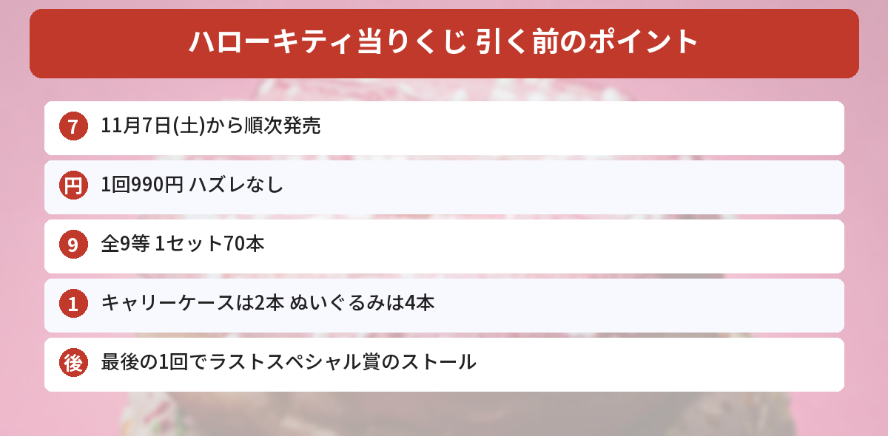

## この記事で分かること

キティちゃんの当りくじが明日から出るんだって！何が当たるの？


11月7日（土）発売で、1回990円。ハズレなしで、いちばん上はキャリーケースだよ。1セットに何本ずつ入っているかも一緒に見ていこう。


ハズレなしのくじ「**サンリオ当りくじ**」に、**ハローキティ**が登場します。赤いタータンチェック「Hello Kitty Red」を取り入れたデザインです。

この記事では、[サンリオ公式の発表](https://www.sanrio.co.jp/news/goods/kt-atarikuji-20261029/)をもとに、値段、賞品、売っている場所をまとめます（2026年11月6日に確認）。



---
## 公式情報

サンリオ当りくじ公式Xの発表です。

---
## 発売日と値段

- **発売日**：2026年11月7日（土）から順次
- **値段**：1回990円（税込）
- **売っている場所**：全国のサンリオショップ、コンビニエンスストアほか
- **ハズレ**：なし（必ずどれかの賞品が当たる）


始まる日はお店によってちがいます。取り扱いのないお店もあります。

---
## 賞品と本数（1セットあたり）
| 等 | 賞品 | 本数 |
|---|---|---|
| 1 | キャリーケース | 2本 |
| 2 | ぬいぐるみ | 4本 |
| 3 | アクセサリーケース | 6本 |
| 4 | マスコット | 10本 |
| 5 | マグカップ | 8本 |
| 6 | ミニトート | 10本 |
| 7 | リップホルダー | 10本 |
| 8 | ハンドタオル | 10本 |
| 9 | ノート | 10本 |
| | **合計** | **70本** |

本数は、くじが始まったときの数です。


キャリーケースは70本中2本だけなんだね…。


始まったばかりのときは、1回で当たる確率は単純に35分の1だね。ぬいぐるみまで入れると、70本中6本だよ。



### ラストスペシャル賞
**最後のくじを引いた人**には、もれなく「**ストール**」がもらえます。残りが少なくなったお店で、全部引ききると手に入ります。

---
## 引く前に知っておきたいこと
- お店によって、始まる日や入荷する日がちがいます。**もう売り切れている**こともあります
- 公式は、**お店への問い合わせはひかえる**よう案内しています
- 残っている賞品は、お店の**残り本数の表示**で確かめられることが多いです
- 品切れの場合はご容赦ください、と案内されています

---
## サンリオのほかの新商品もチェック
11月12日発売の[クリスマスデザインシリーズの記事](/posts/sanrio-christmas-design-series-2026/)でも、サンリオの新商品を紹介しています。発売日やしめきりは[発売日カレンダー](/calendar/)にまとめています。

---
## よくある質問（FAQ）
### Q: いつから引けますか？
A: 2026年11月7日（土）から順次です。お店によって始まる日がちがいます。

### Q: 1回いくらですか？
A: 990円（税込）です。

### Q: ハズレはありますか？
A: ありません。1回ごとに、キャリーケースからノートまでのどれかが必ず当たります。

### Q: どこで引けますか？
A: 全国のサンリオショップ、コンビニエンスストアほかです。取り扱いのないお店もあります。

### Q: ラストスペシャル賞は何ですか？
A: そのお店で最後のくじを引いた人がもらえる「ストール」です。

---

赤いチェックのキティちゃん、かわいい！ミニトートかマグカップがほしいな。


お店によって始まる日がちがうから、近くのサンリオショップやコンビニをのぞいてみてね。


## まとめ
- ハローキティのサンリオ当りくじは、2026年11月7日（土）から順次発売
- 1回990円（税込）、ハズレなし
- 賞品は全9等で1セット70本。キャリーケースは2本、ぬいぐるみは4本
- 最後の1回を引いた人には、ラストスペシャル賞の「ストール」
- サンリオショップ、コンビニエンスストアほかで発売。始まる日はお店ごとにちがう

---
### あわせて読みたい
- [【サンリオ】クリスマスデザインシリーズ2026は11/12発売！値段・全7アイテム・個数制限まとめ](/posts/sanrio-christmas-design-series-2026/)
- [【サンリオ】ミニチュアチャームのガシャポン2種！実写版は10月第4週から・値段と全種類まとめ](/posts/sanrio-miniature-charm-2026-10/)
