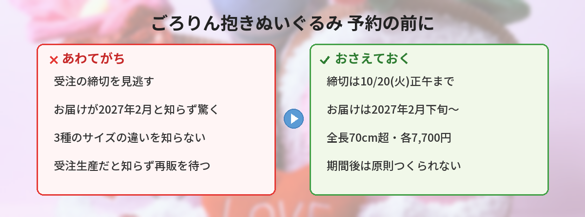

## この記事で分かること


まじかるちいかわの、70cmもある大きいぬいぐるみが出るって本当？どこで買えるの？



本当だよ！「ちいかわマーケット」での受注予約で、締切が10月20日のお昼なの。急がないと間に合わないから、ポイントを整理するね。


10月13日の夜、ちいかわ公式通販「ちいかわマーケット」のXが新商品を発表しました。発表のポストには、公開から1日ほどで約3.8万のいいねが集まっています。

話題になっているのは、「まじかるちいかわ ふんわりもっちり ごろりん抱きぬいぐるみ（全3種）」。全長70cmを超える特大サイズのぬいぐるみです。この記事では、3種類の違い、価格、お届け時期、そして受注生産ならではの注意点をまとめます。「いつまでに買えばいい？」「いつ届く？」という疑問に答えていきます。



---

## 公式情報



発売元は、ちいかわグッズでおなじみのグレイ・パーカー・サービスです。公式通販「ちいかわマーケット」の限定商品として、受注予約を受け付けています。詳しい商品情報は、公式のプレスリリースでも公開されています。

---

## 基本情報


- **商品名**：まじかるちいかわ ふんわりもっちり ごろりん抱きぬいぐるみ（全3種）
- **価格**：各7,700円（税込）
- **サイズ**：全長70cmを超える特大サイズ
- **素材**：ポリエステル、ポリウレタン
- **受注期間**：2026年10月13日（火）18時 〜 10月20日（火）正午12時
- **販売場所**：ちいかわ公式WEB SHOP「ちいかわマーケット」（オンライン限定）
- **お届け**：2027年2月下旬頃より順次発送予定（状況により変更の場合あり）


いちばん大事なのは、**受注の締切が10月20日（火）の正午12時**だということです。この時間を過ぎると、原則として買えなくなります。

---

## どんなぬいぐるみ？「マジカルシンドローム」のあの3人

今回のぬいぐるみは、スペシャルミュージックビデオ「マジカルシンドローム」に登場して話題になった3人がモデルです。「強くなったハチワレ」「強くなったうさぎ」「あのこ」が、巨大な抱きぬいぐるみになりました。

3種とも、丸い顔から胴体が後ろへ長く伸びていて、前脚を顔の左右に出したうつぶせの姿です。抱っこしたり、膝にのせたりして、ふんわりもっちりとしたなで心地を楽しめます。お部屋に置くだけでも存在感があります。


70cmって、どのくらい大きいの？



横になった人の、胸からお腹にのせられるくらいだよ。抱き枕みたいな感じかな。3種類で少しずつ形が違うから、次で紹介するね。


---

## 3種類のサイズと特徴

公式のプレスリリースをもとに、3種の違いを表にまとめました。

| 種類 | サイズ（約） | 見た目の特徴 |
|------|------|------|
| 強くなったハチワレ | H340×W300×D700mm | 白い胴体に青灰色の頭と三角の耳。前脚に青い爪、長い胴体と青い尾 |
| 強くなったうさぎ | H300×W300×D700mm | 淡い黄色の体に垂れた長い耳。オレンジの爪、白い丸い尾 |
| あのこ | H250×W300×D750mm | 白い丸顔に額のオレンジの角。背中の突起、灰色の長い尾 |

どれも全長70cm超ですが、高さや形は少しずつ違います。「強くなったハチワレ」は背が高め、「あのこ」は横に長めです。好きなキャラクターで選ぶのはもちろん、置き場所に合わせて選ぶのもよさそうです。

---

## 独自の視点・買うときの注意点

### 1. まずは締切（10月20日正午）を死守する

今回は受注予約です。**10月20日（火）の正午12時を過ぎると、原則として注文できません**。「あとで買おう」と思っているうちに締切、というのが一番もったいないパターンです。欲しい種類が決まっているなら、早めに注文しておくと安心です。

ちいかわマーケットの新商品は売り切れが続くことが多く、[ちいぽけ公式グッズ第4弾](/posts/chiikawa-pocket-goods-vol4-2026/)のときも販売開始直後から話題になっていました。

### 2. お届けは2027年2月下旬〜。すぐには届かない

受注生産のため、手元に届くのは**2027年2月下旬頃から順次**です。注文してから約4か月先になります。「クリスマスに飾りたい」といった用途には間に合わないので、お届け時期を踏まえて注文しましょう。

### 3. 受注生産＝期間を逃すと基本つくられない

受注生産は、予約を受けた分だけを生産する仕組みです。そのため、締切後に「やっぱり欲しい」と思っても、再販されるとは限りません。気になっているなら、受注期間中に決めるのが基本です。

### 4. 置き場所と送料も考えておく

全長70cm超は、思っているより大きいです。3種そろえると、かなりのスペースを使います。飾る場所をイメージしてから選ぶと、届いてから困りません。送料や支払い方法は、注文前にちいかわマーケットの案内で確認してください。

---

## SNSでの反応

発表のポストには、1日ほどで約3.8万のいいね、約1.3万のリポストが集まりました（10月14日時点）。別の告知ポストでは「約70cmの巨大な毛玉」「お部屋にいるだけで圧迫感」と、大きさをネタにした紹介もされています。

Xでは、こんな声が見られました。

- 大きすぎて最高、お迎えしたい
- 「マジカルシンドローム」のあの3人がぬいぐるみに
- 置き場所をどうするか本気で悩む
- お届けが2027年2月なの、気長に待つ
- 3種そろえると7,700円×3でなかなかのお値段

「大きさ」への驚きと、「置き場所」への悩みがセットで語られているのが印象的でした。

---

## よくある質問（FAQ）

### Q: いつまでに予約すればいいですか？
A: 2026年10月20日（火）の正午12時までです。受注予約なので、この時間を過ぎると原則として注文できません。

### Q: どこで買えますか？
A: ちいかわ公式WEB SHOP「ちいかわマーケット」の限定商品です。店頭やほかの通販では購入できません。

### Q: いつ届きますか？
A: 2027年2月下旬頃から順次発送の予定です（状況により変わる場合があります）。注文からお届けまで、約4か月かかります。

### Q: 値段はいくらですか？
A: 全3種とも、各7,700円（税込）です。3種そろえると23,100円になります。

### Q: 締切を過ぎたら、もう買えませんか？
A: 受注生産のため、締切後の再販は未定です。確実に欲しい場合は、受注期間中に注文するのが安心です。

---


10月20日のお昼までに予約、届くのは来年の2月なんだね。置き場所、ちゃんと考えてから決める！



そうそう、受注生産だから締切を逃さないことがいちばん大事だよ。大きさもしっかりあるから、お迎えする前に飾る場所をイメージしておくといいね。


## まとめ

- まじかるちいかわ「ごろりん抱きぬいぐるみ（全3種）」が、ちいかわマーケットで受注予約中
- 「強くなったハチワレ」「強くなったうさぎ」「あのこ」の3種、各7,700円（税込）
- 全長70cmを超える特大サイズ。3種で高さや形が少しずつ違う
- 受注は2026年10月20日（火）正午12時まで。お届けは2027年2月下旬頃から
- 受注生産なので、締切を過ぎると原則つくられない。置き場所も考えて選ぶ

---
### あわせて読みたい
- [【ちいぽけ】グッズ第4弾10/24発売！お弁当・お店屋さんとポップアップ情報](/posts/chiikawa-pocket-goods-vol4-2026/)
- [映画ちいかわ「人魚の島のひみつ」7月24日公開！あらすじ・前売り券・最新情報まとめ](/posts/chiikawa-movie-mermaid-island-2026/)

<!-- affiliate -->
## 関連リソース

「まじかるちいかわ」の世界をもっと楽しみたい方に、関連グッズを選びました。

**ちいかわ なんか小さくてかわいいやつ（1）**（ナガノ／講談社） 
「まじかるちいかわ」の元になった、ちいかわたちの物語を最初から読める原作コミックスの第1巻です。

- <a href="https://af.moshimo.com/af/c/click?a_id=5490814&amp;p_id=54&amp;pc_id=54&amp;pl_id=27059&amp;url=https%3A%2F%2Fitem.rakuten.co.jp%2Fbook%2F16589257%2F" rel="nofollow sponsored noopener" referrerpolicy="no-referrer-when-downgrade" target="_blank">ちいかわ なんか小さくてかわいいやつ（1）（楽天市場）</a>
- <a href="https://af.moshimo.com/af/c/click?a_id=5490817&amp;p_id=170&amp;pc_id=185&amp;pl_id=27060&amp;url=https%3A%2F%2Fwww.amazon.co.jp%2Fdp%2F4065223962" rel="nofollow sponsored noopener" referrerpolicy="no-referrer-when-downgrade" target="_blank">ちいかわ なんか小さくてかわいいやつ（1）（Amazon）</a>
<!-- /affiliate -->
