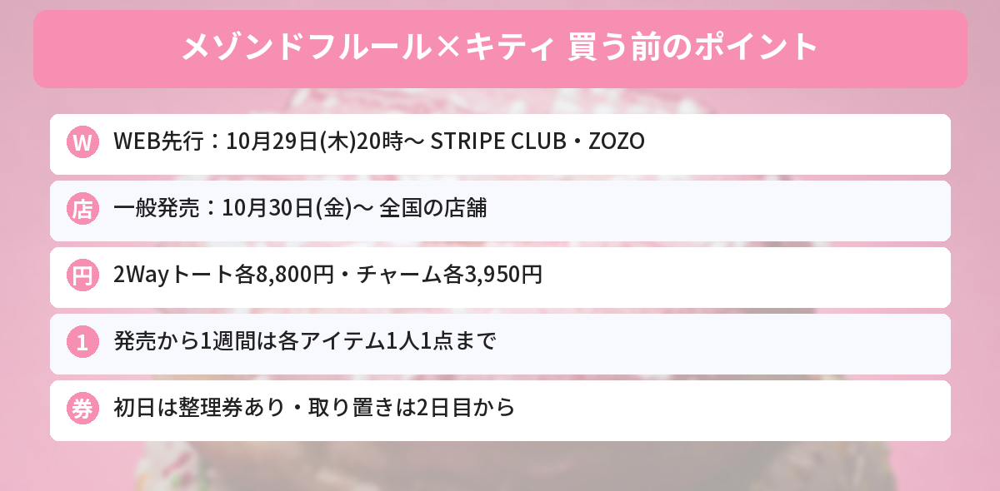

## この記事で分かること

メゾンドフルールのキティちゃんコラボ、タイニーチャムとおそろいなの！？いつ買えるの？


そうなんだ。ギンガムチェックのリボンがおそろいの、バッグとチャームの全4型だよ。通販は**今日10月29日（木）の20時から**先行販売、お店は**10月30日（金）から**。1人1点までの制限もあるから、先にチェックしておこう。


ギフトブランドの「Maison de FLEUR（メゾン ド フルール）」から、11月1日にお誕生日をむかえるハローキティと、お友だちのタイニーチャムのコラボアイテムが登場します。

この記事では、サンリオ公式サイトの発表をもとに、発売日、値段、売っている場所、買うときの注意点をまとめます。



---
## 公式情報

Maison de FLEUR公式Xの、WEB先行販売のお知らせです。ハローキティとタイニーチャムが、おそろいのギンガムチェックのリボンをつけています。

---
## 発売日と売っている場所
| 販売 | 日時 | 場所 |
|---|---|---|
| 店舗の先行販売 | 10月28日（水）〜 | ラフォーレ原宿店（東京） |
| **WEB先行販売** | **10月29日（木）20:00〜** | 公式通販「STRIPE CLUB」、ZOZOTOWN |
| **一般発売** | **10月30日（金）〜** | 全国のMaison de FLEUR店舗 |

---
## ラインナップと値段（全4型）

- **ハローキティ 2Wayトートバッグ**（White）：8,800円
- **タイニーチャム 2Wayトートバッグ**（Beige）：8,800円
- **ハローキティ チャーム**（White）：3,950円
- **タイニーチャム チャーム**（Beige）：3,950円
- ※すべて税込み価格


### 2Wayトートバッグ
ふわふわの**ファー素材**に、キャラクターの顔を**刺しゅう**で表したトートバッグです。ショルダーストラップつきの**2Way**なので、手で持っても、肩にかけても使えます。ハローキティは白、タイニーチャムはベージュです。

### チャーム
ギンガムチェックのリボンと襟に、**ピンクのチュチュ**を合わせたぬいぐるみのチャームです。足の裏には、Maison de FLEURの頭文字「F」の刺しゅうが入っています。


キティちゃんとタイニーチャムのチャーム、並べたらかわいすぎる…！バッグにつけておそろいにしたい。


わかる。ちなみにタイニーチャムは、キティのまねをしてリボンをつけているくまのお友だちなんだ。おそろいなのはそういう理由もあるよ。


---
## 買うときの注意点
### 1人1点まで（発売から1週間）
発売日から1週間は、お会計に並んだ本人だけ、**各アイテム1点まで**です。何人分かまとめてのお会計や、並び直しはできません。

### 発売初日は整理券
- 発売初日は、オープンの15分前から**シャッフル整理券**が配られます
- タカシマヤゲートタワーモール店とイオンモール岡崎店は9時30分から、ラフォーレ原宿店は10時30分から配られます
- くわしくは、各店のスタッフInstagramで案内される予定です

### お取り置き・お取り寄せ
- **発売初日のお取り置きはできません**（2日目からはできます）
- ほかのお店からの**お取り寄せはできません**

---
## キティちゃんのお誕生日情報もチェック
11月1日のお誕生日に向けたイベントやグッズは、[HELLO KITTY WEEK 2026まとめ](/posts/hello-kitty-week-2026/)で紹介しています。発売日は[発売日カレンダー](/calendar/)にもまとめています。

---
## よくある質問（FAQ）
### Q: 通販ではいつから買えますか？
A: 2026年10月29日（木）20時から、公式通販「STRIPE CLUB」とZOZOTOWNで先行販売です。

### Q: お店ではいつ発売ですか？
A: 10月30日（金）から全国のMaison de FLEUR店舗で発売です。ラフォーレ原宿店では10月28日（水）から先行販売しています。

### Q: 値段はいくらですか？
A: 2Wayトートバッグが各8,800円、チャームが各3,950円（どちらも税込）です。

### Q: いくつまで買えますか？
A: 発売日から1週間は、各アイテム1人1点までです。並び直しやまとめてのお会計はできません。

### Q: 取り置きはできますか？
A: 発売初日はできません。2日目からはできます。ほかのお店からの取り寄せはできません。

---

通販は今夜20時から、お店は明日から。各1点までだね！


うん。お店で買うなら、初日は整理券の時間に気をつけてね。


## まとめ
- Maison de FLEUR × ハローキティ＆タイニーチャムのコラボは全4型
- 2Wayトートバッグ各8,800円、チャーム各3,950円（税込）
- WEB先行は10月29日（木）20時から（STRIPE CLUB・ZOZOTOWN）、一般発売は10月30日（金）から全国の店舗
- 発売から1週間は各アイテム1人1点まで。初日は整理券あり、取り置き不可
- 11月1日のハローキティのお誕生日を祝うコラボ

---
### あわせて読みたい
- [【11月1日】ハローキティのお誕生日！HELLO KITTY WEEK 2026まとめ](/posts/hello-kitty-week-2026/)
- [【サンリオ大賞】キラキラツインチャーム10/26発売！全20種・429円・どこで買える？](/posts/sanrio-character-award-twin-charm-2026/)
