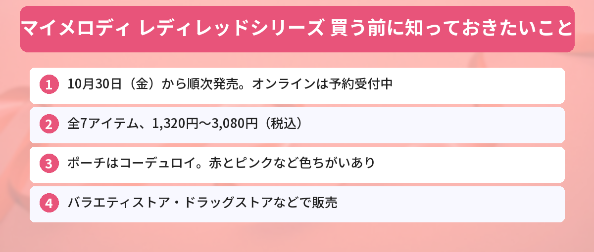

## この記事で分かること

赤いマイメロのポーチがかわいいって、サンリオの公式Xで話題になってたよ！いつ、どこで買えるの？


粧美堂の「レディレッドシリーズ」だね。10月30日（金）から、全国のバラエティストアやドラッグストアなどで順次発売だよ。オンラインストアでは今、予約もできるんだ。全7アイテムの値段をまとめるね！


化粧雑貨やキャラクター雑貨をつくる粧美堂（しょうびどう）から、マイメロディの新しい雑貨シリーズが登場します。テーマは、**赤ずきん姿のマイメロディ**。こっくりとした深い赤と、ちょっぴりレトロなデザインが特徴です。

サンリオ公式のXで紹介されたポストには、8,000件を超えるいいねが集まっています（10月22日時点）。この記事では、粧美堂とサンリオの公式発表をもとに、発売日、全アイテムの値段、買える場所をまとめます。



---
## 公式情報

サンリオ公式のXでは、粧美堂のオンラインストアで予約を受け付けていて、全国のバラエティストアなどでは10月30日（金）から順次発売されると案内されています。

---
## 基本情報

- **発売日**：2026年10月30日（金）から順次
- **発売元**：粧美堂
- **アイテム数**：全7アイテム（色や柄ちがいあり）
- **価格**：1,320円〜3,080円（税込）
- **買える場所**：全国のバラエティストア、ディスカウントストア、ドラッグストア、粧美堂公式オンラインストア
- **オンライン**：予約受付中（10月30日以降に順次発送）


---
## 全アイテムと値段
粧美堂の発表に載っている商品と価格（税込）です。

### ポーチ（コーデュロイ生地）
| 商品名 | 種類 | 価格 |
|------|------|------|
| ティッシュポーチ | red／pink | 各2,420円 |
| 巾着ポーチ | red／pink | 各2,420円 |
| ハートミニポーチ | 1種 | 2,530円 |

ポーチ類は、秋らしい**コーデュロイ生地**を使っています。ティッシュポーチと巾着ポーチは、赤とピンクの2色から選べます。

### ヘアアクセサリー
| 商品名 | 種類 | 価格 |
|------|------|------|
| ヘアクリップ | フェイス／お洋服屋 | 各1,320円 |
| バンスクリップ | red／white | 各2,200円 |

ヘアクリップには、リボンやパールがついています。

### チャーム・キーホルダー
| 商品名 | 種類 | 価格 |
|------|------|------|
| キーホルダー | red／white | 各1,760円 |
| マスコットチャーム | 1種 | 3,080円 |

マスコットチャームは、表と裏でちがう姿が楽しめるデザインです。


ヘアクリップの「お洋服屋」ってどんなデザインなんだろう…！色も赤とピンクで迷っちゃう。


色ちがいは画像で見比べるのがいちばんだね。粧美堂のオンラインストアに商品ごとの写真が出ているから、見てから選ぶと安心だよ。


---
## どこで買える？
### お店で買う
**全国のバラエティストア、ディスカウントストア、ドラッグストア**などで、10月30日（金）から順次発売です。粧美堂は「一部の店舗では発売日が異なる場合がある」としています。お店によって入荷の日や品ぞろえがちがうので、行く前にお店に確かめると確実です。

### オンラインで買う
**粧美堂公式オンラインストア**では、すでに予約を受け付けています。発送は**10月30日以降に順次**です。

---
## 買う前の注意点
- 発売日は「10月30日から**順次**」。お店によっては少し遅れて並ぶこともあります
- 色や柄のちがいがある商品は、どれがほしいか先に決めておくとスムーズです
- 公式の写真はイメージです。実物の色味は少しちがって見えることがあります

サンリオのほかの新作は、[サンリオ パーティランドの記事](/posts/sanrio-party-land-2026/)や、11月1日のハローキティのお誕生日に合わせた[HELLO KITTY WEEK 2026まとめ](/posts/hello-kitty-week-2026/)でも紹介しています。発売日は[発売日カレンダー](/calendar/)にもまとめています。

---
## よくある質問（FAQ）
### Q: マイメロディ レディレッドシリーズはいつ発売ですか？
A: 2026年10月30日（金）から順次発売されます。粧美堂のオンラインストアでは予約を受け付けています。

### Q: 値段はいくらですか？
A: 1,320円（ヘアクリップ）から3,080円（マスコットチャーム）までです（税込）。

### Q: どこで買えますか？
A: 全国のバラエティストア、ディスカウントストア、ドラッグストアのほか、粧美堂公式オンラインストアで買えます。

### Q: 全部で何種類ありますか？
A: ティッシュポーチ、巾着ポーチ、ハートミニポーチ、ヘアクリップ、バンスクリップ、キーホルダー、マスコットチャームの全7アイテムです。色や柄のちがいがあるものもあります。

### Q: オンラインで予約した商品はいつ届きますか？
A: 10月30日以降に順次発送されます。

---

10月30日から順次発売で、オンラインならもう予約できるんだね！赤ずきんのマイメロ、秋にぴったり。


うん。ポーチはコーデュロイだから、冬まで長く使えそうだね。ほしい色を決めて、早めにチェックしてみて！


## まとめ
- 粧美堂の「マイメロディ レディレッドシリーズ」は2026年10月30日（金）から順次発売
- 赤ずきん姿のマイメロディがテーマの、レトロでかわいい全7アイテム
- 価格は1,320円〜3,080円（税込）。ポーチはコーデュロイ生地
- 全国のバラエティストア・ディスカウントストア・ドラッグストアと、粧美堂公式オンラインストアで販売
- オンラインストアは予約受付中で、10月30日以降に順次発送

---
### あわせて読みたい
- [【サンリオ パーティランド】10/29発売！値段・限定セット・何人で遊べる？](/posts/sanrio-party-land-2026/)
- [【11月1日】ハローキティのお誕生日！HELLO KITTY WEEK 2026まとめ](/posts/hello-kitty-week-2026/)
