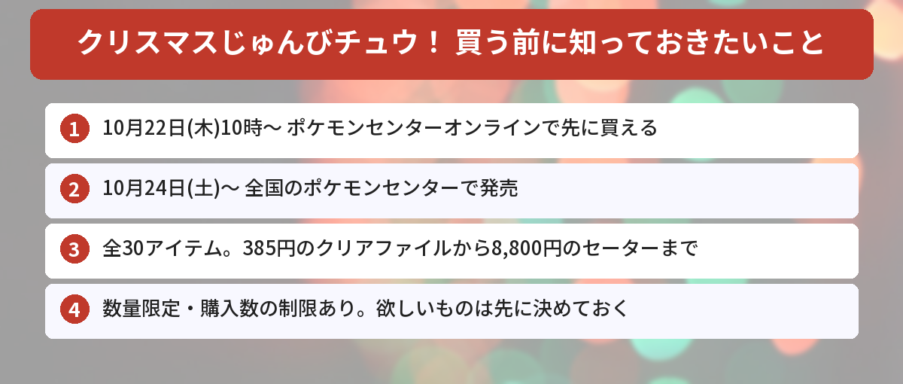

## この記事で分かること


ポケモンセンターのクリスマスグッズが出るって見たよ！モジャンボのセーターがすごいって話題だけど、いつ発売なの？



お店では10月24日（土）発売で、ポケモンセンターオンラインなら10月22日（木）10時から先に買えるよ。全30点あるから、値段と買い方をまとめるね！


ポケモンセンターに、今年のクリスマスグッズ「クリスマスじゅんびチュウ！」が登場します。アートに描かれているのは、ピカチュウたちがクリスマスの準備をお手伝いしているようす。ツリーごっこをするモジャンボや、ソリを引くドオーなど、ほのぼのしたデザインです。

ポケモンセンターの公式Xが紹介したポストには、1万件を超えるいいねが集まりました（10月19日時点）。この記事では、ポケモン公式サイトの発表をもとに、発売日、全ラインナップと値段、買うときの注意点をまとめます。



---

## 公式情報



公式Xでは、小さなフロッキードールの「ふわふわドール」（全5種類のピカチュウ）が紹介されています。

---

## 基本情報


- **発売日**：2026年10月24日（土）
- **オンライン先行**：ポケモンセンターオンラインで10月22日（木）10時から
- **販売店舗**：全国のポケモンセンター（ポケモンセンターヨコハマサテライトでの取り扱いは未定）
- **ラインナップ**：ぬいぐるみ、マスコット、セーター・カーディガン、文房具、雑貨など全30点（サイズちがいを含む）
- **価格**：385円〜8,800円（税込）


---

## 全ラインナップと値段

ポケモン公式サイトで発表されている商品と価格（税込）です。

### ぬいぐるみ・マスコット

| 商品名 | 価格 |
|------|------|
| プレゼントお届けチュウぬいぐるみ ピカチュウ ドオー | 5,500円 |
| もちふわぬいぐるみ ツリーごっこピカチュウ | 4,400円 |
| マスコット ピカチュウ つまみぐい | 2,200円 |
| マスコット ピカチュウ ゆきまみれ | 2,200円 |
| マスコット ピカチュウとポリゴン2のおもちゃ | 2,200円 |
| ふわふわドール | 880円 |

### 身につけるもの

| 商品名 | 価格 |
|------|------|
| クリスマスセーター モジャンボ（M・L） | 各8,800円 |
| クリスマスカーディガン マッギョ（M・L） | 各8,800円 |
| フード付きマフラー ピカチュウ | 4,400円 |
| パーティーカチューシャ モジャンボ | 2,640円 |
| ヘアピン | 1,760円 |
| ピアス／イヤリング ピカチュウゆきだるま&オーナメント | 各1,320円 |
| ピカみみサンタ帽キーホルダー | 825円 |

### 雑貨・飾り

| 商品名 | 価格 |
|------|------|
| 卓上ミラーボール ズガドーン | 6,600円 |
| ブランケット入りクッション | 3,960円 |
| 蓋付きマグカップ | 3,630円 |
| アドベントボックス | 3,080円 |
| ポーチ | 2,420円 |
| ビッグ巾着 | 1,980円 |
| ガーランド | 1,320円 |
| オーナメントコレクション | 825円 |
| ロゴピンズ | 770円 |

### 文房具

| 商品名 | 価格 |
|------|------|
| メッセージカード | 990円 |
| キラキラぷっくりシール | 825円 |
| ミニカードセット ピカチュウ | 550円 |
| ミニカードセット ピカチュウとパルデアウパー | 550円 |
| A4クリアファイル | 385円 |

※商品名の「クリスマスじゅんびチュウ！」の部分は省略しています。

---

## 話題のアイテム

### モジャンボのセーターとマッギョのカーディガン

今回いちばん話題になっているのが、身につけるアイテムです。モジャンボのクリスマスセーターは、モヘア素材のふわふわした袖がポイント。マッギョのカーディガンは、公式も「大胆なデザインが目を引く」と紹介しています。クリスマスパーティーで、主役になれそうです。


マッギョのカーディガン、インパクトがすごいね！



SNSでも「衝撃的」「着てみたい」って声がたくさん出てたよ。サイズはMとLの2つだから、自分のサイズを先に確かめておこうね。


### 光ってまわるズガドーンのミラーボール

ズガドーン風デザインの卓上ミラーボールは、光ってまわる仕様です。パーティーの飾りにぴったりです。

### クリスマスまでを楽しむアドベントボックス

アドベントボックスは、クリスマスまでの日にちを数えながら楽しめるアイテムです。12月が待ち遠しくなりそうです。

---

## 独自の視点・買い逃さないためのコツ

### 1. 早く欲しいならオンラインの10月22日10時

お店の発売は10月24日ですが、ポケモンセンターオンラインでは2日早い10月22日（木）10時から取り扱いが始まります。お店に行けない人や、確実に手に入れたい人は、オンラインの開始時間をねらいましょう。

### 2. 数量限定・購入数の制限あり

公式の注意事項では、数量に限りがあること、購入数を制限する場合があることが案内されています。店舗によって取り扱う商品や在庫の数もちがいます。欲しいアイテムは先に決めておくと安心です。

### 3. 後日ほかの場所で売られる可能性も

公式によると、後日、ポケモンセンターヨコハマサテライト、ポケモンストア、Amazon.co.jpの「ポケモンストア」、イベント会場などで取り扱う可能性があります。発売日に買えなくても、すぐに高い転売品を買わず、公式の案内を待つのがおすすめです。

### 4. 予算を決めておく

全部そろえると、かなりの金額になります。セーターやカーディガンは1着8,800円、ミラーボールは6,600円です。ふわふわドール（880円）やクリアファイル（385円）など手に取りやすいものもあるので、予算に合わせて選びましょう。

### 5. クリスマスはほかのキャラクターも盛りだくさん

この冬は、[ちいかわのクリスマスイベント](/posts/chiikawa-christmas-2026/)など、ほかのキャラクターのクリスマス企画も続きます。予定と予算を早めに立てておくと、慌てずに楽しめます。

---

## SNSでの反応

発表のあと、Xではこんな声が見られました。

- まだ10月なのに、もうクリスマスグッズ！
- ツリーごっこのピカチュウがかわいすぎる
- モジャンボのセーターとマッギョのカーディガン、どっちも気になる
- サンタより先にお財布が飛んでいきそう

ピカチュウのかわいさと、モジャンボ・マッギョのインパクトの両方が話題になっています。

---

## よくある質問（FAQ）

### Q: クリスマスじゅんびチュウ！はいつ発売ですか？
A: 全国のポケモンセンターで2026年10月24日（土）に発売です。ポケモンセンターオンラインでは、10月22日（木）10時から取り扱いが始まります。

### Q: どこで買えますか？
A: 全国のポケモンセンターとポケモンセンターオンラインです。ポケモンセンターヨコハマサテライトでの取り扱いは未定です。

### Q: 値段はいくらですか？
A: 385円（A4クリアファイル）から8,800円（セーター・カーディガン）までです（税込）。

### Q: セーターのサイズはありますか？
A: モジャンボのセーターとマッギョのカーディガンは、MとLの2サイズです。

### Q: 売り切れたら、もう買えませんか？
A: 公式によると、後日ポケモンストアやAmazon.co.jpの「ポケモンストア」などで取り扱う可能性があります。公式の案内を確認してください。

---


オンラインは10月22日の10時、お店は10月24日なんだね！ツリーごっこのピカチュウ、ねらってみる！



いいね！数量限定だから、欲しいものを決めておくのが大事だよ。売り切れても、あわてて転売品を買わないようにね。


## まとめ

- ポケモンセンターのクリスマスグッズ「クリスマスじゅんびチュウ！」が2026年10月24日（土）発売
- ポケモンセンターオンラインは10月22日（木）10時から先行
- 全30点（サイズちがいを含む）、価格は385円〜8,800円（税込）
- モジャンボのセーターとマッギョのカーディガン、ズガドーンのミラーボールが話題
- 数量限定・購入数の制限あり。後日ほかの場所で売られる可能性もある

---
### あわせて読みたい
- [【ちいかわ】クリスマス2026まとめ！パークとクリスマスマーケット、抽選は10/25まで](/posts/chiikawa-christmas-2026/)
- [【ポムポムプリン】VTコスメとコラボ！10/23からQoo10・楽天で先行発売](/posts/vt-pompompurin-2026/)
