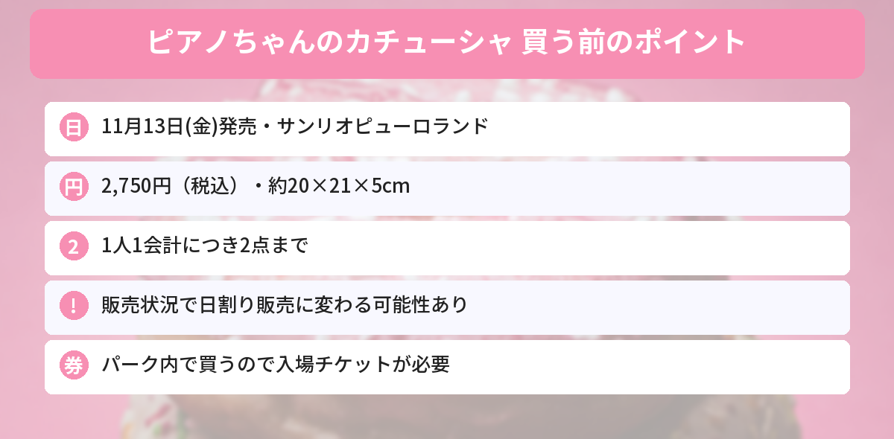

## この記事で分かること

ピューロランドで、ピアノちゃんのカチューシャが出るって！春に出たのは買えなかったから、今度こそほしい…。いつ発売なの？


**11月13日（金）発売**で、値段は**2,750円**だよ。**1会計2点まで**の制限があって、売れ方によっては**日ごとに数を分けて売る**こともあるみたい。順番に見ていこう。


サンリオピューロランドの「エンジョイグッズ」に、マイスウィートピアノのカチューシャが登場します。マイメロディのお友だちで、ピンクのひつじの女の子「ピアノちゃん」のカチューシャです。

ピアノちゃんのカチューシャは、春のイベント「PURO SPRING PARTY」のときにも出ていて、フリマアプリでは今も出品が見られる人気アイテムです。この記事では、ピューロランド公式サイトの商品ページをもとに、発売日、値段、買うときの注意点をまとめます。



---
## 基本情報

- **発売日**：2026年11月13日（金）
- **価格**：2,750円（税込）
- **大きさ**：約20×21×5cm
- **購入制限**：1人1会計につき2点まで
- **売っている場所**：サンリオピューロランド


---
## 買うときの注意点
### 1会計2点まで
1人1回のお会計で買えるのは**2点まで**です。友だちの分もまとめて、というときは気をつけてください。

### 日ごとに数を分けて売る可能性
公式サイトでは、「販売状況により、**日割りでの販売に変更する可能性**がある」と案内されています。日割りになると、1日に売る数が決まるので、夕方に行くと売り切れていることも考えられます。

### 売り切れになることも
商品は予告なく品切れ・完売になることがあります。発売直後は人気が集中しやすいので、ほしい人は**早い時間に行く**のがおすすめです。

### パークの中で買う
ピューロランドのグッズは、パークの中のショップで売られます。入るには**入場チケット**が必要なので、行く日を決めたら先にチケットを用意しておきましょう。どのショップで売るかは、公式サイトの商品ページで確かめてください。


春のときは買えなかったから、今回は発売日に行きたい！


11月13日は金曜日だから、平日に行ける人はチャンスかも。日割りになったときのために、朝早めに行くと安心だよ。


---
## マイスウィートピアノってどんな子？
マイスウィートピアノは、マイメロディのいちばんの仲よしで、ピンクのひつじの女の子です。2026年のサンリオキャラクター大賞では、昨年の18位から**13位**に上がり、TOP20の中でいちばん大きくランクアップしました。

サンリオキャラクター大賞のグッズは[キラキラツインチャームの記事](/posts/sanrio-character-award-twin-charm-2026/)、ピアノちゃんも入ったガシャポンは[ミニチュアチャームの記事](/posts/sanrio-miniature-charm-2026-10/)で紹介しています。発売日は[発売日カレンダー](/calendar/)にまとめています。

---
## よくある質問（FAQ）
### Q: マイスウィートピアノのカチューシャはいつ発売ですか？
A: 2026年11月13日（金）から、サンリオピューロランドで発売です。

### Q: 値段はいくらですか？
A: 2,750円（税込）です。

### Q: いくつまで買えますか？
A: 1人1会計につき2点までです。販売状況により、日ごとに数を分けて売る形に変わる可能性があります。

### Q: 通販で買えますか？
A: 公式サイトでは、ピューロランドのショップでの販売として案内されています。通販についての案内はありません。

### Q: 大きさはどれくらいですか？
A: 約20×21×5cmです。

---

11月13日発売、2,750円で1会計2点まで。チケットも先に用意しておく！


うん。行く前に、公式サイトで販売状況が変わっていないかも見ておこうね。


## まとめ
- サンリオピューロランドで「マイスウィートピアノ カチューシャ」が2026年11月13日（金）発売
- 価格は2,750円（税込）、大きさは約20×21×5cm
- 1人1会計につき2点まで。販売状況で日割り販売に変わる可能性あり
- パーク内で買うので、入場チケットが必要
- 予告なく品切れになることがあるので、早めの時間がおすすめ

---
### あわせて読みたい
- [【サンリオ】ミニチュアチャームのガシャポン2種！実写版は10月第4週から・値段と全種類まとめ](/posts/sanrio-miniature-charm-2026-10/)
- [【サンリオ大賞】キラキラツインチャーム10/26発売！全20種・429円・どこで買える？](/posts/sanrio-character-award-twin-charm-2026/)
