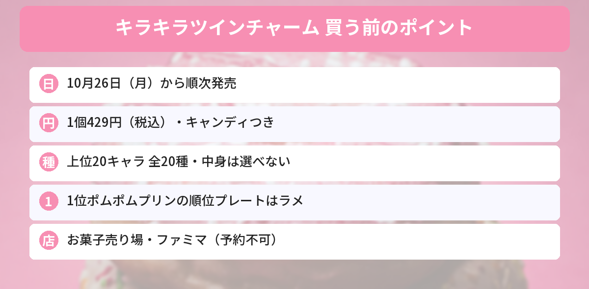

## この記事で分かること

サンリオキャラクター大賞のチャームが出るって聞いたよ！いつ、どこで買えるの？


「2026年サンリオキャラクター大賞 キラキラツインチャーム」は、10月26日（月）から順次発売だよ。1個429円（税込）で、上位20キャラの全20種。何が出るかは開けてのお楽しみなんだ。


2026年サンリオキャラクター大賞で上位に入った20キャラクターが、順位プレートつきのチャームになります。発売元はタカラトミーアーツで、キャンディがついた「食玩」です。サンリオ公式ニュースXの発売告知ポストは、いいね2,000件を超えました（10月24日時点）。

この記事では、タカラトミーアーツ・ファミリーマート・サンリオの発表をもとに、発売日、値段、中身、売っている場所と注意点をまとめます。



---
## 公式情報

サンリオ公式ニュースXの告知ポストです。キャラクターのアクリルと、順位が入ったプレートが2つ並んだツインチャームになっています。

---
## 基本情報

- **発売日**：2026年10月26日（月）から順次 ※お店によって発売日・時間がちがいます
- **価格**：1個429円（税込）
- **中身**：アクリルキーホルダー（ツインチャーム）1個＋キャンディ
- **種類**：全20種（2026年サンリオキャラクター大賞の上位20キャラ）
- **仕様**：ブラインドパッケージ（何が出るかは開けるまで分かりません）
- **売っている場所**：スーパーなどのお菓子売り場（食玩コーナー）、ファミリーマート など
- **発売元**：タカラトミーアーツ


---
## どんなチャーム？
### キャラと順位プレートの2つセット
チャームは、**キャラクターのアクリル**と**順位プレート**の2つがつながった「ツインチャーム」です。キャラクター大賞の応援アートが使われていて、アクリルは**キラキラのグリッター仕様**です。

### 1位ポムポムプリンのプレートだけラメ
1位に輝いたキャラクターの順位プレートは、**ラメでキラキラ光る特別仕様**になる予定です。今年の1位は、30周年の「ポムポムプリン」でした。

### 2026年の上位キャラ
最終順位は6月28日に発表されました。総得票数は過去最多の7,064万7,379票です。

| 順位 | キャラクター |
|---|---|
| 1位 | ポムポムプリン（2年連続・通算5度目） |
| 2位 | シナモロール |
| 3位 | ポチャッコ |
| 4位 | クロミ |
| 5位 | ハローキティ |
| 6位 | あひるのペックル（昨年10位から） |
| 13位 | マイスウィートピアノ（昨年18位から） |

このほかのキャラも含めて、20位までの全20キャラがラインナップされています。全順位はサンリオキャラクター大賞の公式サイトで見られます。


推しの順位プレートがつくのはうれしい！でも、ブラインドだと推しが出るまで大変そう…。


全20種だから、1個で推しが出る確率は単純に20分の1だね。友だちと交換する前提で買うのもアリだよ。


---
## 売っている場所と注意点
### お菓子売り場の食玩コーナー
キャンディつきの食玩なので、スーパーや量販店の**お菓子売り場**にならびます。おもちゃ売り場ではないので、探すときは注意してください。

### ファミリーマートでも発売
ファミリーマートの商品ページにも掲載されています。ただし、次の点に気をつけてください。
- **予約・お取り置きはできません**
- **地域やお店によっては取り扱いがありません**
- お店によって**発売日・販売開始時間がちがいます**
- お店への電話での問い合わせはしないよう案内されています

### 通販のBOX販売
10個入りのBOXは、通販サイトで10月28日ごろからの取り扱いが案内されています。BOXで買っても、中身の組み合わせは選べない点に注意してください。

---
## サンリオのほかの新商品もチェック
サンリオキャラクター大賞の途中結果は[中間発表の記事](/posts/sanrio-character-ranking-2026-interim/)、ほかの新商品は[マイメロディ「レディレッドシリーズ」の記事](/posts/mymelody-lady-red-2026/)でも紹介しています。発売日やしめきりは[発売日カレンダー](/calendar/)にまとめています。

---
## よくある質問（FAQ）
### Q: キラキラツインチャームはいつ発売ですか？
A: 2026年10月26日（月）から順次発売です。お店によって発売日や販売開始時間がちがいます。

### Q: 値段はいくらですか？
A: 1個429円（税込）です。アクリルキーホルダー1個とキャンディが入っています。

### Q: 何種類ありますか？
A: 2026年サンリオキャラクター大賞の上位20キャラクターの全20種です。ブラインドパッケージなので、中身は選べません。

### Q: どこで買えますか？
A: スーパーなどのお菓子売り場（食玩コーナー）や、ファミリーマートなどで発売されます。ファミリーマートは店舗によって取り扱いがない場合があります。

### Q: 予約やお取り置きはできますか？
A: ファミリーマートでは予約・お取り置きを受け付けていません。

---

10月26日から、お菓子売り場で1個429円。1位のプリンのプレートはラメなんだね！


そうそう。お店によって発売日がずれることもあるから、見つからなくても何日かのぞいてみてね。


## まとめ
- 「2026年サンリオキャラクター大賞 キラキラツインチャーム」は2026年10月26日（月）から順次発売
- 1個429円（税込）、アクリルキーホルダー＋キャンディの食玩
- 上位20キャラの全20種、ブラインドパッケージ
- キャラのアクリルと順位プレートのツインチャームで、1位ポムポムプリンのプレートはラメ仕様
- ファミリーマートでも発売。予約・お取り置きはなし、取り扱いがない店舗もあり

---
### あわせて読みたい
- [【マイメロディ】レディレッドシリーズ10/30発売！全7アイテムの値段と買える場所](/posts/mymelody-lady-red-2026/)
- [サンリオキャラクター大賞 中間発表！1位ポムポムプリン・2位シナモロール・3位ポチャッコ](/posts/sanrio-character-ranking-2026-interim/)
