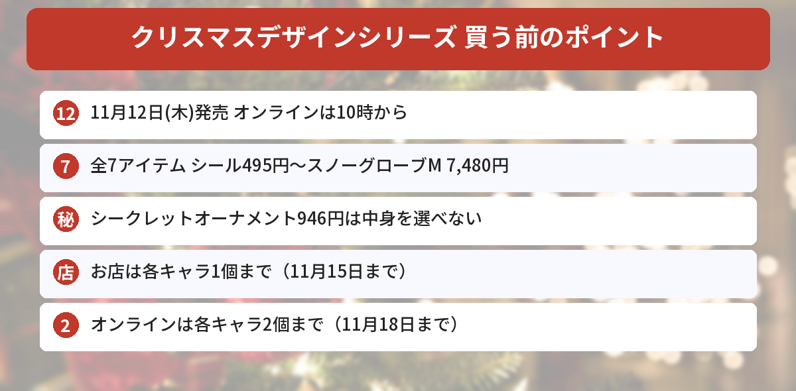

## この記事で分かること

今年もサンリオのクリスマスシリーズが出るって聞いたよ！いつ発売？何があるの？


11月12日（木）発売だよ。マスコットホルダーやスノーグローブなど全7アイテム。お店とオンラインで買える数がちがうから、そこも一緒に見ていこう。


サンリオが11月4日、「**クリスマスデザインシリーズ**」の詳細を公開しました。今年のテーマは「**2026Christmas 55 Years of Sanrio Shops～リボンがつなぐギフトストーリー～**」。リボンやプレゼントをモチーフにしたアイテムがそろっています。

この記事では、[サンリオ公式の発表](https://www.sanrio.co.jp/news/goods/mx-christmas-design-202611/)をもとに、値段、売っている場所、個数制限をまとめます。



---
## 発売日と売っている場所

- **発売日**：2026年11月12日（木）
- **売っている場所**：サンリオ直営店・百貨店のサンリオコーナーほか、サンリオオンラインショップ
- **オンライン**：10:00発売（商品ページは9:30以降に見られる）
- **取り扱いがないお店**：一部店舗（MR. MEN LITTLE MISS MARKET 原宿店など）、アウトレット店舗、サンリオカフェ


---
## 全7アイテムと値段
| | アイテム | 値段（税込） |
|---|---|---|
| 1 | マスコットホルダー（全8種） | 各2,596円 |
| 2 | クッションブランケット | 3,696円 |
| 3 | 持ち手付き巾着 | 1,397円 |
| 4 | シール | 495円 |
| 5 | シークレットマスコットオーナメント（全8種） | 946円 |
| 6 | スノーグローブS（全8種） | 各2,794円 |
| 7 | ポムポムプリン スノーグローブM | 7,480円 |

### マスコットホルダー（各2,596円）
雪だるま、トナカイ、サンタクロースなど、クリスマスらしい姿のマスコットホルダーです。ふわふわのウインターコスチュームを着ています。

### スノーグローブS（各2,794円）・M（7,480円）
小さめのSサイズは全8種で、ちょっとしたすき間にも飾れます。どちらも振るとドームの中でラメが舞い、**「2026」の年号入り**です。Mサイズはポムポムプリンだけで、**7色に光ります**。

### シークレットマスコットオーナメント（946円）
ヒモ付きで、ツリーに飾れるマスコットです。裏のゴムに指をはめて遊ぶこともできます。**中身は選べません**。全8種を1つずつそろえた**コンプリートセット**でも買えますが、お店や在庫によってはそろわないこともあります。


シークレットかぁ…推しが出るまで買っちゃいそう。


全8種だから、1個で推しが出る確率は単純に8分の1だね。Xでは発表当日から交換相手を探すポストも出ているよ。コンプリートセットで買えるかも、お店で聞いてみよう。


### そのほか
- **クッションブランケット（3,696円）**：プレゼントのような大きなリボン付き。たたんでケースに入れるとクッションになります
- **持ち手付き巾着（1,397円）**：リボン付きで、ギフトバッグのような形です
- **シール（495円）**：ぷっくりした透明シール。ホログラムとゴールドの箔押しでキラキラしています

### 全8種のキャラクターは？
公式ページには、全8種のキャラクターの一覧は書かれていません。Xの交換ポストでは、ハローキティ、マイメロディ、クロミ、キキ、ララ、シナモロール、ポチャッコ、ポムポムプリンの名前が出ています。くわしくは発売日に公式オンラインショップの商品ページで確かめてください。

---
## 個数制限（お店とオンラインでちがう）
| | お店 | オンラインショップ |
|---|---|---|
| 期間 | 11月12日（木）〜15日（日） | 11月12日（木）〜18日（水） |
| 各アイテム | **各キャラクター1個まで** | **各キャラクター2個まで** |
| シークレットオーナメント | 8個まで | 8個まで |

### お店で買うときの注意点
- 発売初日は、混雑をさけるため**カウンター販売**をするお店があります。商品を手に取って選ぶことはできません
- 制限の期間中は、お店でも電話でも**取り置きはできません**
- 在庫は電話で聞いても答えてもらえません
- 何人分かをまとめて払う、並び直す、といった買い方はえんりょするよう案内されています
- 制限は予告なく変わることがあります

---
## サンリオのほかのクリスマス情報もチェック
ちいかわのクリスマスグッズは[「ツリーなうさぎ」の記事](/posts/chiikawa-tree-usagi-christmas-2026/)で紹介しています。発売日やしめきりは[発売日カレンダー](/calendar/)にまとめています。

---
## よくある質問（FAQ）
### Q: いつ発売ですか？
A: 2026年11月12日（木）です。サンリオオンラインショップは10:00発売で、商品ページは9:30以降に見られます。

### Q: どこで買えますか？
A: サンリオ直営店・百貨店のサンリオコーナーほか、サンリオオンラインショップです。一部店舗、アウトレット店舗、サンリオカフェでは取り扱いがありません。

### Q: いちばん安いアイテムは？
A: シール（495円）です。シークレットマスコットオーナメントは946円、持ち手付き巾着は1,397円です。

### Q: 何個まで買えますか？
A: お店（11月12日〜15日）は各アイテム各キャラクター1個まで、オンラインショップ（11月12日〜18日）は各キャラクター2個までです。シークレットオーナメントはどちらも8個までです。

### Q: シークレットオーナメントはキャラクターを選べますか？
A: 選べません。全8種を1つずつそろえたコンプリートセットでも買えますが、お店や在庫によってはそろわない場合があります。

---

11月12日の10時だね！スノーグローブの「2026」入り、毎年集めたくなるやつだ。


うん。お店は1個まで、オンラインは2個までだから、どこで買うか先に決めておくと安心だよ。


## まとめ
- サンリオ「クリスマスデザインシリーズ」は2026年11月12日（木）発売。オンラインは10:00から
- テーマは「55 Years of Sanrio Shops～リボンがつなぐギフトストーリー～」
- マスコットホルダー各2,596円、スノーグローブS各2,794円、プリンのスノーグローブM 7,480円など全7アイテム
- シークレットオーナメント（946円）は中身を選べない。コンプリートセットもあり
- 個数制限：お店は各キャラ1個（〜15日）、オンラインは各キャラ2個（〜18日）

---
### あわせて読みたい
- [【ちいかわ】動く！？ツリーなうさぎは抽選販売！11/6発売のクリスマス新商品まとめ](/posts/chiikawa-tree-usagi-christmas-2026/)
- [【サンリオ】ミニチュアチャームのガシャポン2種！実写版は10月第4週から・値段と全種類まとめ](/posts/sanrio-miniature-charm-2026-10/)
