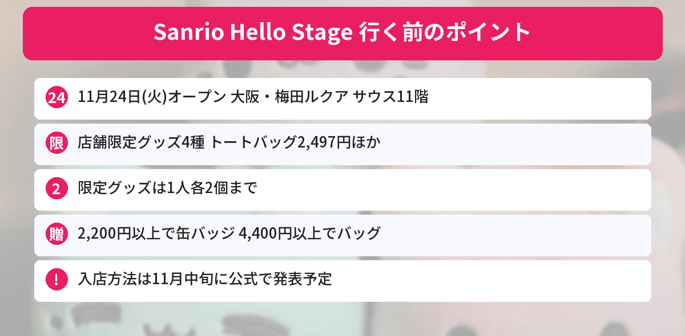

## この記事で分かること

大阪の梅田に、サンリオの新しいお店ができるんだって！どんなお店なの？


「Sanrio Hello Stage」っていう新しいお店の、日本で1号店だよ。11月24日（火）オープンで、限定グッズやノベルティもあるんだ。入店のしかたは11月中旬に発表されるから、そこも気をつけておこう。


サンリオが、新しいお店「**Sanrio Hello Stage**」の**国内1号店**を、大阪・梅田のルクア サウスにオープンします。コンセプトは「**Hello! My Character～はじめましてに出会える場所～**」です。

この記事では、[サンリオ公式の発表](https://www.sanrio.co.jp/news/shop/mx-lucua-south-open-20261106/)をもとに、お店の情報、限定グッズ、ノベルティをまとめます（2026年11月9日に確認）。



---
## 公式情報

サンリオ公式ニュースXの発表です。

---
## お店の情報

- **オープン日**：2026年11月24日（火）
- **場所**：大阪府大阪市北区梅田3-1-1 ルクア サウス 11階
- **営業時間**：10:00～20:00
- **電話**：06-6655-8770（11月24日から）
- **入店方法**：11月中旬ごろに、サンリオ公式ポータルサイトで発表予定



入店方法がまだ決まってないってことは、整理券とか抽選になるかもしれないの？


まだ分からないんだ。公式は「11月中旬ごろにお知らせ」としているから、行く前に必ず確かめてね。


---
## お店限定グッズ
キービジュアルを使った、**このお店でしか買えない**グッズです。

| アイテム | 値段（税込） |
|---|---|
| トートバッグ | 2,497円 |
| フラットポーチ | 1,342円 |
| アクリルキーホルダー | 792円 |
| ステッカーセット | 693円 |

- **1人につき各アイテム2個まで**です
- 何人分かをまとめて払う、同じ日に同じ商品を何回も買う、といった買い方はえんりょするよう案内されています

### オリジナルペーパーバッグ（110円）
オープンを記念した、キービジュアル柄のペーパーバッグです。**1枚110円**で、**1人5枚まで**。ペーパーバッグだけを買うことはできません。数に限りがあります。

---
## オープン記念ノベルティ
| 条件（税込） | もらえるもの |
|---|---|
| **2,200円以上** | カプセルトイを回せるコイン1枚 → キャラクター缶バッジ（全80種・ランダム） |
| **4,400円以上** | オリジナルバッグ |

- **11月24日（火）から、なくなり次第終了**（先着）です
- どちらも**1人1回・1つずつ**です。8,800円以上買っても、缶バッジとバッグが1つずつになります
- 缶バッジのデザインは選べません


缶バッジが80種類もあるの！？推しが出るかドキドキするね。


4,400円以上だと、缶バッジもバッグも両方もらえるよ。先着だから、早めに行くのがよさそうだね。


---
## 日本初登場「MIAMILO（ミアミロ）」
中国で展開している新しいキャラクターのプロジェクト「ニーハオ！ウィーアーステッカーズ」から、**MIAMILO（ミアミロ）**のグッズが**日本で初めて**並びます。ぬいぐるみやマスコットなどが出る予定です。こちらも**1人につき各アイテム2個まで**です。

---
## サンリオのほかの情報もチェック
11月12日発売の[クリスマスデザインシリーズの記事](/posts/sanrio-christmas-design-series-2026/)や、[ハローキティの当りくじの記事](/posts/hellokitty-atarikuji-2026-11/)もあわせてどうぞ。発売日やイベントは[発売日カレンダー](/calendar/)にまとめています。

---
## よくある質問（FAQ）
### Q: いつオープンしますか？
A: 2026年11月24日（火）です。営業時間は10:00～20:00です。

### Q: どこにありますか？
A: 大阪・梅田のルクア サウス 11階です（大阪府大阪市北区梅田3-1-1）。

### Q: 予約や整理券は必要ですか？
A: オープン後の入店方法は、11月中旬ごろにサンリオ公式ポータルサイトで発表される予定です。行く前に確かめてください。

### Q: 限定グッズは何個まで買えますか？
A: 1人につき各アイテム2個までです。オリジナルペーパーバッグは1人5枚までです。

### Q: ノベルティの条件は？
A: 税込2,200円以上でキャラクター缶バッジ（カプセルトイ）、4,400円以上でオリジナルバッグがもらえます。先着で、なくなり次第終了です。

---

梅田なら行きやすい！限定のトートバッグ、ほしいな。


11月中旬の入店方法の発表を見てから、行く日を決めようね。


## まとめ
- 「Sanrio Hello Stage」の国内1号店が、2026年11月24日（火）に大阪・梅田のルクア サウス11階にオープン
- お店限定グッズはトートバッグ2,497円など4種。1人各2個まで
- 2,200円以上で缶バッジ（全80種）、4,400円以上でオリジナルバッグ。先着・なくなり次第終了
- 日本初登場のMIAMILO（ミアミロ）のグッズも
- 入店方法は11月中旬ごろに公式で発表予定

---
### あわせて読みたい
- [【サンリオ】クリスマスデザインシリーズ2026は11/12発売！値段・全7アイテム・個数制限まとめ](/posts/sanrio-christmas-design-series-2026/)
- [【サンリオ当りくじ】ハローキティが11/7発売！1回990円・全9等の賞品とラストスペシャル賞まとめ](/posts/hellokitty-atarikuji-2026-11/)
