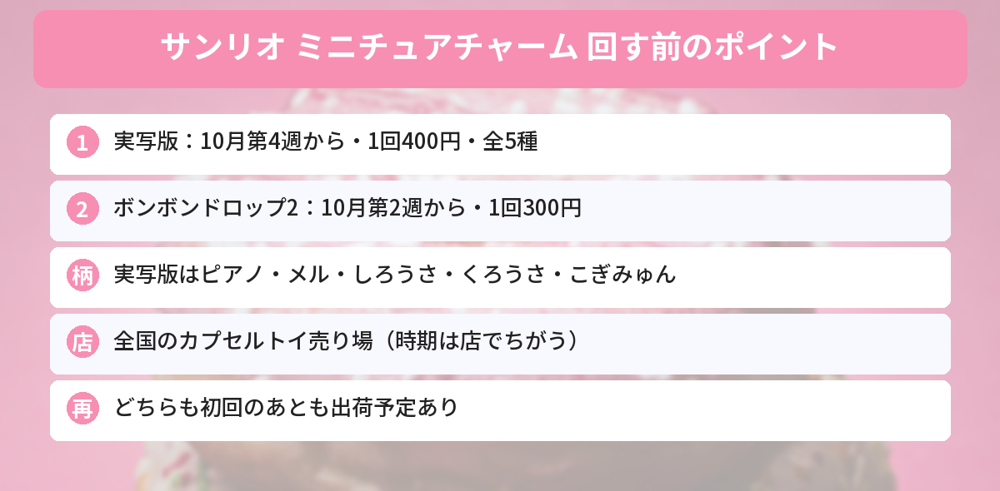

## この記事で分かること

サンリオの「ミニチュアチャーム」のガシャポンが出てるって聞いたよ！どんなのがあるの？いつから回せるの？


10月は2種類あるんだ。今週（10月第4週）から出るのが、ふわふわの「実写版ミニチュアチャーム」で1回400円。10月第2週から出ているのが、シールのパッケージまで小さくした「ボンボンドロップミニチュアチャーム2」で1回300円だよ。


バンダイのガシャポンから、サンリオキャラクターズの「ミニチュアチャーム」が10月に2つ登場しています。どちらも全5種で、ボールチェーンつきのチャームです。

この記事では、バンダイとサンリオの発表をもとに、2つのちがい、ラインナップ、売っている場所をまとめます。



---
## 公式情報

サンリオ公式ニュースXの「10月発売予定のガシャポン新商品」のまとめポストです。「ボンボンドロップミニチュアチャーム2」などが紹介されています。

---
## 2つのちがい
| | 実写版ミニチュアチャーム | ボンボンドロップミニチュアチャーム2 |
|---|---|---|
| 発売 | **10月第4週から順次** | 10月第2週から順次 |
| 値段 | 1回400円（税込） | 1回300円（税込） |
| 種類 | 全5種 | 全5種 |
| 特ちょう | ふわふわの**フロッキー仕上げ** | シールの**パッケージまで再現**（約5.5cm） |
| 発売元 | バンダイ | バンダイ |

---
## 実写版ミニチュアチャーム（10月第4週〜）

- **発売**：2026年10月第4週から順次 ※地域・お店によってちがいます
- **価格**：1回400円（税込）、1カプセル1個入り
- **種類**：全5種
- **仕様**：フロッキー仕上げ、ボールチェーンつき
- **対象年齢**：15才以上
- **売っている場所**：全国のカプセルトイ売り場
- **発売元**：バンダイ


表面が**ふわふわのフロッキー（起毛）仕上げ**になっていて、手ざわりまで楽しめるチャームです。キャラクターごとにポーズがちがいます。

### ラインナップ（全5種）
- マイスウィートピアノ
- ウィッシュミーメル
- しろうさ（シュガーバニーズ）：コック帽をかぶった姿
- くろうさ（シュガーバニーズ）：コック帽をかぶった姿
- こぎみゅん：ひよこを乗せた姿


ピアノちゃんとメルちゃんがいるのうれしい！しろうさ・くろうさはペアでそろえたいな。


全5種だから、1回で好きな子が出る確率は単純に5分の1だね。何回回すか、先に決めておくと安心だよ。


---
## ボンボンドロップミニチュアチャーム2（10月第2週〜）

- **発売**：2026年10月第2週から順次
- **価格**：1回300円（税込）
- **種類**：全5種
- **大きさ**：約5.5cm（パッケージまで再現）
- **仕様**：カラーに合わせたボールチェーンつき
- **発売元**：バンダイ


ぷっくりした立体感で人気の「ボンボンドロップシール」を、**パッケージごと小さくした**チャームの第2弾です。

### ラインナップ（全5種）
- ハローキティ
- マイメロディ
- はぴだんぶい
- ポムポムプリン
- シナモロール

---
## 売っている場所と注意点
### カプセルトイ売り場で探す
どちらも、ショッピングモールや駅などの**カプセルトイ売り場**のガシャポンです。ガシャポンバンダイオフィシャルショップなどでは、公式Xで入荷状況を案内していることもあります。

### 知っておきたい注意点
- 発売の時期は**地域やお店によってちがいます**。発売週でも、まだ入っていないことがあります
- 自動販売機なので、**同じものが続けて出る**こともあります
- どちらも**初回のあとも何回か出荷する予定**と案内されています。すぐ見つからなくても、あとで入ることがあります
- 実写版は**対象年齢15才以上**です。小さな部品があるので、小さい子の手の届かないところに置きましょう

---
## サンリオのほかの新商品もチェック
今日から発売の[キラキラツインチャームの記事](/posts/sanrio-character-award-twin-charm-2026/)や、[マイメロディ「レディレッドシリーズ」の記事](/posts/mymelody-lady-red-2026/)でも新商品を紹介しています。発売日やしめきりは[発売日カレンダー](/calendar/)にまとめています。

---
## よくある質問（FAQ）
### Q: 実写版ミニチュアチャームはいつから回せますか？
A: 2026年10月第4週から順次発売です。地域やお店によって時期がちがいます。

### Q: 1回いくらですか？
A: 実写版ミニチュアチャームは1回400円（税込）、ボンボンドロップミニチュアチャーム2は1回300円（税込）です。

### Q: 何種類ありますか？
A: どちらも全5種です。実写版はマイスウィートピアノ、ウィッシュミーメル、しろうさ、くろうさ、こぎみゅん。ボンボンドロップ2はハローキティ、マイメロディ、はぴだんぶい、ポムポムプリン、シナモロールです。

### Q: どこで買えますか？
A: 全国のカプセルトイ売り場のガシャポンで販売されます。

### Q: 売り切れていたら、もう買えませんか？
A: どちらも初回の発売のあとに、何回か出荷する予定と案内されています。時間をおいて、またのぞいてみてください。

---

今週からふわふわの実写版、ボンボンドロップの2弾はもう出てるんだね！両方さがしてみる。


うん。お店によって入る時期がずれるから、見つからなくても何回かのぞいてみてね。


## まとめ
- 「サンリオキャラクターズ 実写版ミニチュアチャーム」は2026年10月第4週から順次発売
- 1回400円（税込）・全5種。ふわふわのフロッキー仕上げ、対象年齢15才以上
- ラインナップはマイスウィートピアノ、ウィッシュミーメル、しろうさ、くろうさ、こぎみゅん
- 「ボンボンドロップミニチュアチャーム2」は10月第2週から、1回300円・全5種
- どちらもカプセルトイ売り場のガシャポン。初回のあとも出荷予定あり

---
### あわせて読みたい
- [【サンリオ大賞】キラキラツインチャーム10/26発売！全20種・429円・どこで買える？](/posts/sanrio-character-award-twin-charm-2026/)
- [【2026年5月】サンリオキャラクターズ クリスタルめじるしアクセサリーがガシャポンに登場！全5種まとめ](/posts/sanrio-gashapon-crystal-accessory-2026/)
