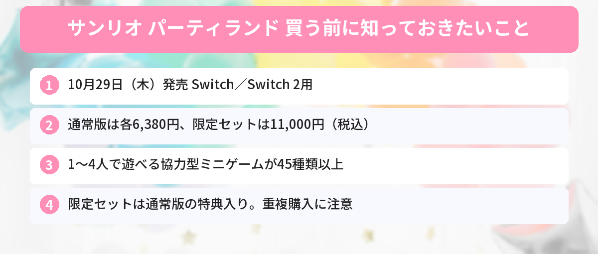

## この記事で分かること

なにわ男子がサンリオのゲームのCMに出るって話題になってたよ！『サンリオ パーティランド』って、いつ出るの？いくらなの？


10月29日（木）発売のNintendo Switch／Switch 2用ソフトだよ。通常版は6,380円で、フィギュアがついたサンリオショップ限定セットもあるんだ。ちがいを順番に整理するね！


サンリオが自分たちで作るゲームブランド「Sanrio Games（サンリオゲームズ）」の、第1作目となるパーティゲームです。ハローキティやシナモロールたちが住む街を舞台に、ミニゲームやボードゲームで遊べます。

10月20日には東京でなにわ男子が出演する新しいテレビCMの発表会が開かれ、サンリオゲームズの公式Xのポストには9,000件を超えるいいねが集まりました（10月20日時点）。この記事では、公式発表をもとに、値段、通常版と限定セットのちがい、遊び方をまとめます。



---
## 公式情報

サンリオゲームズの公式Xでは、ゲームの中でパーティをしているのがなにわ男子のみなさんだと発表されました。発売日の10月29日から、新しいテレビCM「みんなでパーティ」篇が全国で放送されます。

---
## 基本情報

- **発売日**：2026年10月29日（木）
- **対応機種**：Nintendo Switch／Nintendo Switch 2
- **価格**：パッケージ版・ダウンロード版 各6,380円（税込）、サンリオショップ・サンリオオンラインショップ限定セット 11,000円（税込）
- **ジャンル**：パーティゲーム
- **プレイ人数**：1〜4人
- **対象年齢**：CERO A（全年齢対象）
- **登場キャラクター**：145以上（いっしょに遊べるパートナーは16キャラクター）
- **ミニゲーム**：45種類以上


---
## どんなゲーム？
自分で作った「アバター（ゲームの中の自分）」で、サンリオキャラクターたちが暮らす街「パーティランド」を歩き回り、ミニゲームやボードゲームを楽しみます。

### ミニゲームは「みんななかよく」の協力型
45種類以上あるミニゲームは、どれも「みんななかよく」がテーマの**協力型**です。ファミ通のインタビューで、開発の責任者は「競い合いをできるだけなくした」と話しています。100ほど試作したなかから、約45作品が選ばれたそうです。

東京ゲームショウ2026で試遊できたのは、次の3つでした。

- シナモロールのホームランダービー（耳でボールを投げるシナモンが見られる）
- ぐでたまのおしかえしてハシラッシュ
- けろけろけろっぴのぷかぷかギフトリバー

### ミニゲーム以外の遊び
ボードゲームのほかに、アバターの着せ替え、シールあつめ、魚釣りなども入っています。ひとりでもじっくり遊べる作りです。


対戦じゃなくて協力なら、ゲームが苦手な家族とも遊びやすそう！


そうなの。最大4人まで遊べるし、全年齢対象だから、子どもから大人までいっしょに楽しめるよ。


---
## 通常版と限定セット、どっちを買う？
いちばん迷うのがここです。中身を比べてみましょう。

| | パッケージ版 | ダウンロード版 | サンリオショップ限定セット |
|------|------|------|------|
| 価格（税込） | 6,380円 | 6,380円 | 11,000円 |
| ハローキティ ミニマスコットホルダー | ○（数量限定） | — | ○ |
| アバター用Tシャツ（80以上のキャラから選べる） | — | ○（早期購入） | ○ |
| キャラクターフィギュアセット（5体） | — | — | ○ |
| NFC機能つきスペシャルカード | — | — | ○ |
| 買える場所 | ゲーム販売店など | ニンテンドーeショップなど | サンリオ直営店・百貨店のサンリオコーナー（一部のぞく）・サンリオオンラインショップ本店 |

### 限定セットだけの特典
- **フィギュアセット**：ハローキティ・マイメロディ・ポムポムプリン・シナモロール・クロミの5体。ゲームの中のポーズや表情を再現しています
- **NFC機能つきスペシャルカード**：Switch本体にかざすと、フルーツデザインの衣装を着たキャラクター8種（ハローキティ、マイメロディ、ポムポムプリン、シナモロール、クロミ、ポチャッコ、バッドばつ丸、ウサハナ）がゲームで使えるようになります

### 二重に買わないように注意
限定セットには、パッケージ版の「ミニマスコットホルダー」と、ダウンロード版の「アバター用Tシャツ」も入っています。公式も**重複購入に注意**するよう呼びかけています。限定セットを買うなら、通常版を別に買う必要はありません。

---
## 予約特典の受け取りで気をつけること
- **ミニマスコットホルダー**（パッケージ版）は数量限定で、なくなりしだい終了です。取り扱いのないお店もあります
- **アバター用Tシャツ**（ダウンロード版）は、2027年1月28日（木）23時59分までに買った人が対象です。受け取りはゲームの中で行い、インターネットにつながっている必要があります。キャラクターではなく、アバター専用の衣装です
- 限定セットのゲームソフトは、パッケージ版（Nintendo Switch用）です

お店ごとに独自の予約特典がつく場合もあるので、予約するお店の案内もあわせて見ておきましょう。

---
## サンリオのほかの話題もチェック
11月1日はハローキティのお誕生日です。表参道のイベントや新作グッズは[HELLO KITTY WEEK 2026まとめ](/posts/hello-kitty-week-2026/)で紹介しています。ポムポムプリンが好きな人は、[VT×ポムポムプリンのコラボコスメ](/posts/vt-pompompurin-2026/)もどうぞ。

発売日やしめきりは[発売日カレンダー](/calendar/)にもまとめています。

---
## よくある質問（FAQ）
### Q: サンリオ パーティランドはいつ発売ですか？
A: 2026年10月29日（木）に発売されます。

### Q: Switch 2でも遊べますか？
A: 対応機種はNintendo SwitchとNintendo Switch 2です。

### Q: 値段はいくらですか？
A: パッケージ版・ダウンロード版はどちらも6,380円（税込）、サンリオショップ・サンリオオンラインショップ限定セットは11,000円（税込）です。

### Q: 何人で遊べますか？
A: 1〜4人で遊べます。ひとりでも、家族や友だちといっしょにでも楽しめます。

### Q: 限定セットと通常版、両方買ったほうがいいですか？
A: 限定セットには通常版の特典（ミニマスコットホルダーとアバター用Tシャツ）も入っているので、両方買う必要はありません。

---

フィギュアがほしいなら限定セット、ゲームだけなら6,380円の通常版だね！10月29日が楽しみ！


うん。限定セットは数量限定の予定だから、気になる人はサンリオショップの案内を早めに見ておいてね。


## まとめ
- 『サンリオ パーティランド』は2026年10月29日（木）発売。Nintendo Switch／Switch 2用
- パッケージ版・ダウンロード版は各6,380円、サンリオショップ限定セットは11,000円（税込）
- 1〜4人で遊べる協力型のミニゲームが45種類以上。キャラクターは145以上
- 限定セットはフィギュア5体とNFCカードつき。通常版の特典も入っているので重複購入に注意
- なにわ男子出演の新CMは発売日の10月29日から放送

---
### あわせて読みたい
- [【11月1日】ハローキティのお誕生日！HELLO KITTY WEEK 2026まとめ](/posts/hello-kitty-week-2026/)
- [【ポムポムプリン】VTコスメとコラボ！10/23からQoo10・楽天で先行発売](/posts/vt-pompompurin-2026/)
